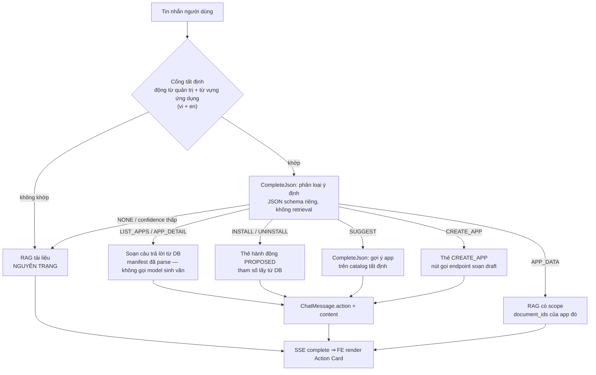

# OpenVie v1.0.0 — Kế hoạch Triển khai: Tương tác Ứng dụng & Tạo App qua Chat (Conversational BizApp Platform)

> **Mục tiêu phiên bản:** `v1.0.0`
> **Phạm vi:** LLM **nhận biết** ứng dụng, **gợi ý** ứng dụng, **cài/gỡ** ứng dụng có xác nhận an toàn, và **tạo ứng dụng từ lịch sử hội thoại** — đồng thời **sửa toàn bộ rủi ro hiện có** của đường chiếu tri thức (record → KB) trong cùng phiên bản.
>
> **Tiêu chí bất di bất dịch:** không phá vỡ bất kỳ chức năng nào đang chạy. Mọi thay đổi phải **cộng thêm (additive)** và **trung tính theo mặc định**: khi tính năng bị tắt hoặc khi dữ liệu mới không tồn tại, hành vi của hệ thống phải **giống hệt** hiện tại — và điều đó phải được **chứng minh bằng test**, không phải bằng lời tuyên bố.

---

## 0. Phạm vi, nguyên tắc và những gì đã bị loại bỏ

### 0.1 Ba tầng tách biệt (nguyên tắc kiến trúc)

Tính năng này **không** đi qua đường RAG tài liệu. Ba tầng tách biệt hoàn toàn:

| Tầng | Nhiệm vụ | Có gọi model? | Có chạm retrieval? | Có ghi KB? |
| --- | --- | --- | --- | --- |
| **A. Chính sách & dữ liệu (deterministic)** | Liệt kê app đã cài, chi tiết app, quyết định cài/gỡ | Không | Không | Không |
| **B. Hiểu ý định & soạn nội dung (structured LLM)** | Phân loại ý định, gợi ý app, soạn manifest draft, diễn đạt câu trả lời | Có — qua RPC `CompleteJson` riêng | Không | Không |
| **C. RAG tài liệu (đường hiện có)** | Trả lời câu hỏi dựa trên tài liệu | Có — qua `GenerateAnswer` | Có | — |

LLM **không bao giờ** được quyền tự thực thi thay đổi trạng thái; mọi thay đổi đều do người dùng bấm nút và server kiểm tra lại từ DB.

### 0.2 Đã loại bỏ khỏi thiết kế (kèm lý do kỹ thuật, để không ai thêm lại)

| Bị loại bỏ | Lý do (bằng chứng trong code) |
| --- | --- |
| Ghi `bizapp/_installed_catalog.md` vào Knowledge Base workspace | Retrieval chỉ lọc `tenant_id + knowledge_base_id + document_ids` (`rag-chatbot-fastapi/app/modules/index/internal/qdrant_search.py:191-211`) ⇒ catalog cạnh tranh slot ngữ cảnh và có thể thành `[S1]`; `GRAPH_EXTRACTION_ENABLED` mặc định `True` (`app/bootstrap/settings.py:143`) ⇒ entity của catalog vào Kuzu; tài liệu `COMPLETED` làm `incrementSearchRevision` (`api/.../document/service/DocumentService.java:631`) ⇒ purge cache + `409 KNOWLEDGE_BASE_CHANGED` (`chat/query/ChatControlPlaneService.java:129-135`, `retrieval/internal/cache.py:142-148`); `safeFileName()` cắt còn basename (`DocumentService.java:790-793`) ⇒ nhiều tài liệu hệ thống khác nhau ghi đè nhau |
| Nhét metadata app vào `SubmitMessageRequest.metadata` | `metadata` nằm trong `fingerprintPayload` (`ChatControlPlaneService.java:731-734`) ⇒ dữ liệu biến động làm fingerprint đổi ⇒ `IDEMPOTENCY_KEY_REUSED` |
| Sửa `_SYSTEM_PROMPT` trong `rag-chatbot-fastapi` để sinh `action_card` | Prompt này điều khiển toàn bộ RAG tài liệu: trích dẫn `[S1]`, abstention, chống liệt kê tên tệp, cổng ý định, định tuyến nhạy cảm (`generation/internal/service.py:60-76`, `internal/intent.py`, `internal/sensitive_policy.py`) |
| Tài liệu "catalog" như một loại tài liệu (`SYSTEM_CATALOG`) | Không còn đối tượng nào sinh ra nó sau khi bỏ ghi KB cho catalog; thêm loại không dùng là nợ kỹ thuật |

### 0.3 Ngoài phạm vi (non-goals)

- Text-to-SQL / truy vấn do LLM viết. Không có ở bất kỳ đâu, kể cả cho báo cáo BizApp.
- Tự cài đặt ứng dụng không có xác nhận người dùng (`auto-install`).
- Ký số trong tiến trình, giữ khoá ký, xác thực chữ ký (giữ nguyên quyết định cũ: uỷ thác qua `external_call`).
- Bảng typed do tổ chức tự định nghĩa / DDL sinh từ manifest.
- Thiết kế BPMN nhiều bước.
- Xác thực chữ ký mật mã cho template từ xa.
- Sửa đổi **logic** truy hồi, xếp hạng hay prompt của `rag-chatbot-fastapi`. Chỉ các thay đổi cộng thêm liệt kê tại G-1 (§7.1) được phép — mỗi thay đổi phải mang nhãn phê duyệt và có test chứng minh trung tính. Không được đổi trọng số fusion, thứ tự xếp hạng, `_SYSTEM_PROMPT`, hay ngưỡng/điểm số.

### 0.4 Graph retrieval: hiện trạng **chưa có** công tắc — v1.0.0 bổ sung công tắc (W0.6)

**Hiện trạng (đã kiểm tra code).** Đây là lý do W0.2/W0.3 buộc phải chạm **cả Kuzu**, và cũng là lý do cần một công tắc tường minh thay vì lạm dụng các tham số sẵn có.

| Hiểu nhầm thường gặp | Thực tế | Bằng chứng |
| --- | --- | --- |
| "Có cờ bật/tắt graph retrieval" | **Không có.** `RetrievalConfig.FIELDS` chỉ có `GRAPH_CANDIDATE_COUNT`, `GRAPH_MAX_HOPS`, `GRAPH_SERVICE_URL`, `GRAPH_TIMEOUT_SECONDS` và các `*_GRAPH_WEIGHT` | `retrieval/internal/config.py:22-63` |
| "`GRAPH_MAX_HOPS=0` là tắt" | **Sai.** Vòng mở rộng chỉ không chạy; `_select_seeds` → `load_entity_mentions` → `_add_evidence` vẫn thực thi và vẫn trả kết quả | `graph/internal/search.py:174-236`; `tests/test_config.py:46-52` (0 là giá trị hợp lệ, không phải tắt) |
| "Đặt `*_GRAPH_WEIGHT=0` là loại bỏ kênh" | **Sai.** RRF vẫn duyệt kênh graph và `chunks.setdefault` vẫn giữ chunk với `score = 0.0`; chỉ bị cắt nếu danh sách `FUSION_CANDIDATE_COUNT` đã đầy bởi dense+sparse | `retrieval/internal/retrieval.py:442-462` |
| "`GRAPH_EXTRACTION_ENABLED=false` là tắt graph" | **Sai.** Cờ này chỉ bỏ **trích xuất lúc ingest**; truy hồi vẫn chạy, chỉ trả về ít/không kết quả | `bootstrap/settings.py:143`, `bootstrap/ingestion.py:134` |
| "Kênh graph được gọi có điều kiện" | **Sai.** Luôn nằm trong `asyncio.gather` cùng dense và sparse, không có `if` | `retrieval/internal/retrieval.py:180-225` |
| "Cách duy nhất để vô hiệu hoá" | Làm graph-service không truy cập được: `return_exceptions=True` nuốt lỗi, kênh trả `[]` + metric `AI_RETRIEVAL_FALLBACKS_TOTAL{component="graph"}` — degrade mềm, không chắc chắn, không có test | `retrieval/internal/retrieval.py:222-236` |
| "Truy hồi láng giềng cũng là graph" | **Không.** `_expand_neighbors` dùng index (`load_neighbors`, `_related_table_rows`), không dùng Kuzu | `retrieval/internal/retrieval.py:376-440` |

**Bổ sung trong v1.0.0 — W0.6:** công tắc cấu hình `GRAPH_RETRIEVAL_ENABLED` (mặc định `true`). Khi `false`: kênh graph **không được gọi** — không có request HTTP tới graph-service, không truy vấn Kuzu, `weighted_reciprocal_rank_fusion` nhận `graph = []`. Khi `true`: hành vi **giống hệt** hiện tại.

Hai hệ quả bắt buộc phải ghi nhớ:

1. **Công tắc không thay thế W0.2/W0.3.** Tắt graph là quyết định vận hành (đánh đổi chất lượng trả lời đa bước), **không** phải biện pháp bảo đảm cách ly. Kế hoạch này vẫn lọc ở cả hai kho, vì mặc định của công tắc là **bật** và đa số triển khai sẽ giữ nguyên.
2. **Bật/tắt làm thay đổi kết quả truy hồi**, nên phải vào fingerprint cấu hình cache (W0.6) để cache không trộn hai chế độ, và phải được đo bằng metric (tỷ lệ truy hồi có/không có đóng góp của graph).

**Cái gì chặn ô nhiễm — công tắc graph KHÔNG nằm trong số đó:**

| Kênh truy hồi | Tài liệu hệ thống có mặt? | Cái chặn nó | `GRAPH_RETRIEVAL_ENABLED=false` có chặn được? |
| --- | --- | --- | --- |
| dense (Qdrant) | **Có** — tài liệu projected/digest được embed như mọi tài liệu khác | `excluded_document_kinds` → `must_not` trên payload (W0.2/W0.3) | **Không** |
| sparse (Qdrant) | **Có** | như trên | **Không** |
| graph (Kuzu) | **Có** — ingest tạo entity/relation cho chính các tài liệu đó | `document_kind` trên node `Source` + mệnh đề `NOT IN` (W0.2/W0.3) | Có, **nhưng chỉ kênh này** |
| láng giềng (`_expand_neighbors`) | Chỉ khi chunk của tài liệu hệ thống đã lọt vào primary | Không cần lọc riêng: láng giềng chỉ mở rộng trong cùng `document_id`, nên chặn ở upstream là đủ | **Không** |

Về tỷ trọng: dense + sparse là hai kênh **chính** và luôn chạy — mặc định `DENSE_CANDIDATE_COUNT=40`, `SPARSE_CANDIDATE_COUNT=40`, `GRAPH_CANDIDATE_COUNT=20`; trọng số RRF mặc định `semantic 0.55/0.30/0.15`, `exact 0.25/0.60/0.15`, `calculation 0.35/0.50/0.15` (chỉ `relational` mới nghiêng về graph: `0.30/0.15/0.55`). **Tắt graph chỉ bỏ kênh nhỏ nhất ở 3/4 hồ sơ truy vấn**, phần lớn bề mặt ô nhiễm vẫn nguyên qua Qdrant.

Ma trận tương tác với cờ cũ (ghi vào `docs/DEPLOYMENT.md`):

| `GRAPH_EXTRACTION_ENABLED` | `GRAPH_RETRIEVAL_ENABLED` | Kết quả |
| --- | --- | --- |
| `true` (mặc định) | `true` (mặc định) | Hành vi hiện tại: trích xuất + truy hồi graph |
| `true` | `false` | Graph vẫn được dựng nhưng **không dùng để truy hồi**; lãng phí compute khi ingest — phải ghi cảnh báo trong tài liệu |
| `false` | `true` | Graph rỗng dần theo tài liệu mới; truy hồi graph chạy nhưng trả về ít/không kết quả |
| `false` | `false` | Thuần dense + sparse; ingest nhanh nhất |

### 0.5 Ma trận phủ ô nhiễm — mọi đường, mọi setting

Mục tiêu: **không đường nào** để tài liệu hệ thống (`BIZAPP_RECORD`/`BIZAPP_DIGEST`) lọt vào câu trả lời tài liệu, bất kể cấu hình nào. Mỗi dòng phải có test.

| # | Đường / tham số | Tài liệu hệ thống có thể lọt? | Cơ chế chặn | Test |
| --- | --- | --- | --- | --- |
| 1 | dense (Qdrant `search_dense`) | Có | `must_not` trên payload (W0.2/W0.3) | G-5, E2E-D4 |
| 2 | sparse (Qdrant `search_sparse`) | Có | như trên (dùng chung `_filter`) | G-5 |
| 3 | graph (Kuzu, **bốn** truy vấn) | Có | `NOT IN` trên node `Source` (W0.2/W0.3) | `GraphExclusionTest` |
| 4 | láng giềng (`load_neighbors`) | Không — chỉ mở rộng trong cùng `document_id` của chunk đã chọn | Không cần lọc riêng; chặn ở upstream là đủ | E2E-D4 |
| 5 | `_related_table_rows` (`list_table_rows`) | Không — truyền **cả** `document_id` **và** `table_id` (`retrieval.py:365-367`) | Không cần lọc riêng; thêm test khoá chéo tài liệu | `VectorPathContainmentTest` |
| 6 | Reranker (`RERANKER_ENABLED`) | Không — chỉ xếp lại danh sách đã lọc, không thêm tài liệu mới | Không cần | `VectorPathContainmentTest` |
| 7 | `SEMANTIC_ANSWER_CACHE_MODE=serve` | **Có** — entry tạo trước tính năng vẫn khớp key cũ | `document_kind_policy_version` + `GRAPH_RETRIEVAL_ENABLED` vào `retrieval_configuration` (W0.8); semantic cache kế thừa key này (`semantic_answer_cache.py:290-292`) | `CachePolicyKeyTest` |
| 8 | Retrieval cache (`RETRIEVAL_CACHE_ENABLED`) | **Có** — như trên | Như trên (`retrieval/internal/cache.py:55-96`) | `CachePolicyKeyTest` |
| 9 | `document_ids` do client gửi (chat scope) | **Có** — trỏ thẳng vào id tài liệu hệ thống | W0.5: `validateChatScope` từ chối id tài liệu hệ thống | `SystemDocumentScopeRejectionTest` |
| 10 | Mọi điểm vào của chat (REST SSE, JSON đồng bộ, `ChatRuntimeApi.submitScopedTurn`) | **Có** — nếu chỉ áp ở một controller | W0.9: áp tại **điểm dựng `GenerationRequest` duy nhất** | `AllChatEntryPointsExclusionTest` |
| 11 | Adapter legacy được tiêm (`dense=`/`sparse=`/`neighbor_loader=`) | **Có** — nhánh đó không nhận danh sách loại trừ | W0.9: gỡ, hoặc buộc chữ ký nhận danh sách loại trừ; production hiện không tiêm (`bootstrap/generation.py:71-74`) | `LegacyAdapterGuardTest` |
| 12 | **Dữ liệu đã ingest trước khi nâng cấp** | **Có** — thiếu thuộc tính ⇒ bị coi là `USER` | W0.7: backfill DB + Qdrant + Kuzu | `ProvenanceBackfillTest` |
| 13 | `include_system=true` ở list tài liệu | Lộ metadata (không phải truy hồi) | W0.5: chỉ `ORG_OWNER` | `DocumentProvenanceTest` |
| 14 | `GRAPH_RETRIEVAL_ENABLED=false` | Không tạo đường mới; exclusions vẫn đúng | — | G-9, E2E-R7 |
| 15 | `GRAPH_EXTRACTION_ENABLED=false` | Không tạo đường mới; graph rỗng dần nhưng exclusions vẫn đúng | — | G-9 |

---

## 1. Kiểm toán hiện trạng (baseline) — cái gì đã có, cái gì phải sửa

### 1.1 Đã có sẵn trong cây (tận dụng, không xây lại)

| Năng lực | Bằng chứng |
| --- | --- |
| Cột `chat_messages.action` kiểu `jsonb`, mặc định `{}`, **hiện không nơi nào ghi** | `api/.../chat/model/ChatMessage.java:59-61` |
| DTO đã lộ `action` ra ngoài: `AssistantMessageResponse.action`, `MessageResponse.action` | `api/.../chat/dto/ChatDtos.java:121,136` |
| `toAssistant(...)` đang truyền `null` cho `action` → chỉ cần điền | `ChatControlPlaneService.java:693-694` |
| SSE frame `complete` mang nguyên `AssistantMessageResponse` | `api/.../chat/controller/ChatController.java:166` |
| RPC `CompleteJson` (có `json_schema`) đã nối đủ proto → Java client → Python server | `proto/openvie_ai_v1.proto:154-166`, `ai/api/AiInferenceApi.java:134`, `ai/infrastructure/GrpcAiInferenceClient.java:279`, `rag-chatbot-fastapi/app/modules/generation/transport/grpc.py:114` |
| Tiền lệ dùng `CompleteJson` cho manifest | `bizapp/service/BizAppDraftService.java:104` (gọi với `json_schema = "bizapp.v1.schema.json"`) |
| Bảng `bizapp_drafts` với `source CHECK IN ('ai','canvas','import','remix')` | Flyway `V14__bizapp_drafts.sql:15-30` — **không cần migration mới cho W3** |
| Ranh giới module: bắt buộc đi qua `com.openvie.api.<module>.api.<X>Api` (interface) | `api/src/test/java/com/openvie/api/architecture/ModularMonolithArchitectureTest.java:58-66,102-105` |
| Cổng ý định + định tuyến nhạy cảm (chỉ ở Python, dùng cho RAG) | `generation/internal/intent.py`, `generation/internal/sensitive_policy.py` |
| Manifest đã parse sẵn trên mỗi installation | `bizapp/service/BizAppInstallService.java:115-120` (`toView(saved, parser.parse(...))`) |
| Cơ chế chiếu record → KB (đang chạy trong cây) | `bizapp/service/knowledge/BizAppKnowledgeProjector.java`, `BizAppProjectionListener.java` |

### 1.2 Khiếm khuyết phải sửa trong v1.0.0

| # | Khiếm khuyết | Bằng chứng | Hệ quả |
| --- | --- | --- | --- |
| D1 | Tài liệu hệ thống (projected/digest) không phân biệt được với tài liệu người dùng | Không có cột kind/source trên `document/model/Document.java:48-113` | Không thể loại trừ ở retrieval; lộ trong UI Tài liệu; xoá được bởi người dùng |
| D2 | Tên tài liệu hệ thống bị `safeFileName` cắt còn basename | `DocumentService.java:790-793`; khoá chống trùng `(tenant, kb, fileName)` tại `:171-172` | `bizapp/crm/_digest.md` và `bizapp/booking/_digest.md` cùng map về `_digest.md` ⇒ **ghi đè chéo ứng dụng** |
| D3 | Ghi lại cùng fileName với nội dung khác khi tài liệu đang `PENDING/PROCESSING` sẽ ném lỗi | `DocumentService.java:187-192` | Chiếu record liên tiếp ⇒ thất bại im lặng, KB lệch thực tế |
| D4 | Mỗi thay đổi bản ghi làm `search_revision +1` (qua refresh digest) | `DocumentService.java:631`; `ChatControlPlaneService.java:129-135` | Purge retrieval cache + semantic cache theo revision (`retrieval/internal/cache.py:142-148`, `generation/internal/semantic_answer_cache.py:629`); lượt chat đang stream có thể `409` |
| D5 | Payload Qdrant hiện tại không có trường loại tài liệu | `index/internal/qdrant_search.py:191-211` (`_filter` chỉ có tenant/kb/document_id) | Không loại trừ được; graph scope cũng chỉ theo `document_ids` (`graph/internal/search.py:407-410`) |
| D6 | `CompleteJsonRequest` không có trường `locale` | `proto/openvie_ai_v1.proto:154-158` | Nguy cơ trả lời/gợi ý sai ngôn ngữ |
| D7 | `toAssistant` không truyền `action` | `ChatControlPlaneService.java:693-694` | Không có kênh trả thẻ hành động có cấu trúc |

---

## 2. Bất biến (Invariants) — mỗi điều phải có test tương ứng

| Mã | Bất biến | Test/gate |
| --- | --- | --- |
| **I-1** | Không tự động thay đổi trạng thái: cài/gỡ chỉ xảy ra khi người dùng bấm nút, qua endpoint server-authoritative | §7.3 E2E-A1, E2E-A2 |
| **I-2** | Quyền `ORG_OWNER` kiểm tra **phía server**; không tin bất kỳ trường nào trong thẻ hành động | §7.2 unit + §7.3 E2E-A3 |
| **I-3** | Tham số hành động được đọc lại từ DB (theo `messageId` + `actionId`), **không** lấy từ nội dung do model sinh | §7.2 `ChatActionServiceTest` |
| **I-4** | Bản thảo là dữ liệu chưa tin cậy: chỉ vào `bizapp_drafts`; `install` chạy lại `BizAppManifestValidator` từ đầu và **bỏ qua** `validation` đã lưu | §7.3 E2E-D2 |
| **I-5** | Không ghi gì vào Knowledge Base từ luồng ứng dụng (không catalog, không ghi thay mặt người dùng) | §7.1 gate G-2 + ArchUnit |
| **I-6** | `_SYSTEM_PROMPT` **bất biến**. Trong `{retrieval,index,graph,generation}` chỉ cho phép các thay đổi cộng thêm ở danh sách trắng G-1 — không đổi trọng số, không đổi xếp hạng, không đổi prompt, không đổi ngưỡng | §7.1 G-1 (danh sách trắng + nhãn `rag-change-approved`), G-3, G-4, G-5, G-9, G-10 |
| **I-7** | Thay đổi wire chỉ **cộng thêm**, mặc định trung tính: giá trị mặc định ⇒ hành vi giống hệt hiện tại | §7.2 parity fixture, G-4 |
| **I-8** | Token/auth của hành động dùng phiên của người dùng (JWT/API key), không có "danh tính dịch vụ" thay mặt người dùng cho hành động quản trị | §7.3 E2E-A3 |
| **I-9** | Tài liệu hệ thống: không hiển thị mặc định trong UI Tài liệu, không xoá được bởi bất kỳ vai trò người dùng nào, không xuất hiện trong citation của câu hỏi tài liệu thường | §7.3 E2E-D1/D3/D4 |
| **I-10** | Mọi hành động quản trị ghi audit `LogAction` với actor thật | §7.2 `Audit` assertions |
| **I-11** | Câu hỏi nhạy cảm (theo `sensitive_policy`) không bao giờ được trả lời bằng nhánh ứng dụng | §7.3 E2E-S1 |

---

## 3. Kiến trúc luồng

### 3.1 Sơ đồ định tuyến một lượt chat



### 3.2 Mô hình ý định (intent) — hợp đồng dữ liệu

Kết quả phân loại là một object JSON có kiểm soát, sinh bằng `CompleteJson` với schema riêng của OpenVie:

```jsonc
{
  "intent": "NONE | LIST_APPS | APP_DETAIL | APP_DATA | INSTALL | UNINSTALL | SUGGEST | CREATE_APP",
  "appKind": "crm",          // null khi không xác định; phải khớp kind trong catalog/đã cài
  "confidence": 0.0,         // [0,1]
  "reply": "…",              // câu diễn đạt cho người dùng; rỗng khi intent = NONE
  "reason": "…"              // chẩn đoán, không hiển thị trực tiếp
}
```

Quy tắc:
- `confidence < ngưỡng` (`app.chat.intent-confidence-threshold`, mặc định `0.75`) ⇒ coi như `NONE` ⇒ đi đường RAG.
- `appKind` phải tồn tại trong danh mục (đã cài hoặc template có sẵn); nếu không ⇒ hạ cấp về `NONE` (không bao giờ bịa ứng dụng).
- Với `NONE`, **không** sinh câu trả lời mới: tuyệt đối không được trả lời thay cho RAG.
- Bộ phân loại chỉ nhận: catalog tất định (tên/kind/mô tả/entity), danh sách app đã cài, vai trò người dùng, `locale`. **Không** nhận nội dung tài liệu, không nhận credential.

### 3.3 Hợp đồng thẻ hành động (`chat_messages.action`)

Dùng đúng cột `jsonb` đã có (`ChatMessage.action`), không migration, không đổi giao thức SSE:

```jsonc
{
  "type": "bizapp_action",
  "actionId": "3f1c…",                        // uuid, duy nhất, dùng để thực thi
  "kind": "bizapp.install | bizapp.uninstall | bizapp.catalog | bizapp.suggest | bizapp.draft | bizapp.open_composer",
  "status": "PROPOSED | EXECUTING | EXECUTED | FAILED | DENIED | EXPIRED",
  "appKind": "crm",
  "appName": "CRM Lite",
  "version": 1,
  "description": "…",
  "requiresRole": "ORG_OWNER",                 // chỉ để hiển thị; server kiểm tra lại
  "executedBy": null,                          // uuid người thực thi
  "executedAt": null,
  "result": null,                              // { "installationId": …, "processKey": … } khi EXECUTED
  "payload": { "templateRef": "platform:crm" } // tham số đề xuất; server KHÔNG tin payload này
}
```

### 3.4 Ngữ cảnh danh mục (catalog context) — tất định, không qua KB

- Nguồn: `BizAppInstallationRepository.findByTenantIdAndStatusOrderByCreatedAtDesc` (app đã cài) + `BizAppMarketplaceService`/bundled `api/src/main/resources/marketplace/bizapps/{crm,booking,signature-request}.json` (template có sẵn).
- Dạng: JSON rút gọn `{ kind, name, version, entities[], views[], source }`, dựng lại mỗi lượt (rẻ, không cache qua revision).
- Không bao giờ đưa manifest đầy đủ vào prompt (giới hạn kích thước + không lộ credential); chỉ đưa trường an toàn đã allow-list.

---

## 4. Phân rã công việc

### W0 — Nguồn gốc tài liệu & an toàn truy hồi (điều kiện tiên quyết cho mọi thứ còn lại)

**W0.1 Cột nguồn gốc trên `documents`** (Flyway `V18__document_provenance.sql`):
- `document_kind varchar(24) NOT NULL DEFAULT 'USER'` với `CHECK (document_kind IN ('USER','BIZAPP_RECORD','BIZAPP_DIGEST'))`.
- `source_ref varchar(128) NULL` — với tài liệu hệ thống: `bizapp:<kind>` (ví dụ `bizapp:crm`).
- Index: `(tenant_id, knowledge_base_id, document_kind)`, `(tenant_id, source_ref)`.
- Backfill `document_kind = 'USER'` cho toàn bộ hàng hiện có (đúng ngữ nghĩa: mọi tài liệu hiện tại là của người dùng).
- **Tuyệt đối không sửa V1–V17** (đổi checksum Flyway ⇒ vỡ DB hiện hữu).

**W0.2 Ghi loại tài liệu vào *hai* kho (Qdrant **và** Kuzu)**:
- **Qdrant**: khi index, ghi thêm `document_kind` + `source_ref` vào payload; tạo payload index (bước vận hành, ghi vào `docs/DEPLOYMENT.md`).
- **Kuzu**: ghi cùng hai giá trị vào node `Source` (`graph/internal/service.py:59-60` định nghĩa `Source(id, tenant_id, knowledge_base_id, name)`; ghi tại `:80-82`). Bắt buộc vì **kênh graph đọc Kuzu, không đọc Qdrant** — `must_not` của Qdrant vô hiệu với kênh này. Ghi bằng **`MERGE … SET`** (như đường ghi `Entity` tại `:122-124`) chứ **không** phải `CREATE`, để node `Source` **đã tồn tại** cũng được cập nhật thuộc tính khi ghi lại.
- **Tương thích ngược**: điểm/node cũ **thiếu** thuộc tính ⇒ được coi là `USER` (điều kiện lọc phải là "thiếu khoá ⇒ không bị loại"), nên dữ liệu cũ vẫn truy hồi y như hiện nay. Việc phân loại lại dữ liệu cũ là W0.7.
- **[verify]** khả năng thêm cột vào bảng node đã tồn tại của Kuzu (`ALTER TABLE Source ADD document_kind STRING`); nếu Kuzu không hỗ trợ ⇒ phải rebuild node table (drop + tạo lại + chiếu lại qua W0.7). Kết luận phải ghi trong PR trước khi chốt W0.2.

**W0.3 Bộ lọc loại trừ cộng thêm ở wire**:
- Thêm trường **cộng thêm** vào `GenerateAnswerRequest`: `repeated string excluded_document_kinds = 15;` (không đổi số trường đang có).
- **Dense + sparse**: lọc bằng `must_not` trên payload Qdrant (`index/internal/qdrant_search.py:191-211`).
- **Graph**: không dùng payload Qdrant. Phải sửa **toàn bộ chuỗi** truyền tham số qua ranh giới tiến trình: `graph/api/__init__.py` (`GraphSearchQuery`, dòng 106-127) → `graph/transport/http.py` (model request của graph-service, dòng 74-75) → **cả bốn** câu truy vấn Kuzu (`list_search_entities`, `load_entity_mentions`, `load_edges`, `load_evidence` — `graph/internal/service.py:237-360`) dưới dạng `AND s.document_kind NOT IN $excluded`. Bỏ sót `transport/http.py` thì tham số không qua được ranh giới HTTP và bộ lọc graph **im lặng vô hiệu**.
- **Chuỗi truyền tham số phía generation** (chỉ truyền, không đổi logic): `generation/transport/grpc.py` → `generation/api/__init__.py` (`GenerationRequest`) → `generation/internal/generator.py` → `retrieval/api/__init__.py` (`RetrievalQuery`).
- Không thể né việc lọc này bằng cách "tắt graph": mặc định `GRAPH_RETRIEVAL_ENABLED=true` và cách ly tài liệu hệ thống **không** được phép phụ thuộc vào một tuỳ chọn vận hành (xem §0.4, R25).
- `contracts/` có fixture cho request/response mới; test parity hai phía (quy tắc CONTRIBUTING cho thay đổi wire).
- **Trung tính mặc định**: danh sách rỗng ⇒ truy vấn giống hệt hiện tại (test bắt buộc).

**W0.4 Java quyết định phạm vi theo ý định**:
- `intent = NONE` (mọi câu hỏi tài liệu): `excluded_document_kinds = ['BIZAPP_RECORD','BIZAPP_DIGEST']` ⇒ câu hỏi tài liệu **không** bao giờ trích dẫn tài liệu hệ thống.
- `intent = APP_DATA(appKind)`: `document_ids = <id các tài liệu projected của app đó>` (dùng trường `document_ids` **đã có**), không loại trừ ⇒ trả lời dữ liệu ứng dụng có trích dẫn.
- Danh sách id tài liệu projected tra qua `source_ref = 'bizapp:<kind>'` (W0.1) — cần một phương thức `listProjectedDocumentIds` trên ranh giới `document.api`.

**W0.5 Vệ sinh & bảo vệ tài liệu hệ thống**:
- `DocumentService.delete`: tài liệu `document_kind <> 'USER'` ⇒ `403` cho mọi vai trò người dùng (chỉ tiến trình nền được xoá).
- `DocumentController` list: mặc định **ẩn** tài liệu hệ thống; thêm tham số `include_system=false`, và `include_system=true` chỉ cho `ORG_OWNER` (dùng cho trang quản trị/kiểm tra).
- **Chat scope**: `validateChatScope` (và đường kiểm tra citation tương ứng) **từ chối** `document_ids` trỏ vào tài liệu `document_kind <> 'USER'` — nếu không, client vẫn có thể hỏi thẳng vào tài liệu hệ thống và I-9 bị vô hiệu qua đường khác.
- Lakehouse analytics `documents`: loại tài liệu hệ thống khỏi số đếm (để chỉ số không nhảy khi record thay đổi).
- Đổi tên tài liệu hệ thống sang dạng phẳng, duy nhất, không phụ thuộc `/` (vì `safeFileName` cắt basename): `bizapp__<kind>__digest.md`, `bizapp__<kind>__<entity>__<id>.md`.
- **Sửa lỗi D2/D3** (xem W4).

**W0.6 Công tắc Graph Retrieval (`GRAPH_RETRIEVAL_ENABLED`)** — cho phép tắt hẳn kênh graph:
- **Cấu hình**: `settings.GRAPH_RETRIEVAL_ENABLED: bool = True` (`app/bootstrap/settings.py`); thêm khoá vào `RetrievalConfig.FIELDS` (`retrieval/internal/config.py:22-63`); thêm vào `retrieval_configuration_fingerprint` (`retrieval/internal/cache.py:55-96`) để cache **không trộn** hai chế độ.
- **Thực thi** tại `HybridRetriever.retrieve` (`retrieval/internal/retrieval.py:180-225`): bọc kênh graph trong điều kiện; khi tắt, truyền `graph = []` cho `weighted_reciprocal_rank_fusion` và **không** phát sinh request HTTP tới graph-service, **không** truy vấn Kuzu.
- **Không sửa module `graph/`**: công tắc nằm ở phía consumer (retrieval). `GraphQueryApi`, `GraphSearchQuery`, `DeterministicGraphSearch` không đổi.
- **Phạm vi**: toàn cục theo tiến trình, đồng bộ với các thiết lập retrieval hiện có (đều env-driven). Tắt theo từng workspace/KB là **ngoài phạm vi v1.0.0** — lý do: `RetrievalConfig` và `retrieval_configuration_fingerprint` đều là cấu hình toàn cục; làm theo KB cần đường plumbing mới, tăng bề mặt rủi ro mà chưa có yêu cầu.
- **Vận hành**: thêm khoá vào `.env.example`, `.env.production.example`, `docker-compose.yml`, `docker-compose.prod.yml`; ghi ma trận tương tác ở §0.4 vào `docs/DEPLOYMENT.md`; log một dòng lúc khởi động và expose gauge `ai_retrieval_channel_enabled{channel="graph"}` để biết chế độ đang chạy.
- **Trung tính mặc định**: `true` ⇒ không thay đổi một hành vi nào (chứng minh bằng test so byte trên cùng fixture, G-9).

**W0.7 Phân loại lại dữ liệu hệ thống đã chiếu trước khi nâng cấp (bắt buộc)**:
Điều kiện "thiếu thuộc tính ⇒ coi là `USER`" đúng cho tài liệu người dùng, nhưng **sai** cho tài liệu hệ thống **đã được chiếu** bởi `BizAppKnowledgeProjector` trong cây hiện tại — chúng nằm sẵn trong Qdrant và Kuzu **không có** `document_kind`, nên sau khi nâng cấp vẫn tiếp tục lọt vào câu trả lời tài liệu. Phải phân loại lại, và cách làm **không thêm wire mới**:

- **Cơ chế: chiếu lại qua đúng đường ghi hiện có**, không ghi payload thủ công. Lệnh vận hành (ApplicationRunner trong `bootstrap/`, theo tiền lệ `OwnerRecoveryCommand.java:57-58`) thực hiện cho từng installation `ACTIVE`:
  1. Liệt kê tài liệu cũ theo mẫu tên của projector hiện tại (`bizapp_<kind>_<entity>_<id>.md`, `bizapp_<kind>_digest.md`) trong KB của workspace.
  2. Gọi lại `BizAppKnowledgeProjector.projectRecord(...)` / `refreshDigest(...)` với **tên phẳng mới** (W4.1) và `documentKind`/`sourceRef` ⇒ tài liệu được ingest lại, ghi payload Qdrant + thuộc tính Kuzu qua đúng đường W0.2.
  3. Xoá tài liệu **cũ** (theo tên cũ) bằng `DocumentApi.deleteByFileName` ⇒ dọn cả Qdrant và Kuzu của bản ghi cũ.
  4. Dọn tài liệu mồ côi (bản ghi đã bị xoá nhưng tài liệu còn) bằng cùng mẫu tên.
- **Idempotent, có `--dry-run`**, chạy lại an toàn (tên phẳng + dedupe theo `(tenant, kb, fileName)` đã có sẵn).
- **Vì sao không backfill payload trực tiếp**: sẽ phải mở thêm RPC/endpoint nội bộ vào tầng index và giữ hai đường ghi song song — đúng loại nợ kỹ thuật mà kế hoạch này đang tránh. Chiếu lại dùng một đường ghi duy nhất.
- **Chi phí**: re-embed các tài liệu hệ thống (không phải tài liệu người dùng); nêu trong `docs/DEPLOYMENT.md` kèm hướng dẫn chạy ngoài giờ cao điểm.
- **Kiểm chứng**: `ProvenanceBackfillTest` trên fixture "dữ liệu cũ" khẳng định sau khi chạy: (a) không còn tài liệu hệ thống nào bị coi là `USER`; (b) không còn tài liệu tên cũ; (c) E2E-D4 đạt trên môi trường nâng cấp.
- **Nếu bỏ qua bước này**: E2E-D4 **fail** trên mọi triển khai nâng cấp (chỉ đạt trên cài mới). Đây là lý do bước này bắt buộc, không tuỳ chọn.

**W0.8 Chính sách cache (để cấu hình cũ không phục vụ đáp án cũ)**:
- `retrieval_configuration_fingerprint` (`retrieval/internal/cache.py:55-96`) bổ sung: `GRAPH_RETRIEVAL_ENABLED` và `document_kind_policy_version` (hằng số phiên bản, ví dụ `document-kind-v1`, tăng khi chính sách loại trừ thay đổi).
- Semantic answer cache (`generation/internal/semantic_answer_cache.py:290-292`) **kế thừa** khoá này qua `retrieval_configuration` trong `scope_hash` ⇒ tự động tách phiên bản, không cần sửa thêm logic cache.
- Hệ quả: bật/tắt công tắc graph hoặc đổi chính sách loại trừ ⇒ cả retrieval cache và semantic cache đều **không** phục vụ entry của chế độ khác.

**W0.9 Áp dụng tại mọi điểm vào của chat + chặn adapter legacy**:
- Bộ lọc mặc định (`excluded_document_kinds` cho `intent = NONE`) phải được đặt tại **điểm dựng `GenerationRequest` duy nhất** (`ChatControlPlaneService.toRequest/captureContext`, dòng ~800-804) để mọi điểm vào cùng hưởng: REST SSE, JSON đồng bộ (`Accept: application/json`), và `ChatRuntimeApi.submitScopedTurn` (đường app-scoped session).
- Nhánh `intent = APP_DATA` là ngoại lệ **duy nhất** được đặt `document_ids` (danh sách tài liệu của app), và nhánh đó không loại trừ gì.
- **Adapter legacy**: các tham số `dense=`, `sparse=`, `neighbor_loader=` của `HybridRetriever` (`retrieval/internal/retrieval.py:149-151`) là nhánh **không** nhận danh sách loại trừ. Production hiện không tiêm (`bootstrap/generation.py:71-74`), nhưng kế hoạch yêu cầu: gỡ các tham số này, hoặc mở rộng chữ ký để nhận `excluded_document_kinds`; kèm test khẳng định không còn nhánh nào trả về tài liệu hệ thống khi bị loại trừ.

---

### W1 — Nhận biết ứng dụng (không ghi KB)

**W1.1 Ranh giới công bố mới `bizapp/api/BizAppRuntimeApi`** (interface, theo `ModularMonolithArchitectureTest`):

```java
public interface BizAppRuntimeApi {
    List<InstalledAppSummary> listInstalledSummary(UUID tenantId);
    List<MarketplaceTemplateSummary> listMarketplaceSummary(UUID tenantId);
    AppActionOffer offerInstall(UUID tenantId, UUID orgId, String appKind, UUID actorId);
    AppActionOffer offerUninstall(UUID tenantId, String appKind, UUID actorId);
    InstallOutcome executeOffer(UUID tenantId, UUID orgId, UUID actorId, AppActionOffer offer);
    DraftOutcome createDraftFromSession(UUID tenantId, UUID orgId, UUID actorId, UUID sessionId, String hint);
    List<UUID> listProjectedDocumentIds(UUID tenantId, String appKind);
}
```

- Bọc `BizAppInstallService` / `BizAppMarketplaceService` / `BizAppDraftService` — không sửa nghiệp vụ hiện có, chỉ công bố.
- `AppActionOffer` là tham số **server-side** (dựng từ DB), không bao giờ dựng từ nội dung model sinh.

**W1.2 Bộ soạn câu trả lời tất định (`bizapp`)**:
- `LIST_APPS` → liệt kê app `ACTIVE` kèm tên/version/entity/view, soạn bằng chuỗi i18n (`BizApps.*` trong `messages/{en,vi}.json`).
- `APP_DETAIL(appKind)` → mô tả thực thể, trường (từ manifest đã parse), hook, view.
- Trả lời **không có citation** (đây là metadata nền tảng, không phải nội dung tài liệu).

**W1.3 Bộ phân loại ý định (Java, `chat/query/BizAppIntentRouter`)**:
- Cổng tất định trước (danh sách động từ quản trị + từ vựng ứng dụng vi/en, có biến thể không dấu) — chỉ khi khớp mới tốn một lời gọi `CompleteJson`. Mục đích **không phải tiết kiệm chi phí** mà là không chèn thêm độ trễ vào đường RAG tài liệu.
- Có khoá cấu hình để bật chế độ "phân loại mọi lượt" phục vụ đo lường/eval (mặc định tắt), ghi số đo thực vào `docs/BIZAPPS.md`.
- Lưu `intent` + `appKind` + `confidence` vào lượt (`chat_turns`, xem V19) để: (a) phục vụ metric; (b) replay không phải phân loại lại; (c) endpoint thực thi đối chiếu được thẻ có thật sự được đề xuất trong lượt đó.

**W1.4 Short-circuit trong `ChatControlPlaneService`**:
- Vẫn tạo `ChatTurn` như hiện tại (fingerprint, idempotency, revision guard) để không phá vỡ idempotency.
- Nếu ý định ≠ `NONE`: **không** gọi `inferenceClient.generate`; soạn `AssistantMessageResponse` cục bộ (content + `action` + `suggestedQuestions` rỗng) rồi đi qua đúng đường finalize hiện có (lưu `ChatMessage`, cấp số thứ tự, `COMPLETED`).
- Đường `NONE` giữ nguyên 100% hành vi (kể cả retry theo revision).
- Nhánh mới phải chịu cùng ràng buộc: `checkCancelled`, Idempotency-Key, revision guard.

---

### W2 — Thẻ hành động tương tác & thực thi an toàn

**W2.1 `BizAppIntentRouter` sinh `action` (đã có cột, chỉ cần điền)**
- `INSTALL` → `kind: "bizapp.install"`, `status: "PROPOSED"`, `appKind` khớp template.
- `UNINSTALL` → `kind: "bizapp.uninstall"`, `status: "PROPOSED"`, chỉ khi app đang `ACTIVE`.
- `SUGGEST` → `kind: "bizapp.suggest"`, kèm danh sách đề xuất (tối đa 3) — mỗi đề xuất một `actionId` riêng nếu muốn cho phép bấm cài ngay.
- `CREATE_APP` → `kind: "bizapp.draft"`, `status: "PROPOSED"`, kèm `sessionId` để endpoint soạn draft dùng lại ngữ cảnh.
- `toAssistant` phải truyền `message.getAction()` thay cho `null` (`ChatControlPlaneService.java:693-694`).

**W2.2 Endpoint thực thi `POST /api/v1/chat/actions/execute`**
- Body: `{ "messageId": uuid, "actionId": uuid }` — **không** nhận `appKind`, `templateRef` từ client/model.
- Trình tự bắt buộc:
  1. `@PreAuthorize("hasRole('ORG_OWNER')")` + kiểm tra tenant/workspace từ phiên.
  2. Nạp `ChatMessage` theo `messageId`, xác nhận thuộc tenant của caller, `role = assistant`, và `action.actionId` khớp.
  3. Xác nhận `action.status == PROPOSED` (chống bấm lại / replay) và `action.kind` ∈ {install, uninstall}.
  4. Đối chiếu trạng thái thực tế: đã cài ⇒ `409`, chưa cài ⇒ `404` (tái dùng `BizAppInstallService.existsByTenantIdAndKindAndStatus` / `findByTenantIdAndKind`).
  5. Thực thi qua `BizAppRuntimeApi.executeOffer` (bọc `install()` / `uninstall()` hiện có — soft-disable như hiện tại).
  6. Ghi audit `BIZAPP_APP_INSTALLED` / `BIZAPP_APP_UNINSTALLED` với actor thật.
  7. Append một `ChatMessage` assistant do **server soạn** (không gọi model, không tạo `ChatTurn`) mô tả kết quả, mang `action.status = EXECUTED|FAILED` + `result`; trả về ngay trong response để FE render tức thì.
- Yêu cầu `Idempotency-Key` (hoặc `actionId` làm khoá tự nhiên): hai lần gọi cùng `actionId` chỉ thực thi một lần.
- Không chạm KB ⇒ không bump `search_revision` ⇒ không thể gây `409 KNOWLEDGE_BASE_CHANGED` cho lượt chat đang stream.

**W2.3 Bảo vệ chống lạm dụng**
- Rate limit theo user bằng cơ chế `app.rate-limit.*` hiện có.
- Kill-switch `app.chat.bizapp-actions.enabled` (mặc định `false`): tắt ⇒ không có nhánh ý định, không có endpoint (404), chat trở về hành vi hiện tại nguyên vẹn.
- Vai trò không đủ: câu trả lời giải thích + `action.status = DENIED`, nút bị khoá ở FE, nhưng **quyết định vẫn ở server**.

---

### W3 — Tạo ứng dụng từ lịch sử hội thoại

**W3.1 Mở rộng ranh giới `chat/api/ChatRuntimeApi`** (đã tồn tại: `createScopedSession`, `submitScopedTurn`):
```java
List<RecentTurn> listRecentTurns(UUID tenantId, UUID actorId, UUID sessionId, int limit);
```
- Chỉ trả `role` + `content` của các lượt gần nhất (đã cắt độ dài), không trả citation/action của lượt khác.

**W3.2 `POST /api/v1/bizapps/drafts/from-chat`** (`ORG_OWNER`):
- Vào: `{ "sessionId": uuid, "hint": "…" }`.
- Xử lý:
  1. Lấy lịch sử qua `ChatRuntimeApi.listRecentTurns`.
  2. Dựng `systemPrompt` = lược đồ `bizapp.v1` + 2–3 ví dụ **chỉ từ template bundled (Apache-2.0, nội dung gốc)** + `locale` (bắt buộc nhúng vào `systemPrompt`, vì `CompleteJsonRequest` không có trường locale — D6).
  3. Gọi `CompleteJson` với `json_schema = "bizapp.v1.schema.json"` (tái dùng nguyên đường của `BizAppDraftService.generateDraft`).
  4. Vòng sửa lỗi ≤ 2 lần, đưa thông điệp lỗi của validator trở lại prompt.
  5. Kiểm định bằng `BizAppManifestValidator`; lưu `bizapp_drafts` (`source='ai'`, `meta.sessionId`, `meta.model`).
  6. Audit `BIZAPP_DRAFT_GENERATED`.
- Ra: `{ draftId, title, summary: { entities[], blocks[] }, validation: { ok, errors[] } }`.
- **Không bao giờ tự cài đặt.** Prompt không chứa: tài liệu, bản ghi, credential, nội dung KB.

**W3.3 Thẻ kết quả trong chat**
- Sau khi sinh draft, chat trả `kind: "bizapp.draft"`, `status: "EXECUTED"`, kèm `payload.draftId`.
- FE hiển thị tóm tắt + hai nút: `[Chỉnh sửa trên Visual Composer]` → `/admin/apps/compose/{draftId}`; `[Cài đặt vào Workspace]` (chỉ `ORG_OWNER` và `validation.ok === true`, gọi endpoint W2.2 với `appKind` + `templateRef` bắt nguồn từ draft).
- Vì soạn draft là việc nặng, lượt chat **không** chờ sinh draft: thẻ `PROPOSED` → người dùng bấm → FE gọi W3.2 (HTTP thường, có trạng thái tiến trình) → cập nhật thẻ tại chỗ.

---

### W4 — Gia cố đường chiếu tri thức hiện có (sửa D2, D3, D4)

**W4.1 Đặt tên phẳng, duy nhất** — `bizapp__<kind>__<entity>__<recordId>.md`, `bizapp__<kind>__digest.md`; `DocumentApi.ingestText`/`deleteByFileName` nhận thêm `documentKind` + `sourceRef`. Sửa triệt để D2.

**W4.2 Tuần tự hoá theo tên tài liệu** — một khoá (lock) theo `(tenantId, knowledgeBaseId, fileName)` quanh chuỗi ingest/delete; nếu có lần ghi đang bay thì **hợp nhất** (coalesce) thay vì ghi chồng. Sửa D3 (lỗi `Wait for current document processing to finish…` tại `DocumentService.java:187-192`).

**W4.3 Gộp dao động digest (debounce)** — `refreshDigest` chỉ chạy tối đa một lần trong cửa sổ `app.bizapps.projection-debounce-ms` (mặc định 30000) cho mỗi `(tenant, kind)`; sau cửa sổ, chạy một lần với dữ liệu mới nhất. Giảm mạnh D4 mà **không** đổi ngữ nghĩa revision.

**W4.4 Giữ nguyên ngữ nghĩa revision, tăng khả năng chịu đựng**
- Không tắt bump `search_revision` (revision là bảo vệ tính đúng: câu trả lời đang bay có thể lệch dữ liệu).
- Thêm metric `chat_turn_revision_conflicts_total` để đo tần suất; ghi vào `docs/BIZAPPS.md` cách vận hành khi con số cao.
- Bổ sung test khẳng định: **cài/gỡ ứng dụng không bump revision** (vì không ghi KB), nên tình huống "vừa chat vừa cài" không còn tạo `409`.

**W4.5 Chống lộ & chống xoá** — áp dụng W0.5 cho tài liệu `BIZAPP_RECORD`/`BIZAPP_DIGEST`.

---

### W5 — Giao diện Web

**W5.1 `frontend/src/components/chat/BizAppActionCard.tsx`**
- Render từ `message.action` (dữ liệu đã có sẵn trong `AssistantMessageResponse.action` và `MessageResponse.action`).
- Biến thể: `install` (nút `[Xác nhận cài đặt]`), `uninstall` (cảnh báo + `[Xác nhận gỡ]`/`[Huỷ]`), `catalog` (danh sách app + `[Mở /apps]`), `suggest` (danh sách gợi ý, mỗi mục có `[Cài đặt]`), `draft` (`[Mở Composer]`, `[Cài đặt]`).
- Trạng thái: `PROPOSED → EXECUTING (spinner) → EXECUTED | FAILED | DENIED`; sau `EXECUTED` nút chuyển thành nhãn kết quả, **không** bấm lại được.
- `orgRole !== 'ORG_OWNER'`: vô hiệu hoá nút + tooltip giải thích quyền hạn (server vẫn là nơi quyết định).

**W5.2 `frontend/src/lib/bizapp-api.ts`**: thêm `executeChatActionApi`, `createDraftFromChatApi`.

**W5.3 Tài liệu**: trang Tài liệu ẩn tài liệu hệ thống theo mặc định (W0.5); không cần UI mới.

**W5.4 i18n & a11y**: khoá `Chat.bizappAction.*`, `BizApps.*` trong `messages/en.json` + `vi.json` (`npm run i18n:check`); thẻ có `role`, `aria-live` cho vùng trạng thái, thao tác bằng bàn phím.

---

### W6 — Cổng chống hồi quy (định nghĩa "không phá hoại" thành thứ máy kiểm được)

Xem §7.1. W6 là công việc thực thi, không phải tài liệu suông: thêm test, script, và job CI vào repo.

---

## 5. Mô hình dữ liệu (Flyway)

Không sửa V1–V17 (checksum). Hai migration mới, đều mang header giấy phép:

| Migration | Nội dung |
| --- | --- |
| `V18__document_provenance.sql` | `documents.document_kind varchar(24) NOT NULL DEFAULT 'USER'` + `CHECK (document_kind IN ('USER','BIZAPP_RECORD','BIZAPP_DIGEST'))`; `documents.source_ref varchar(128) NULL`; backfill `'USER'`; index `(tenant_id, knowledge_base_id, document_kind)` và `(tenant_id, source_ref)`; comment giải thích tài liệu hệ thống (W0.1, W4.5) |
| `V19__chat_turn_intent.sql` | `chat_turns.intent varchar(32) NULL`, `chat_turns.intent_confidence numeric(4,3) NULL`, `chat_turns.intent_app_kind varchar(64) NULL`; index `(tenant_id, intent)` phục vụ metric (W1.3) |

Không cần migration cho drafts: `V14__bizapp_drafts.sql` đã cho phép `source = 'ai'` (`V14__bizapp_drafts.sql:27`). Không cần migration cho thẻ hành động: `chat_messages.action` là `jsonb` đã tồn tại (`ChatMessage.java:59-61`).

---

## 6. Bề mặt API

Tất cả dưới `/api/v1`. Không đổi APISIX.

| Phương thức | Đường dẫn | Vai trò | Công việc | Ghi chú |
| --- | --- | --- | --- | --- |
| `POST` | `/chat/actions/execute` | `ORG_OWNER` | W2.2 | Tham số lấy từ DB theo `messageId`+`actionId`; idempotent |
| `POST` | `/bizapps/drafts/from-chat` | `ORG_OWNER` | W3.2 | Sinh draft từ `sessionId`; draft-only |
| `GET` | `/bizapps/installed-summary` | `MEMBER+` | W1.1 | Dữ liệu tất định cho UI/metrics (không dùng làm nguồn prompt RAG) |
| `GET` | `/documents?include_system=false` | `MEMBER+` | W0.5 | Tham số mới, mặc định ẩn tài liệu hệ thống |
| — | `GenerateAnswerRequest.excluded_document_kinds` | nội bộ | W0.3 | Trường proto cộng thêm, mặc định rỗng = hành vi cũ |

Thuộc tính cấu hình mới (ghi vào `application*.yaml` + `.env.example`):

| Khoá | Mặc định | Ý nghĩa |
| --- | --- | --- |
| `app.chat.bizapp-actions.enabled` | `false` | Kill-switch toàn bộ nhánh ý định + endpoint thực thi |
| `app.chat.intent-confidence-threshold` | `0.75` | Ngưỡng hạ cấp về `NONE` |
| `app.chat.intent-classify-all-turns` | `false` | Bật phân loại mọi lượt (chỉ để đo lường/eval) |
| `app.bizapps.projection-debounce-ms` | `30000` | Cửa sổ gộp digest (W4.3) |

Thuộc tính mới phía `rag-chatbot-fastapi` (ghi vào `.env.example`, `.env.production.example`, `docker-compose*.yml`):

| Khoá | Mặc định | Ý nghĩa |
| --- | --- | --- |
| `GRAPH_RETRIEVAL_ENABLED` | `true` | Bật/tắt hẳn kênh graph trong truy hồi (W0.6). `false` ⇒ không gọi graph-service, không truy vấn Kuzu; vẫn giữ `GRAPH_EXTRACTION_ENABLED` độc lập (ma trận ở §0.4) |

---

## 7. Kiểm thử, CI và khả năng quan sát

### 7.1 Cổng CI (phải xanh trước khi merge bất kỳ mục nào)

| Mã | Cổng | Cách thực thi |
| --- | --- | --- |
| **G-1** | Không sửa logic RAG tài liệu | Job so `git diff --name-only` với `origin/main`. **Danh sách trắng đầy đủ** (mọi mục phải mang nhãn `rag-change-approved` + bằng chứng G-4/G-5/G-9/G-10): <br>(1) `index/internal/qdrant_search.py` — `must_not` theo `excluded_document_kinds`; ghi payload `document_kind`/`source_ref` tại thời điểm index; <br>(2) `graph/internal/service.py` — ghi `MERGE … SET` thuộc tính `Source` + mệnh đề `NOT IN` ở **bốn** truy vấn; <br>(3) `graph/api/__init__.py` + `graph/transport/http.py` — trường `excluded_document_kinds` (bắt buộc cả hai, nếu thiếu `http.py` thì tham số không qua được ranh giới tiến trình); <br>(4) `retrieval/api/__init__.py` + `retrieval/internal/retrieval.py` — truyền tham số, gate `GRAPH_RETRIEVAL_ENABLED`, chặn adapter legacy; <br>(5) `retrieval/internal/config.py` + `retrieval/internal/cache.py` — khoá cấu hình `GRAPH_RETRIEVAL_ENABLED` + `document_kind_policy_version`; <br>(6) `generation/transport/grpc.py` + `generation/api/__init__.py` + `generation/internal/generator.py` — **chỉ truyền** trường mới xuống retrieval; <br>(7) `generation/internal/semantic_answer_cache.py` — chỉ để khoá cache kế thừa `retrieval_configuration` (W0.8). <br>Mọi thay đổi khác trong `rag-chatbot-fastapi/app/modules/{retrieval,index,graph,generation}/**` ⇒ **fail** |
| **G-2** | Không ghi KB từ luồng ứng dụng | ArchUnit: `com.openvie.api.chat..` và `com.openvie.api.bizapp..` không được phụ thuộc `document.service..`; chỉ được dùng `document.api..`; cấm `DocumentApi.ingestText` trong gói `chat`/`controller` |
| **G-3** | Prompt tài liệu bất biến | Test băm SHA-256 của `_SYSTEM_PROMPT` + `_prompt_messages` với fixture cố định; giá trị băm ghim trong test |
| **G-4** | Wire cộng thêm & trung tính | Fixture `contracts/` cho `excluded_document_kinds` rỗng ⇒ request serialize giống hệt bản cũ (so byte với fixture cũ); test parity Python ↔ Java |
| **G-5** | Payload tương thích ngược | Test với điểm Qdrant **thiếu** khoá `document_kind` ⇒ vẫn được truy hồi (không bị `must_not` loại oan) |
| **G-6** | Không tự cài đặt | Test khẳng định không có đường nào từ model/LLM tới `BizAppInstallService.install` (chỉ từ `ChatActionService` sau khi kiểm quyền) |
| **G-7** | i18n & lint FE | `npm run lint`, `npm run i18n:check`, `vitest` |
| **G-8** | Java verify | `make -C api verify` (unit + MockMvc + ArchUnit) |
| **G-9** | Công tắc graph trung tính & hiệu lực thật | Ba khẳng định: (a) `GRAPH_RETRIEVAL_ENABLED=true` (mặc định) ⇒ **không** một byte khác biệt so với fixture hiện tại (spy graph client: vẫn được gọi); (b) `false` ⇒ graph client **không** được gọi lần nào, `weighted_reciprocal_rank_fusion` nhận `graph = []`, kết quả bằng đúng kết quả khi chạy dense+sparse thuần; (c) bật/tắt ⇒ `retrieval_configuration_fingerprint` **khác nhau** (cache không trộn chế độ) |
| **G-10** | Ma trận phủ §0.5 kín | Job đối chiếu §0.5 với danh sách test thực tế trong repo: mỗi dòng (1–15) phải có ít nhất một test được tham chiếu và **tồn tại**; dòng nào chưa có test ⇒ **fail**. Chạy trên cả hai chế độ `GRAPH_RETRIEVAL_ENABLED` và cả ba chế độ `SEMANTIC_ANSWER_CACHE_MODE` (`off`/`shadow`/`serve`) |

### 7.2 Unit & tích hợp (Java/Python)

| Test | Khẳng định |
| --- | --- |
| `BizAppIntentRouterTest` | Cổng tất định khớp/không khớp vi+en (kể cả không dấu); confidence thấp ⇒ `NONE`; `appKind` không tồn tại ⇒ `NONE`; câu hỏi nhạy cảm + động từ quản trị ⇒ đi nhánh ứng dụng (I-11) |
| `ChatActionServiceTest` | Quyền quyết định ở server; tham số lấy từ DB chứ không từ thẻ; `status != PROPOSED` ⇒ từ chối; hai lần gọi cùng `actionId` ⇒ một lần thực thi; audit có actor |
| `CatalogAnswerComposerTest` | `LIST_APPS`/`APP_DETAIL` sinh đúng nội dung, không citation, không gọi model |
| `ChatControlPlaneShortCircuitTest` | Nhánh ý định ≠ NONE **không** gọi `inferenceClient`; vẫn ghi `ChatTurn`/`ChatMessage`, vẫn tôn trọng Idempotency-Key và revision guard |
| `DocumentProvenanceTest` | `document_kind` mặc định `USER`; tài liệu hệ thống bị `403` khi `delete`; list ẩn theo mặc định |
| `ProjectionConcurrencyTest` | Ghi lại cùng tên khi đang `PENDING/PROCESSING` ⇒ hợp nhất, không ném `BadRequestException`; tên phẳng không trùng giữa hai app (D2, D3) |
| `ProjectionDebounceTest` | 10 thay đổi bản ghi trong cửa sổ ⇒ 1 lần ghi digest |
| `RevisionScopeTest` | `install`/`uninstall` **không** gọi `incrementSearchRevision`; tạo bản ghi **có** (giữ hành vi hiện tại) |
| `CompleteJsonLocaleTest` | `vi` và `en`: locale nhúng vào `systemPrompt`; đầu ra đúng ngôn ngữ |
| `DraftFromChatInjectionTest` | Prompt yêu cầu secret/SQL/`http://169.254.169.254`/`storage: typed` ⇒ manifest bị validator từ chối |
| Proto/fixture parity (pytest) | `excluded_document_kinds` hai phía khớp; rỗng ⇒ không đổi filter |
| `GraphExclusionTest` (pytest, Kuzu in-process) | Node `Source` cũ **thiếu** thuộc tính ⇒ vẫn được trả về (coi là `USER`); `excluded_document_kinds=['BIZAPP_RECORD']` ⇒ cả bốn truy vấn (`list_search_entities`, `load_entity_mentions`, `load_edges`, `load_evidence`) không trả evidence từ `Source` bị loại |
| `GraphRetrievalToggleTest` (pytest, spy graph client) | `GRAPH_RETRIEVAL_ENABLED=true` ⇒ graph client được gọi đúng một lần/lượt và kết quả giống hệt baseline; `false` ⇒ **không** lần gọi nào, fusion nhận `graph=[]`, kết quả bằng dense+sparse thuần; `GRAPH_MAX_HOPS=0` vẫn gọi graph (ghim §0.4: hops không phải công tắc) |
| `GraphRetrievalFingerprintTest` | `retrieval_configuration_fingerprint` khác nhau giữa `GRAPH_RETRIEVAL_ENABLED` `true`/`false` ⇒ cache không trộn hai chế độ |
| `CachePolicyKeyTest` | §0.5 dòng 7–8: với `SEMANTIC_ANSWER_CACHE_MODE=serve` và `RETRIEVAL_CACHE_ENABLED=true`, entry tạo ở phiên bản policy cũ **không** được phục vụ sau khi `document_kind_policy_version` hoặc `GRAPH_RETRIEVAL_ENABLED` đổi |
| `ProvenanceBackfillTest` | §0.5 dòng 12 (W0.7): trên fixture "dữ liệu cũ", sau khi chạy lệnh ⇒ không tài liệu hệ thống nào còn bị coi là `USER`, không còn tên tài liệu cũ, tài liệu mồ côi bị dọn; chạy hai lần cho kết quả như nhau (idempotent) |
| `SystemDocumentScopeRejectionTest` | §0.5 dòng 9: `document_ids` trỏ tài liệu hệ thống ⇒ bị từ chối ở `validateChatScope`; không có tài liệu hệ thống nào xuất hiện trong citation |
| `AllChatEntryPointsExclusionTest` | §0.5 dòng 10: REST SSE, JSON đồng bộ (`Accept: application/json`) và `ChatRuntimeApi.submitScopedTurn` **đều** gửi `excluded_document_kinds` mặc định khi `intent = NONE`; chỉ nhánh `APP_DATA` mới bỏ loại trừ |
| `LegacyAdapterGuardTest` | §0.5 dòng 11: khởi tạo `HybridRetriever` với adapter legacy mà không truyền danh sách loại trừ ⇒ **fail-fast** (hoặc gỡ hẳn tham số); không nhánh nào trả tài liệu hệ thống khi bị loại trừ |
| `VectorPathContainmentTest` | §0.5 dòng 5–6: `_related_table_rows`/`load_neighbors` không trả tài liệu khác `document_id`; reranker không thêm tài liệu nằm ngoài danh sách đã lọc |

### 7.3 Kịch bản E2E (Playwright + backend thật)

| Mã | Kịch bản | Điều kiện đạt |
| --- | --- | --- |
| **E2E-A1** | `ORG_OWNER`: "hãy cài app đặt lịch" ⇒ thẻ `PROPOSED` ⇒ bấm xác nhận | App `ACTIVE`, xuất hiện ở `/apps`, có audit, thẻ chuyển `EXECUTED` |
| **E2E-A2** | Cùng câu lệnh nhưng **không** bấm nút | Không có cài đặt nào xảy ra |
| **E2E-A3** | `MEMBER`/`WORKSPACE_ADMIN` gửi cùng câu lệnh; và gọi thẳng endpoint bằng token của họ | Thẻ `DENIED`; endpoint `403`; không thay đổi trạng thái |
| **E2E-A4** | Gọi lại endpoint với cùng `actionId` 2 lần | Một lần thực thi, lần hai trả kết quả cũ |
| **E2E-D1** | Tài liệu hệ thống sau khi tạo bản ghi | Không hiện trong UI Tài liệu; vẫn phục vụ được `APP_DATA` |
| **E2E-D2** | Sinh draft từ chat rồi gọi `install` với `validation` giả | `install` chạy lại validator; draft sai bị từ chối; không có đường auto-install |
| **E2E-D3** | Người dùng (mọi vai trò) xoá tài liệu hệ thống | `403`; dữ liệu chiếu còn nguyên |
| **E2E-D4** | Hỏi câu hỏi tài liệu văn phòng sau khi có tài liệu hệ thống | Không citation nào trỏ tài liệu hệ thống — kể cả khi kết quả chỉ đến từ **kênh graph** (fixture dựng tài liệu hệ thống chỉ có trong Kuzu) |
| **E2E-S1** | Câu hỏi chứa từ vựng nhạy cảm, không có động từ quản trị | Đi đường RAG tài liệu, không sinh thẻ hành động |
| **E2E-R1** | Hỏi 20 câu hỏi tài liệu trước và sau khi bật tính năng | Nội dung + citation **giống hệt** |
| **E2E-R2** | Đang stream câu trả lời tài liệu thì thực thi cài đặt | Không `409 KNOWLEDGE_BASE_CHANGED`; lượt stream hoàn tất bình thường |
| **E2E-R3** | Cài 2 ứng dụng liên tiếp | Catalog liệt kê đủ cả hai; không tài liệu nào ghi đè |
| **E2E-R4** | Tạo 10 bản ghi liên tiếp | Chiếu thành công, không lỗi tuần tự, số lần bump revision được ghi nhận |
| **E2E-R5** | Điểm Qdrant cũ (thiếu `document_kind`) | Vẫn được truy hồi |
| **E2E-R6** | Chat `vi` và `en` | Gợi ý/thẻ/draft đúng ngôn ngữ |
| **E2E-R7** | Bộ 20 câu hỏi tài liệu chạy ở **cả hai** trạng thái `GRAPH_RETRIEVAL_ENABLED` | `true` ⇒ **giống hệt** kết quả trước tính năng (nội dung + citation); `false` ⇒ không lỗi, không citation nào trỏ tài liệu hệ thống, và số lần gọi graph-service = 0 (kiểm bằng log/metric của graph-service) |
| **E2E-D5** | **Kịch bản nâng cấp**: dựng DB/Qdrant/Kuzu bằng mã **trước** tính năng (đã có tài liệu hệ thống tên cũ), rồi nâng cấp và chạy W0.7 | Trước W0.7: E2E-D4 **fail** (chứng minh lỗ hổng là thật); sau W0.7: E2E-D4 và E2E-R1 đạt; không tài liệu hệ thống nào còn bị coi là `USER` |

### 7.4 Khả năng quan sát

- Metric: `chat_app_intent_total{intent}`, `chat_action_execute_total{action,outcome}`, `chat_turn_revision_conflicts_total`, `bizapp_projection_total{state}`, `bizapp_draft_validation_total{result}`, gauge `ai_retrieval_channel_enabled{channel="graph"}` (W0.6). **Không** dùng `org_id`/`tenant_id` làm nhãn metric.
- Audit: `BIZAPP_APP_INSTALLED`, `BIZAPP_APP_UNINSTALLED` (đã có), `BIZAPP_DRAFT_GENERATED` (đã có), thêm `CHAT_APP_ACTION_EXECUTED`, `CHAT_APP_ACTION_DENIED`.

---

## 8. Sổ rủi ro — mọi rủi ro phải được xử lý trong v1.0.0

| # | Rủi ro | Xử lý trong kế hoạch | Test/cổng chứng minh |
| --- | --- | --- | --- |
| R1 | Ghi catalog vào KB ⇒ ô nhiễm truy hồi | **Loại bỏ thiết kế** (§0.2); danh mục đọc trực tiếp từ DB | I-5, G-2 |
| R2 | Ô nhiễm tài liệu hệ thống vào câu trả lời tài liệu | Bộ lọc `excluded_document_kinds` cho nhánh `NONE` (W0.3, W0.4) | E2E-D4, E2E-R1 |
| R3 | Ô nhiễm đồ thị Kuzu | Cùng bộ lọc, áp cho cả nhánh graph (W0.3) | G-4, E2E-D4 |
| R4 | Churn `search_revision` khi cài/gỡ ⇒ `409` giữa lượt chat | Cài/gỡ không ghi KB ⇒ không bump (W2.2, W4.4) | E2E-R2, `RevisionScopeTest` |
| R5 | Cache retrieval/semantic lạnh lại sau mỗi thay đổi bản ghi | Gộp digest 30s (W4.3) + metric đo tần suất; giữ ngữ nghĩa revision | `ProjectionDebounceTest`, E2E-R4 |
| R6 | Trùng tên tài liệu hệ thống ⇒ ghi đè chéo app | Tên phẳng duy nhất (W4.1) | `ProjectionConcurrencyTest`, E2E-R3 |
| R7 | Ghi chồng khi tài liệu đang xử lý ⇒ chiếu thất bại im lặng | Khoá theo `(tenant, kb, fileName)` + hợp nhất (W4.2) | `ProjectionConcurrencyTest` |
| R8 | Tài liệu hệ thống lộ trong UI / bị người dùng xoá | `document_kind` + `403` + ẩn mặc định + loại khỏi analytics (W0.5) | E2E-D1, E2E-D3 |
| R9 | Sửa prompt RAG ⇒ hỏng trích dẫn/abstention | Prompt tách hoàn toàn theo nhánh; `_SYSTEM_PROMPT` bất biến | G-1, G-3, E2E-R1 |
| R10 | Thay đổi wire phá client cũ | Trường cộng thêm, mặc định rỗng ⇒ giống hệt | G-4, G-5, E2E-R5 |
| R11 | LLM bịa ứng dụng/hành động | `appKind` phải tồn tại trong DB; ngưỡng confidence; hạ cấp về `NONE` | `BizAppIntentRouterTest` |
| R12 | Prompt injection qua lịch sử chat ⇒ hành động trái phép | Tham số đọc lại từ DB theo `messageId`+`actionId`; server kiểm quyền | `ChatActionServiceTest`, G-6 |
| R13 | Leo thang đặc quyền qua thẻ hành động | `@PreAuthorize` + kiểm trạng thái DB; FE chỉ là lớp hiển thị | E2E-A3 |
| R14 | Draft tự động được cài | Draft chỉ vào `bizapp_drafts`; `install` chạy lại validator, bỏ qua `validation` đã lưu | E2E-D2, G-6 |
| R15 | Injection vào prompt sinh draft | Ví dụ chỉ từ template bundled; không đưa tài liệu/credential; validator-gated | `DraftFromChatInjectionTest` |
| R16 | Định tuyến nhạy cảm bị nhiễu | Động từ quản trị có quyền ưu tiên; không có động từ ⇒ luôn đi RAG tài liệu | `BizAppIntentRouterTest`, E2E-S1 |
| R17 | Fingprint/idempotency đổi do ngữ cảnh biến động | Không nhét app state vào `metadata`; intent lưu ở `chat_turns` | `ChatControlPlaneShortCircuitTest` |
| R18 | Sai ngôn ngữ do `CompleteJson` không có `locale` | Nhúng locale vào `systemPrompt` | `CompleteJsonLocaleTest`, E2E-R6 |
| R19 | Điểm Qdrant cũ thiếu khoá mới ⇒ bị loại oan | `must_not` ⇒ khoá thiếu vẫn được truy hồi | G-5, E2E-R5 |
| R20 | Hai lần cài cùng lúc | `existsByTenantIdAndKindAndStatus` + khoá theo `actionId` | `ChatActionServiceTest`, E2E-A4 |
| R21 | Thay đổi giao thức SSE phá FE | Thẻ đi trong frame `complete` sẵn có; FE chỉ render thêm | G-7, E2E-A1 |
| R22 | Chi phí/độ trễ của bộ phân loại làm chậm đường RAG | Cổng tất định chặn trước; đo và ghi số thực vào docs | §7.4 metric + ghi chú trong `docs/BIZAPPS.md` |
| R23 | Ô nhiễm kênh Kuzu không che được bằng lọc Qdrant đơn thuần | Bộ lọc phải áp cho **cả hai kho** (W0.2/W0.3); §0.4 ghim sự thật nền tảng | `GraphExclusionTest`, E2E-D4 |
| R24 | Bảng node `Source` của Kuzu đã tồn tại; có thể không cho thêm cột ⇒ cần rebuild/backfill | **[verify]** trước khi chốt W0.2; nếu phải rebuild: drop + tạo lại node table rồi chiếu lại (dùng W0.7), có test trên node cũ thiếu thuộc tính | `GraphExclusionTest`, ghi chú trong `docs/DEPLOYMENT.md` |
| R25 | Công tắc `GRAPH_RETRIEVAL_ENABLED` bị dùng như "cách sửa ô nhiễm" ⇒ triển khai tắt graph để né vấn đề, làm giảm chất lượng trả lời đa bước và lệch hành vi giữa các môi trường | Công tắc chỉ là công cụ vận hành: mặc định `true`, **không** là điều kiện tiên quyết của bất kỳ DoD nào; W0.2/W0.3 vẫn bắt buộc; tài liệu nêu rõ đánh đổi và ma trận §0.4 | G-9, E2E-R7, `docs/DEPLOYMENT.md` |
| R26 | Tắt graph mà quên cờ trích xuất ⇒ graph vẫn được dựng (lãng phí compute) hoặc ngược lại graph rỗng nhưng vẫn truy vấn | Ma trận tương tác 4 tổ hợp ở §0.4 ghi vào tài liệu triển khai; log lúc khởi động + gauge `ai_retrieval_channel_enabled{channel="graph"}` | `docs/DEPLOYMENT.md`, log khởi động |
| R27 | **Dữ liệu hệ thống đã chiếu trước khi nâng cấp** không có `document_kind` ở Qdrant/Kuzu ⇒ bị coi là `USER` ⇒ ô nhiễm vẫn nguyên trên mọi triển khai nâng cấp | W0.7: phân loại lại bằng cách **chiếu lại qua đường ghi hiện có** (không thêm wire), có `--dry-run`, idempotent; là bước **bắt buộc** trong tài liệu nâng cấp | `ProvenanceBackfillTest`, E2E-D5, §0.5 dòng 12 |
| R28 | Cache (retrieval + semantic) phục vụ đáp án tạo trước tính năng hoặc ở chế độ khác | W0.8: `GRAPH_RETRIEVAL_ENABLED` + `document_kind_policy_version` vào `retrieval_configuration_fingerprint`; semantic cache kế thừa khoá | `CachePolicyKeyTest`, `GraphRetrievalFingerprintTest`, §0.5 dòng 7–8 |
| R29 | Bộ lọc chỉ được áp ở một điểm vào (REST SSE) ⇒ JSON đồng bộ và app-scoped session vẫn ô nhiễm | W0.9: đặt tại **điểm dựng `GenerationRequest` duy nhất** | `AllChatEntryPointsExclusionTest`, §0.5 dòng 10 |
| R30 | Adapter legacy được tiêm (`dense=`/`sparse=`/`neighbor_loader=`) bỏ qua danh sách loại trừ | W0.9: gỡ tham số hoặc buộc chữ ký nhận danh sách loại trừ, kèm fail-fast | `LegacyAdapterGuardTest`, §0.5 dòng 11 |
| R31 | Bỏ sót `graph/transport/http.py` ⇒ trường loại trừ không qua được ranh giới tiến trình và **bộ lọc graph im lặng vô hiệu** (test in-process vẫn xanh) | Liệt kê tường minh trong G-1 mục (3) và trong W0.3; test phải đi qua ranh giới HTTP thật, không chỉ gọi hàm in-process | `GraphExclusionTest` (qua transport), G-1 |
| R32 | Client gửi `document_ids` trỏ thẳng tài liệu hệ thống ⇒ hỏi được nội dung hệ thống, phá I-9 qua đường khác | W0.5: `validateChatScope` từ chối `document_kind <> 'USER'` | `SystemDocumentScopeRejectionTest`, §0.5 dòng 9 |
| R33 | Kuzu từ chối `ALTER TABLE ADD` trên node table đã tồn tại ⇒ không ghi được thuộc tính | **[verify]** ở W0.2; nếu không hỗ trợ ⇒ rebuild node table + chiếu lại (dùng chính W0.7) | ghi chú trong `docs/DEPLOYMENT.md`, `GraphExclusionTest` |

---

## 9. Tài liệu & công việc phát hành v1.0.0

1. `docs/BIZAPPS.md` (vi + en): mục mới "Trợ lý ảo & ứng dụng" (nhận biết, gợi ý, thẻ hành động, tạo app từ chat), "Nguồn gốc tài liệu & quy tắc truy cập" (`document_kind`, tài liệu hệ thống ẩn/không xoá được/không trích dẫn cho câu hỏi thường), "Giới hạn gộp digest & ngữ nghĩa revision", cùng non-goals (§0.3).
2. `docs/ARCHITECTURE.md`: sơ đồ ba tầng A/B/C, ranh giới `BizAppRuntimeApi` và `ChatRuntimeApi`, vị trí công tắc graph trong luồng truy hồi.
3. `docs/INTEGRATION.md`: endpoint mới, trường proto cộng thêm, bảo đảm SemVer 1.0 trên `/api/v1/**`.
4. `docs/DEPLOYMENT.md`: thuộc tính mới, bước tạo payload index Qdrant, **quy trình nâng cấp bắt buộc theo thứ tự**: sao lưu → chạy `V18`/`V19` → `ALTER TABLE Source …` (nếu Kuzu hỗ trợ, ngược lại rebuild node table) → **chạy W0.7 (dry-run trước, rồi chạy thật)** → kiểm E2E-D4/E2E-R1; cảnh báo checksum V1–V17; ma trận 4 tổ hợp `GRAPH_EXTRACTION_ENABLED` × `GRAPH_RETRIEVAL_ENABLED` (§0.4); đánh đổi khi tắt graph; `document_kind_policy_version` — khi nào phải tăng và hệ quả (invalidate hai tầng cache); `include_system=true` chỉ dành cho `ORG_OWNER`.
5. `docs/DX_OS.md`: cập nhật dòng Tier-3 và ghi chú tầng trợ lý.
6. Phiên bản hợp nhất `1.0.0`: `api/pom.xml`, `rag-chatbot-fastapi/pyproject.toml`, `frontend/package.json`.
7. `README.md` (vi + en): thêm dòng `v1.0.0` ngay sau `v0.3.x` (không có `v0.4`/`v0.5`).
8. `CHANGELOG.md`: mục `[1.0.0]` tổng hợp: tương tác ứng dụng qua chat, nguồn gốc tài liệu, gia cố chiếu tri thức, các cổng chống hồi quy.
9. `.env.example`: các khoá thuộc tính mới ở §6.

---

## 10. Mốc thời gian và Định nghĩa hoàn thành

Thứ tự phụ thuộc: **W0 trước** (mọi thứ khác dựa vào nguồn gốc tài liệu và bộ lọc), rồi **W4** (ổn định đường chiếu), song song **W1/W2/W3**, sau đó **W5**, cuối cùng **W6 + §9**.

| # | Mốc | Phụ thuộc | Nội dung |
| --- | --- | --- | --- |
| M0 | W0 | — | `V18`, payload Qdrant + Kuzu (`MERGE … SET`), trường proto cộng thêm, bộ lọc hai kênh (gồm `transport/http.py`), công tắc `GRAPH_RETRIEVAL_ENABLED`, chính sách cache, áp tại mọi điểm vào, vệ sinh tài liệu hệ thống, **W0.7 phân loại lại dữ liệu cũ** |
| M1 | W4 | M0 | Tên phẳng, khoá tuần tự, gộp digest, metric revision |
| M2 | W1 | M0 | `BizAppRuntimeApi`, bộ soạn tất định, `BizAppIntentRouter`, short-circuit |
| M3 | W2 | M2 | Thẻ hành động + `/chat/actions/execute` + audit + kill-switch |
| M4 | W3 | M2 | `ChatRuntimeApi.listRecentTurns`, `/bizapps/drafts/from-chat`, thẻ draft |
| M5 | W5 | M3, M4 | `BizAppActionCard`, API client, i18n, a11y |
| M6 | W6 + §9 | tất cả | Cổng CI, tài liệu, phiên bản `1.0.0`, CHANGELOG |

### Definition of Done (mọi mục phải đạt)

1. Cả 10 cổng CI ở §7.1 xanh; `make -C api verify`, `pytest`, `vitest`, `npm run lint`, `npm run i18n:check` xanh.
2. Toàn bộ kịch bản E2E ở §7.3 đạt, gồm 7 kịch bản chống hồi quy `E2E-R*` và `E2E-D5` (kịch bản nâng cấp).
3. Hỏi 20 câu hỏi tài liệu trước/sau khi bật tính năng: nội dung và citation **giống hệt** (`E2E-R1`), băm `_SYSTEM_PROMPT` không đổi (`G-3`).
4. Cài/gỡ ứng dụng **không** bump `search_revision` và không gây `409` cho lượt chat đang stream (`E2E-R2`).
5. Tài liệu hệ thống: ẩn khỏi UI mặc định, `403` khi người dùng xoá, không xuất hiện trong citation câu hỏi tài liệu thường (`E2E-D1/D3/D4`).
6. Tạo 10 bản ghi liên tiếp: không lỗi tuần tự, digest được gộp, tên tài liệu không trùng giữa hai ứng dụng (`E2E-R3/R4`).
7. Điểm Qdrant cũ vẫn truy hồi được (`E2E-R5`); vi+en đúng ngôn ngữ (`E2E-R6`).
8. Không có đường nào từ model tới `install`; tham số hành động đọc từ DB; mọi thao tác quản trị có audit (`G-6`, `I-3`, `I-10`).
9. Kill-switch `app.chat.bizapp-actions.enabled=false` ⇒ hệ thống hành xử **đúng như trước tính năng** (kiểm bằng bộ E2E hiện có).
10. Phiên bản `1.0.0` đồng nhất ở ba tệp; tài liệu §9 cập nhật đủ hai ngôn ngữ; không tuyên bố năng lực nào mà test ở trên không chứng minh.
11. **Công tắc graph:** `GRAPH_RETRIEVAL_ENABLED` có hiệu lực thật (bật ⇒ gọi graph-service, tắt ⇒ 0 request tới graph-service), mặc định `true` cho hành vi **giống hệt** trước tính năng, fingerprint cache tách hai chế độ (`G-9`, `GraphRetrievalToggleTest`, `GraphRetrievalFingerprintTest`, `E2E-R7`); ma trận 4 tổ hợp với `GRAPH_EXTRACTION_ENABLED` được ghi trong `docs/DEPLOYMENT.md`.
12. **Ma trận phủ §0.5 kín (G-10):** cả 15 dòng đều có test tồn tại và xanh — trong đó bắt buộc: W0.7 phân loại lại dữ liệu cũ đạt trên môi trường nâng cấp (`E2E-D5`: trước khi chạy thì `E2E-D4` fail, sau khi chạy thì đạt), cache không phục vụ đáp án của chế độ khác (`CachePolicyKeyTest`), mọi điểm vào chat đều áp bộ lọc (`AllChatEntryPointsExclusionTest`), không còn nhánh adapter legacy bỏ qua bộ lọc (`LegacyAdapterGuardTest`), và `document_ids` trỏ tài liệu hệ thống bị từ chối (`SystemDocumentScopeRejectionTest`). Chạy trên cả `off`/`shadow`/`serve` của semantic cache và cả hai trạng thái công tắc graph.


