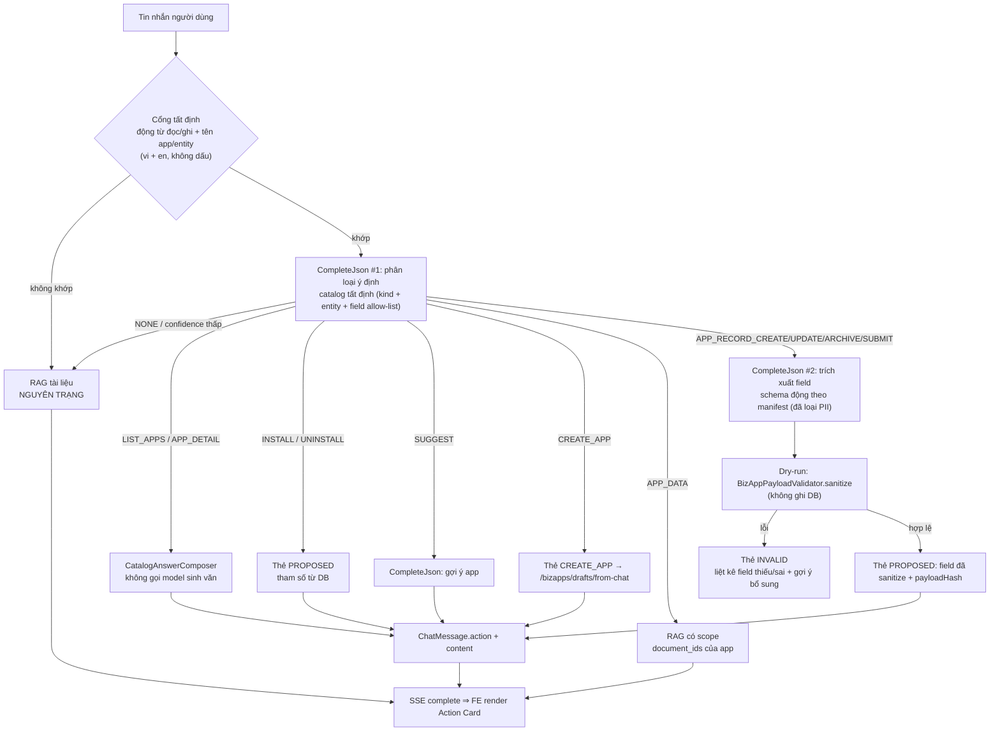
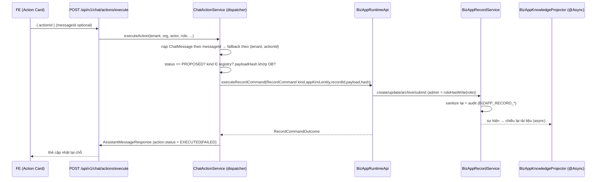

# OpenVie v1.0.0 — Giai đoạn 2: **Tương tác Dữ liệu Tổng quát với Mọi Ứng dụng** (Generic BizApp Data Interaction)

> **Phiên bản:** `v1.0.0` (bổ sung vào mục `[1.0.0]` đang có trong `CHANGELOG.md`).
> **Phạm vi giai đoạn này:** đưa LLM từ "nhận biết / cài-gỡ / tạo app" lên **đọc–ghi dữ liệu nghiệp vụ trong _bất kỳ_ ứng dụng nào có manifest hợp lệ** — app bundled (`crm`, `booking`, `signature-request`), app do tổ chức tự tạo qua Visual Composer, app import/remix. Không hardcode theo từng kind.
> **Tiêu chí bất di bất dịch:** mọi thay đổi **cộng thêm** và **trung tính theo mặc định**. Kill-switch `off` ⇒ hệ thống hành xử **giống hệt** hiện tại, và điều đó phải được **chứng minh bằng test**, không bằng lời tuyên bố.

---

## 0. Trạng thái nền (ĐÃ hoàn thành ở giai đoạn 1 — KHÔNG làm lại)

Các hạng mục dưới đây đã có trong cây. Người thi hành **đọc để tái sử dụng**, không xây lại. Nếu phát hiện lệch so với mô tả ⇒ ghi lại trong PR, không tự ý đổi hành vi.

| Năng lực | Bằng chứng trong cây |
| --- | --- |
| Nguồn gốc tài liệu: `document_kind` (`USER`/`BIZAPP_RECORD`/`BIZAPP_DIGEST`) + `source_ref` | `api/src/main/resources/db/migration/V18__document_provenance.sql`; `document/api/DocumentKind.java` |
| Bộ lọc loại trừ xuyên wire (proto → Python → Qdrant `must_not` + Kuzu `NOT IN` ở **bốn** truy vấn) | `proto/openvie_ai_v1.proto:60` (`repeated string excluded_document_kinds = 15;`); `rag-chatbot-fastapi/app/modules/index/internal/qdrant_search.py`; `.../graph/internal/service.py:258,292,322,381,493`; `.../graph/transport/http.py:78,126` |
| Công tắc `GRAPH_RETRIEVAL_ENABLED` (mặc định `true`) + fingerprint cache (`document_kind_policy_version`) | `rag-chatbot-fastapi/app/bootstrap/settings.py:144`; `.../retrieval/internal/retrieval.py:195`; `.../retrieval/internal/config.py:37`; `.../retrieval/internal/cache.py:58` |
| Khoá `chat_turns.intent`, `intent_confidence`, `intent_app_kind` | `V19__chat_turn_intent.sql`; `chat/model/ChatTurn.java:79-86` |
| Ranh giới module `BizAppRuntimeApi` | `bizapp/api/BizAppRuntimeApi.java` |
| Bộ định tuyến ý định + short-circuit tất định | `chat/query/BizAppIntentRouter.java`; `chat/query/ChatControlPlaneService.java:299-330` |
| Bộ soạn câu trả lời tất định (không citation, không gọi model) | `chat/service/CatalogAnswerComposer.java` |
| Endpoint thực thi thẻ hành động server-authoritative | `chat/controller/ChatController.java:345-364`; `chat/service/ChatActionService.java` |
| Sinh draft từ lịch sử chat | `bizapp/controller/BizAppDraftController.java:65` (`POST /bizapps/drafts/from-chat`) |
| Chiếu record → KB: tên phẳng duy nhất, khoá theo `(tenant, kb, fileName)`, debounce digest, loại field `pii` | `bizapp/service/knowledge/BizAppKnowledgeProjector.java:101,102,113,135-138,167,241-244` |
| Lệnh phân loại lại dữ liệu cũ | `bootstrap/ProvenanceBackfillCommand.java` |
| Thẻ hành động trên FE | `frontend/src/components/chat/BizAppActionCard.tsx`; `frontend/src/lib/bizapp-api.ts` (`executeChatActionApi`) |
| CRUD bản ghi có validate manifest + RBAC + audit + hook | `bizapp/service/BizAppRecordService.java:92-200`; `bizapp/service/BizAppPayloadValidator.java:39`; `bizapp/service/BizAppManifestValidator.java:70-77` |

**Kết luận nền:** đường *đọc* ứng dụng, *cài/gỡ*, *tạo app*, *chiếu tri thức* và *cách ly tài liệu hệ thống* đã xong. **Còn thiếu chính là:** LLM đọc/ghi **dữ liệu bản ghi** trong mọi app — hiện chỉ có nhánh `APP_DATA` đọc-theo-app và toàn bộ đường ghi bị khoá sau form UI/REST.

---

## 1. Bất biến (Invariants) — mỗi điều phải có test

Giữ nguyên `I-1`…`I-11` của giai đoạn 1 (không tự động đổi trạng thái, quyền do server quyết, tham số đọc từ DB, draft là dữ liệu không tin cậy, không ghi KB từ luồng ứng dụng, `_SYSTEM_PROMPT` bất biến, wire cộng thêm/trung tính, token dùng phiên người dùng, tài liệu hệ thống không lộ/không xoá được, audit có actor thật, câu hỏi nhạy cảm không đi nhánh ứng dụng). Bổ sung:

| Mã | Bất biến | Test/gate |
| --- | --- | --- |
| **I-12** | Không tự động ghi dữ liệu: mọi create/update/archive/submit chỉ xảy ra khi người dùng bấm nút, qua endpoint server-authoritative | `RecordActionExecutionTest`, E2E-GA2 |
| **I-13** | Payload ghi được **đọc lại từ `chat_messages.action` trong DB** và **validate lại** tại thời điểm thực thi; giá trị do client gửi lên không bao giờ được dùng | `RecordActionTamperTest` |
| **I-14** | Field `pii: true` **không bao giờ** rời khỏi server tới model (không có trong prompt phân loại, prompt trích xuất, hay thẻ hành động) | `PiiSchemaExclusionTest` |
| **I-15** | **Không hardcode kind**: hệ thống hoạt động với bất kỳ app nào có manifest `bizapp.v1` hợp lệ, kể cả kind chưa từng tồn tại | `AnyInstalledAppInteractionTest`, gate **G-11** |
| **I-16** | LLM **không sinh truy vấn**: chỉ trích xuất cặp `key/value` và bộ lọc trên allow-list field của manifest; không SQL, không Cypher, không biểu thức | `RecordExtractionSchemaTest`, `AiSchemaGuardTest` |
| **I-17** | Không mở rộng quyền: RBAC ghi lấy từ `manifest.rbac` và được kiểm với **vai trò tổ chức thật**, không quy về boolean `admin` | `RecordActionRbacTest` |

---

## 2. Kiến trúc luồng

### 2.1 Định tuyến một lượt chat (mở rộng tại nhánh tất định)



### 2.2 Thực thi (server-authoritative, một dispatcher)



---

## 3. Hợp đồng dữ liệu

### 3.1 Ý định mở rộng (`BizAppIntentRouter.Intent`)

```jsonc
{
  "intent": "NONE | LIST_APPS | APP_DETAIL | APP_DATA | INSTALL | UNINSTALL | SUGGEST | CREATE_APP | APP_RECORD_CREATE | APP_RECORD_UPDATE | APP_RECORD_ARCHIVE | APP_RECORD_SUBMIT",
  "appKind": "asset-registry",     // phải khớp kind trong DB (đã cài hoặc template)
  "entity": "assets",              // bắt buộc với 4 intent APP_RECORD_*
  "confidence": 0.0,               // [0,1]
  "reply": "...",                  // câu diễn đạt; rỗng khi NONE
  "reason": "..."                  // chẩn đoán
}
```

### 3.2 Trích xuất field (CompleteJson #2) — schema động, allow-list

```jsonc
// Yêu cầu: json_schema = "bizapp.record.<kind>.<entity>.schema.json" (sinh runtime, KHÔNG ghi đĩa)
// Chỉ chứa field của manifest, đã loại pii:true, đã cắt theo maxLen
{
  "fields": { "name": "Máy in HP-01", "serial": "SN-1", "state": "NEW" },
  "missingRequired": [],
  "confidence": 0.93
}
```

### 3.3 Thẻ hành động ghi dữ liệu (`chat_messages.action`, jsonb — KHÔNG migration)

```jsonc
{
  "type": "bizapp_action",
  "actionId": "3f1c...",
  "kind": "bizapp.record.create | bizapp.record.update | bizapp.record.archive | bizapp.record.submit",
  "status": "PROPOSED | EXECUTING | EXECUTED | FAILED | DENIED | EXPIRED | INVALID",
  "appKind": "asset-registry",
  "appName": "Quản lý tài sản",
  "entity": "assets",
  "entityLabel": "Tài sản",
  "recordId": null,                       // có với update/archive/submit
  "fields": { "name": "Máy in HP-01", "serial": "SN-1", "state": "NEW" },  // đã sanitize
  "fieldLabels": { "name": "Tên tài sản", "serial": "Số serial" },          // i18n hoá để FE render
  "diff": { "state": { "before": "IN_USE", "after": "BROKEN" } },           // chỉ với update
  "payloadHash": "sha256:...",            // canonical JSON của `fields`
  "invalid": [ { "field": "serial", "code": "REQUIRED", "message": "..." } ],// chỉ khi status=INVALID
  "requiresRole": "ORG_OWNER",
  "executedBy": null,
  "executedAt": null,
  "result": null,                         // { "recordId": "...", "message": "..." }
  "payload": { "sessionId": "..." }
}
```

---

## 4. Phân rã công việc

### W7 — Tương tác dữ liệu tổng quát (trọng tâm giai đoạn này)

**W7.1 Schema digest tất định cho LLM (manifest → JSON allow-list)**

- Thành phần mới: `api/src/main/java/com/openvie/api/bizapp/api/BizAppSchemaDigest.java` (record + builder thuần, không I/O).
- Nguồn: manifest đã parse của **installation `ACTIVE`** (`BizAppInstallationRepository.findByTenantIdAndStatusOrderByCreatedAtDesc`) và template trong catalog (`BizAppMarketplaceService.catalog`).
- Quy tắc sinh (bắt buộc, mỗi quy tắc một test):
  - chỉ entity/field **có trong manifest**; không suy diễn;
  - field `pii: true` ⇒ **loại bỏ** (I-14);
  - giữ `name`, `type`, `required`, `options` (enum), `maxLen`, `format`, `label` (vi/en);
  - cắt: tối đa `app.chat.bizapp-records.max-apps` (mặc định 20) app, `max-entities-per-app` (10), `max-fields-per-entity` (40), `max-label-chars` (80);
  - sắp xếp tất định (kind asc, entity asc, field asc) để prompt ổn định ⇒ không phá fingerprint/idempotency.
- Mở rộng `BizAppRuntimeApi` (cộng thêm, không đổi chữ ký cũ):
  ```java
  List<AppSchemaSummary> listAppSchemas(UUID tenantId);
  List<UUID> listProjectedDocumentIds(UUID tenantId, String appKind);            // đã có
  List<UUID> listProjectedDocumentIds(UUID tenantId, String appKind, String entity); // thêm: theo entity
  ```
  Với `listProjectedDocumentIds(..., entity)` — dùng đúng hạ tầng đã có, không thêm index:
  1. `BizAppKnowledgeProjector.projectRecord` ghi `source_ref = "bizapp:<kind>:<entity>"` (hiện là `"bizapp:<kind>"` tại `BizAppKnowledgeProjector.java:113`); digest giữ `"bizapp:<kind>"` ⇒ **cộng thêm**, không phá `listProjectedDocumentIds(tenantId, appKind)` hiện tại (`DocumentApiImpl.java:118-123` khớp **chính xác** `bizapp:<kind>`, nên hậu tố `:entity` không lọt vào kết quả cũ).
  2. Tra bằng `DocumentRepository.findByTenantIdAndSourceRef(tenantId, "bizapp:<kind>:<entity>")` (đã có).
  3. Tương thích dữ liệu cũ (đã chiếu trước thay đổi): hợp thêm kết quả khớp tiền tố **tên tài liệu** `bizapp__<kind>__<entity>__` lọc từ `findByTenantIdAndKnowledgeBaseIdAndStatus(...)` + `DocumentKind.BIZAPP_RECORD`.
  - Rỗng ⇒ trả `List.of()` (nhánh \"chưa có dữ liệu\" giữ nguyên).
  - **Trung tính với RAG (đã kiểm):** bộ lọc truy hồi chỉ dựa `document_kind` (Qdrant `must_not`, Kuzu `NOT IN $excluded_kinds`) — **không** dựa `source_ref`; `findByTenantIdAndSourceRefStartingWith` hiện **không có consumer nào** trong `api/src/main/java` (chỉ khai báo trong repository); `ProvenanceBackfillCommand` nhận diện tài liệu hệ thống theo **tên tệp** (`bizapp_…`), không theo `source_ref`. Do đó đổi định dạng `source_ref` không đổi kết quả truy hồi.

**W7.2 Mở rộng bộ định tuyến ý định (không hardcode kind)**

- `BizAppIntentRouter.Intent`: thêm 4 giá trị `APP_RECORD_CREATE`, `APP_RECORD_UPDATE`, `APP_RECORD_ARCHIVE`, `APP_RECORD_SUBMIT`; thêm trường `entity` vào `RoutingResult`.
- **Bỏ** danh sách fallback cứng `crm`/`booking`/`signature-request` tại `BizAppIntentRouter.java:315-317`. Thay bằng khớp tất định dựa trên catalog lấy từ DB mỗi lượt:
  - khớp `kind` (chuẩn hoá lowercase), `name.vi`/`name.en` (chuẩn hoá bỏ dấu, lowercase), và slug hoá của name;
  - khớp entity tương tự từ `entity.name` + `entity.label`;
  - **không nhận** appKind ngoài catalog ⇒ `NONE` (giữ hành vi I-11/R11).
- Cổng tất định bổ sung **động từ ghi** (vi/en, kèm biến thể không dấu): `thêm, tạo, ghi nhận, nhập, lưu, cập nhật, sửa, đổi, xoá, gỡ bỏ, lưu trữ, gửi duyệt, trình duyệt` / `add, create, insert, log, save, update, edit, change, delete, remove, archive, submit, send for approval`.
- Prompt phân loại (`buildSystemPrompt`) nhận thêm khối catalog nén: `kind — name(vi/en) — entities[fields...]` (từ W7.1) và 6–8 ví dụ few-shot **generic** (không nêu tên app cụ thể).
- Lưu `entity` vào lượt: không cần cột mới — dùng `chat_turns.intent_app_kind` cho `kind` và `generation_context` (jsonb đã có) cho `{entity}`; ghi rõ trong PR nếu chọn khác.

**W7.3 Dry-run validate trước khi hiển thị thẻ (không ghi DB)**

- Trong nhánh `APP_RECORD_*` của `ChatControlPlaneService`: sau `CompleteJson #2`:
  1. nạp manifest của installation `ACTIVE` (không có ⇒ câu trả lời xác định \"ứng dụng chưa được cài\");
  2. xác nhận `entity` tồn tại trong manifest;
  3. chạy `BizAppPayloadValidator.sanitize(manifest, entity, extracted, requireComplete = true|false)` trong transaction **read-only**;
  4. lỗi ⇒ thẻ `status: "INVALID"` + `invalid[]`; **không** cho phép thực thi (server từ chối cả khi client cố gọi);
  5. hợp lệ ⇒ `fields = clean`, `payloadHash = sha256(canonicalJson(clean))`.
- Với `update`/`archive`/`submit`: server đọc record hiện tại (`BizAppRecordService.get` — đã generic) để lấy title hiển thị và dựng `diff`; **không** tin dữ liệu client.
- **Không** ghi `BizAppRecord` ở bước này (I-12).

**W7.4 Thẻ hành động & thực thi**

- `ChatActionService`: thay chuỗi `if (install) … else if (uninstall)` bằng **registry handler theo `kind`** (map immutable, exhaustive). Kind chưa đăng ký ⇒ `ConflictException` (409).
- Thêm bốn handler ghi dữ liệu; tất cả đi qua ranh giới `BizAppRuntimeApi` (không gọi `bizapp.service..` trực tiếp — gate G-2/G-13):
  ```java
  // BizAppRuntimeApi (cộng thêm)
  RecordCommandOutcome executeRecordCommand(UUID tenantId, UUID orgId, UUID actorId, String callerRole, RecordCommand command);
  record RecordCommand(String kind, String appKind, String entity, UUID recordId,
                       Map<String, Object> payload, String payloadHash) {}
  record RecordCommandOutcome(boolean success, UUID recordId, String message) {}
  ```
- `BizAppRuntimeApiImpl` map: `bizapp.record.create → recordService.create`, `update → update`, `archive → archive`, `submit → submit`; `admin` thay bằng **vai trò thật** (W7.5).
- Thứ tự bắt buộc trong handler (giống W2.2 giai đoạn 1):
  1. `status == PROPOSED`; `payloadHash` khớp giá trị trong DB (lệch ⇒ `409 TAMPERED`);
  2. `sanitize` lại lần nữa (I-13);
  3. RBAC theo `manifest.rbac` + vai trò caller;
  4. thực thi; ghi audit `BIZAPP_RECORD_CREATED|UPDATED|ARCHIVED|SUBMITTED` (đã có trong `BizAppRecordService`) + `CHAT_APP_ACTION_EXECUTED`;
  5. append `ChatMessage` assistant do **server soạn** (không gọi model, không tạo `ChatTurn`) mang `action.status = EXECUTED|FAILED` + `result`.
- Idempotency: khoá theo `actionId` (đã có `actionLocks`); cùng `actionId` + cùng hash ⇒ trả kết quả cũ; khác hash ⇒ `409`.
- Kill-switch **riêng**: `app.chat.bizapp-records.enabled` (mặc định `false`) — độc lập với `app.chat.bizapp-actions.enabled` (cài/gỡ) để bật dần theo rủi ro.
- **Bắt buộc về thứ tự (đây là điều kiện trung tính của đường RAG):** cờ này phải được kiểm **trước** cổng tất định, cùng chỗ với `actionsEnabled` tại `BizAppIntentRouter.route` (`BizAppIntentRouter.java:119-121`). Khi tắt ⇒ `RoutingResult.none()` ngay, **không** mở rộng cổng, **không** thêm lệnh gọi `CompleteJson`, **không** thêm độ trễ nào cho lượt hỏi tài liệu. Cấm đặt cổng tất định phía trước phép kiểm cờ.

**W7.5 RBAC theo manifest, không quy về boolean `admin`**

- Hiện `BizAppRecordService.canWrite(manifest, admin)` chỉ nhận boolean (`:379-383`). Cần biết vai trò:
  ```java
  // BizAppRecordService (đổi chữ ký nội bộ; giữ overload boolean để không phá caller cũ)
  boolean canWrite(Manifest m, String orgRole);          // rbac.write chứa role ⇒ cho phép
  boolean canDelete(Manifest m, String orgRole);         // rbac.delete
  boolean canApprove(Manifest m, String orgRole);        // rbac.approve (dùng cho submit)
  ```
  Quy tắc: `rbac.<action>` **vắng** ⇒ chỉ `ORG_OWNER`+`WORKSPACE_ADMIN`; có ⇒ phải chứa role của caller. `ORG_OWNER` luôn được (giữ tương thích hiện tại: `admin=true` ⇒ cho phép).
- Ma trận role × rbac phải có test (`RecordActionRbacTest`), gồm cả trường hợp `rbac.write = ["MEMBER"]`.

**W7.6 Đọc dữ liệu tổng quát (mở rộng `APP_DATA`)**

- Giữ nguyên cơ chế hiện có (projected documents + `document_ids`), **không** thêm Text-to-SQL (non-goal).
- Bổ sung: nếu LLM xác định được `entity`, dùng `listProjectedDocumentIds(tenantId, appKind, entity)` để thu hẹp scope; xác định không được ⇒ giữ scope toàn app như hiện tại (trung tính).
- **Quy tắc chống hồi quy (bắt buộc):** nếu scope theo entity **rỗng** nhưng scope toàn app **không rỗng** ⇒ **rơi về scope toàn app**, không trả \"chưa có dữ liệu\". Chỉ trả \"chưa có dữ liệu\" khi cả hai đều rỗng. Nếu không có quy tắc này, một lần phân giải entity sai làm lượt đọc mất dữ liệu vốn vẫn trả lời được hôm nay.
- App chưa có bản ghi ⇒ giữ câu trả lời xác định hiện có (`ChatControlPlaneService` nhánh `projectedDocs.isEmpty()`), tổng quát hoá cho mọi kind (không chỉ app đang hardcode).
- **Bỏ** hardcode trong `BizAppRecordService.findAny` (`:336-346`): dùng `resolve(tenantId, appKind, recordId)` (đã generic) hoặc duyệt entity trong manifest qua `storageRouter`.

**W7.7 Generic hoá các giả định hardcode (điều kiện để \"mọi ứng dụng\" là thật)**

| # | Khiếm khuyết | Bằng chứng | Cách sửa |
| --- | --- | --- | --- |
| D8 | Nhận diện app chỉ có 3 kind | `chat/query/BizAppIntentRouter.java:315-317` | khớp theo catalog DB (kind + name vi/en + slug) — W7.2 |
| D9 | Tìm record cho engine trả quyết định hardcode crm/booking | `bizapp/service/BizAppRecordService.java:336-346` | dùng `resolve(...)` generic — W7.6 |
| D10 | Chỉ 2 entity có bảng typed | `bizapp/service/storage/BizAppStorageRouter.java:35-53` | **giữ nguyên** (JSONB là đường mặc định), nhưng phải có test app tự tạo đi trọn vòng JSONB |
| D11 | `isPlatform` set cứng 3 kind ⇒ mức validate khác nhau | `bizapp/service/BizAppInstallService.java:69` | suy ra từ manifest/bundle registry, không từ danh sách cứng; app tổ chức tự tạo giữ `isPlatform=false` và phải **qua** `validate(manifest,false)` |
| D12 | App tự tạo không được đưa entity vào prompt ⇒ LLM không biết để tương tác | `bizapp/service/BizAppRuntimeApiImpl.extractEntityDetails` (chỉ dùng cho `APP_DETAIL`) | đưa `listAppSchemas` vào prompt phân loại (W7.1/W7.2) |
| D13 | `source_ref` chỉ có `bizapp:<kind>` ⇒ không lọc được theo entity | `BizAppKnowledgeProjector.java:113`; `DocumentApiImpl.java:118-123` | ghi `source_ref = "bizapp:<kind>:<entity>"` cho tài liệu bản ghi (digest giữ `bizapp:<kind>`); tra bằng `findByTenantIdAndSourceRef` (đã có) + fallback tiền tố `fileName` `bizapp__<kind>__<entity>__` cho dữ liệu cũ — W7.1 |

**W7.8 Giao diện Web**

- `frontend/src/components/chat/BizAppActionCard.tsx`: thêm nhánh render cho 4 kind ghi dữ liệu:
  - bảng field (`<table>` + `<th scope="col">`) với nhãn i18n từ `fieldLabels`;
  - `status = INVALID` ⇒ hiển thị `invalid[]` màu cảnh báo, **không** có nút thực thi;
  - `archive` ⇒ khối cảnh báo đỏ (không thể hoàn tác từ UI) + tên bản ghi;
  - `update` ⇒ hiển thị `diff` (trước → sau);
  - `submit` ⇒ nhãn \"gửi duyệt\" + tên quy trình.
- Mở rộng union `BizAppActionData.kind` và `status` trong cùng tệp.
- `frontend/src/lib/bizapp-api.ts`: không thêm hàm mới (dùng lại `executeChatActionApi`).
- i18n: `Chat.bizappAction.record.*` (vi + en), `npm run i18n:check` xanh.
- a11y: vùng trạng thái `aria-live="polite"`, nút có `aria-disabled` khi `INVALID`/`DENIED`; thao tác được bằng bàn phím.

**W7.9 Vận hành**

- Metric: `chat_record_action_total{op,outcome}` (op ∈ create/update/archive/submit), `chat_record_action_invalid_total{reason}`. **Không** dùng `org_id`/`tenant_id` làm nhãn.
- Audit: `CHAT_APP_ACTION_EXECUTED`, `CHAT_APP_ACTION_DENIED` (đã có) + `BIZAPP_RECORD_*` (đã có).
- Rate limit theo user bằng cơ chế `app.rate-limit.*` hiện có.
- Ghi chú vận hành trong `docs/BIZAPPS.md`: ghi dữ liệu qua chat **có** bump `search_revision` (qua chiếu, async, đã debounce) ⇒ theo dõi `chat_turn_revision_conflicts_total`.

### W8 — Dọn nợ kỹ thuật phát sinh (bắt buộc trong cùng phiên bản)

- Xoá mọi literal kind của nền tảng khỏi `chat/**` và `bizapp/service/BizAppRecordService` (D8, D9); chỉ cho phép còn trong `api/src/main/resources/marketplace/bizapps/*.json`.
- Thay `BizAppInstallService.isPlatform` bằng suy luận từ registry (D11).
- Cập nhật `docs/BIZAPPS.md` mục \"Giới hạn\": nêu rõ **inline edit field trên thẻ là ngoài phạm vi** — muốn sửa thì nhắn lại (thẻ cũ chuyển `EXPIRED`, thẻ mới qua validate lại). Lý do: mọi thay đổi phải re-validate server-side; cho sửa tại chỗ làm tăng bề mặt tin cậy vào client mà không tăng năng lực thực chất.

---

## 5. Mô hình dữ liệu (Flyway)

**Không có migration mới.** Kiểm chứng:
- Thẻ hành động: `chat_messages.action` là `jsonb` (`chat/model/ChatMessage.java:59-61`) — đủ chứa `fields`/`diff`/`payloadHash`.
- `chat_turns` đã có `intent`, `intent_confidence`, `intent_app_kind` (V19).
- `bizapp_records` đã có `payload` jsonb + `status` (`ACTIVE`/`ARCHIVED`) từ V12.
- `bizapp_drafts` đã cho `source='ai'` (V14).

Nếu phát sinh nhu cầu cột mới ⇒ **dừng lại và báo**, không tự thêm migration trong giai đoạn này.

Thay đổi `source_ref` (W7.1) **không cần migration**: đây là giá trị do projector ghi khi chiếu; hàng cũ vẫn đọc được qua fallback tiền tố `fileName`, và lệnh `ProvenanceBackfillCommand` (đã có) là đường chiếu lại nếu muốn chuẩn hoá dữ liệu cũ.

---

## 6. Bề mặt API & cấu hình

Không có endpoint HTTP mới. Thay đổi cộng thêm:

| Thành phần | Thay đổi | Trung tính khi tắt |
| --- | --- | --- |
| `POST /api/v1/chat/actions/execute` | nhận thêm 4 `kind` ghi dữ liệu | `app.chat.bizapp-records.enabled=false` ⇒ các kind này trả `404`/`409` như chưa tồn tại |
| `BizAppRuntimeApi` | `listAppSchemas`, `listProjectedDocumentIds(kind, entity)`, `executeRecordCommand`, `RecordCommand(Outcome)` | chỉ được gọi từ nhánh mới |
| `BizAppRecordService` | overload RBAC nhận `orgRole` | caller cũ giữ nguyên hành vi boolean |
| `ChatActionService` | dispatcher theo `kind` | map chỉ chứa các kind đang bật |

Thuộc tính mới (`application*.yaml`, `.env.example`):

| Khoá | Mặc định | Ý nghĩa |
| --- | --- | --- |
| `app.chat.bizapp-records.enabled` | `false` | Kill-switch cho 4 intent ghi dữ liệu (độc lập với `bizapp-actions`) |
| `app.chat.bizapp-records.max-apps` | `20` | Số app đưa vào schema digest |
| `app.chat.bizapp-records.max-entities-per-app` | `10` | |
| `app.chat.bizapp-records.max-fields-per-entity` | `40` | |
| `app.chat.bizapp-records.max-label-chars` | `80` | |
| `app.chat.bizapp-records.hash-algorithm` | `sha256` | Thuật toán `payloadHash` (canonical JSON: key sắp xếp, UTF-8, không khoảng trắng) |

---

## 7. Kiểm thử, CI

### 7.1 Cổng cũ (G-1…G-10) — phải **vẫn xanh**, không được nới

Không thay đổi `_SYSTEM_PROMPT` (G-3), wire cộng thêm trung tính (G-4/G-5), ranh giới module (G-2/G-6), công tắc graph (G-9), ma trận phủ tài liệu hệ thống (G-10).

### 7.2 Cổng mới

| Mã | Cổng | Cách thực thi |
| --- | --- | --- |
| **G-11** | Không hardcode kind | Test đọc source tree: `api/src/main/java/com/openvie/api/chat/**` và `bizapp/service/BizAppRecordService.java` **không** được chứa literal `\"crm\"`, `\"booking\"`, `\"signature-request\"` (allow-list rỗng, ghi lý do trong test) |
| **G-12** | Dispatcher đóng | Test phản chiếu: mọi hằng `kind` khai báo trong `ChatActionService` có handler đăng ký; mọi handler có test; kind lạ ⇒ `409` |
| **G-13** | Không có đường LLM → ghi dữ liệu trực tiếp | ArchUnit: `com.openvie.api.chat..` **không** được phụ thuộc `com.openvie.api.bizapp.service..` (chỉ `bizapp.api..`) |
| **G-14** | PII không rời server | Test: manifest có field `pii:true` ⇒ không xuất hiện trong (a) prompt phân loại, (b) schema trích xuất, (c) thẻ hành động, (d) `chat_messages.content` |

### 7.3 Unit & tích hợp (mới)

| Test | Khẳng định |
| --- | --- |
| `RecordExtractionSchemaTest` | Schema sinh từ manifest đúng: chỉ field allow-list, đúng `required`/`options`/`maxLen`; sắp xếp tất định (chạy 2 lần ⇒ cùng bytes) |
| `GenericAppKindResolutionTest` | Kind **không** nằm trong danh sách cứng (ví dụ tự tạo `asset-registry`) vẫn được nhận diện qua `name.vi`/`name.en`/slug, cả có dấu và không dấu |
| `RecordActionDryRunTest` | Thiếu required ⇒ thẻ `INVALID` + `invalid[]`; `enum` sai ⇒ `INVALID`; hợp lệ ⇒ `PROPOSED` + `payloadHash`; **không** có bản ghi nào được ghi ở bước này |
| `RecordActionExecutionTest` | Execute ⇒ record trong DB, audit có actor, sự kiện chiếu phát ra; `action.status = EXECUTED` |
| `RecordActionTamperTest` | Sửa `fields` trong DB (hoặc gửi hash khác) ⇒ `409`, không ghi gì (I-13) |
| `RecordActionRbacTest` | Ma trận role × `rbac.write/delete/approve`: `rbac.write=["MEMBER"]` ⇒ MEMBER ghi được; vắng ⇒ MEMBER `403`/`DENIED`, `ORG_OWNER` OK |
| `PiiSchemaExclusionTest` | (G-14) |
| `RecordActionIdempotencyTest` | Hai lần cùng `actionId` ⇒ một lần ghi; lần hai trả kết quả cũ |
| `ChatActionDispatchTest` | (G-12) |
| `AppSchemaDigestCapTest` | Vượt `max-apps`/`max-fields` ⇒ cắt đúng, không ném lỗi, không vượt kích thước prompt |
| `AnyInstalledAppInteractionTest` | App tự tạo (manifest kiểm trong test) cài vào ⇒ chat **tạo → đọc → sửa → gửi duyệt → lưu trữ** bản ghi thành công (I-15) |
| `AppMentioningDocumentQuestionTest` | **Bảo vệ đường RAG:** bộ câu hỏi *hỏi quy trình/cách làm nhưng có tên app + động từ ghi* (\"Quy trình thêm khách hàng trong CRM gồm những bước nào?\", \"Hướng dẫn sửa lịch hẹn trong ứng dụng đặt lịch?\", \"Chính sách xoá dữ liệu tài sản quy định thế nào?\") ⇒ **không** sinh thẻ hành động, đi RAG tài liệu; chạy ở cả hai trạng thái cờ ghi dữ liệu |
| `RecordKillSwitchNeutralityTest` | Cờ `app.chat.bizapp-records.enabled=false` ⇒ không mở rộng cổng, không gọi `CompleteJson`, không đổi kết quả định tuyến so với baseline (ghi lại trên cùng fixture) |
| `EntityScopeFallbackTest` | Entity scope rỗng nhưng scope app không rỗng ⇒ dùng scope app (không trả \"chưa có dữ liệu\") |

### 7.4 E2E (Playwright + backend thật)

| Mã | Kịch bản | Điều kiện đạt |
| --- | --- | --- |
| **E2E-GA1** | \"Thêm khách hàng Nguyễn Văn An, SĐT 0912345678 vào CRM\" ⇒ thẻ PROPOSED ⇒ bấm xác nhận | Bản ghi xuất hiện trong `/apps/crm`; thẻ `EXECUTED`; audit có actor |
| **E2E-GA2** | Cùng câu lệnh nhưng **không** bấm nút | Không có bản ghi nào được tạo |
| **E2E-GA3** | `MEMBER` gửi câu lệnh ghi khi manifest không cho | Thẻ `DENIED`; gọi thẳng endpoint ⇒ `403`; DB không đổi |
| **E2E-GA4** | Câu lệnh thiếu field bắt buộc (\"thêm một máy in\") | Thẻ `INVALID` kèm danh sách field thiếu; không có nút thực thi |
| **E2E-GA5** | App tự tạo kind mới, đủ 4 thao tác dữ liệu | Tất cả thành công; không cần deploy lại/không hardcode |
| **E2E-GA6** | Kill-switch `app.chat.bizapp-records.enabled=false` | Câu lệnh ghi ⇒ đi đường RAG tài liệu như trước tính năng; không có thẻ ghi nào |
| **E2E-GA7** | Đang stream câu trả lời tài liệu thì xác nhận thẻ tạo bản ghi | Không lỗi cho lượt stream; `search_revision` bump được ghi nhận; không `409` cho lượt vừa xong |
| **E2E-GA8** | Hỏi 20 câu hỏi tài liệu trước/sau khi bật tính năng | Nội dung + citation **giống hệt** (kế thừa E2E-R1) |

### 7.5 Khả năng quan sát

`chat_record_action_total{op,outcome}`, `chat_record_action_invalid_total{reason}`, `chat_app_intent_total{intent}` (đã có), `chat_action_execute_total{action,outcome}` (đã có).

---

## 8. Sổ rủi ro (bổ sung)

| # | Rủi ro | Xử lý | Test |
| --- | --- | --- | --- |
| R34 | Model trích sai field ⇒ dữ liệu rác | Dry-run validate trước khi hiển thị; `requireComplete`; người dùng xem giá trị trước khi bấm | `RecordActionDryRunTest`, E2E-GA4 |
| R35 | Prompt injection trong lịch sử chat ⇒ ghi/xoá trái phép | Tham số đọc lại từ DB theo `actionId`; RBAC server; kill-switch; audit; rate limit | `RecordActionTamperTest`, E2E-GA3 |
| R36 | Ghi qua chat bump `search_revision` ⇒ `409` cho lượt khác | Chiếu là async + debounce sẵn có; thẻ không nằm trong lượt stream RAG; metric | E2E-GA7 |
| R37 | Model bịa entity/field của app lạ | Entity/field chỉ lấy từ manifest; sai ⇒ `404`/`INVALID` | `RecordActionDryRunTest`, `GenericAppKindResolutionTest` |
| R38 | PII rò rỉ vào prompt | Loại `pii:true` khỏi mọi bề mặt LLM; không gửi manifest đầy đủ | G-14, `PiiSchemaExclusionTest` |
| R39 | Mở rộng quyền do quy RBAC về boolean `admin` | RBAC nhận vai trò thật; ma trận role × action | `RecordActionRbacTest`, E2E-GA3 |
| R40 | App tự tạo không đi được vòng JSONB (typed store chỉ 2 entity) | JSONB là đường mặc định trong `BizAppStorageRouter`; test app tự tạo | `AnyInstalledAppInteractionTest`, E2E-GA5 |
| R41 | Thẻ bị sửa ở client để ghi giá trị khác | `payloadHash` + re-validate tại thời điểm thực thi | `RecordActionTamperTest` |

---

## 9. Tài liệu & phát hành

1. `CHANGELOG.md`: mở rộng mục `[1.0.0]` với khối **\"Generic BizApp Data Interaction\"** (4 intent ghi, schema digest động, dry-run validation, RBAC theo manifest, kill-switch riêng, E2E-GA1…GA8).
2. `docs/BIZAPPS.md` (vi + en): mục mới \"Tương tác dữ liệu ứng dụng qua chat\" — cách dùng, giới hạn (inline edit ngoài phạm vi; không Text-to-SQL; PII bị loại khỏi LLM), ma trận RBAC.
3. `docs/ARCHITECTURE.md`: sơ đồ §2, vị trí schema digest và dispatcher.
4. `docs/INTEGRATION.md`: 4 `kind` mới của `/chat/actions/execute`, cấu trúc `action` jsonb mở rộng (SemVer 1.0: cộng thêm).
5. `docs/DEPLOYMENT.md`: khoá cấu hình mới, kill-switch, ghi chú `source_ref = bizapp:<kind>:<entity>` cho tài liệu bản ghi (và fallback tiền tố tên tài liệu cho dữ liệu đã chiếu trước thay đổi).
6. Phiên bản: **giữ `1.0.0`** (không bump), vì đây là phần bổ sung của cùng mốc phát hành; ba tệp phiên bản phải đồng nhất.

---

## 10. Mốc & Định nghĩa hoàn thành

Thứ tự thực thi: **W7.7 (generic hoá) → W7.1 → W7.2 → W7.3 → W7.5 → W7.4 → W7.6 → W7.8 → W7.9 → W8**.

| # | Mốc | Phụ thuộc | Nội dung |
| --- | --- | --- | --- |
| M7 | W7.1–W7.3 | W7.7 | Schema digest, intent mở rộng, dry-run validate, cấu hình |
| M8 | W7.4–W7.6 | M7 | Dispatcher, RBAC theo vai trò, thực thi + audit + idempotency, đọc tổng quát |
| M9 | W7.8–W7.9 | M8 | FE thẻ ghi dữ liệu, i18n, a11y, metric |
| M10 | W8 + §9 | M9 | Dọn hardcode, tài liệu, CHANGELOG |

### Definition of Done

1. `make -C api verify`, `pytest` (rag-chatbot-fastapi), `vitest`, `npm run lint`, `npm run i18n:check` **xanh**.
2. **G-1…G-10 vẫn xanh** (không hồi quy RAG tài liệu, cách ly tài liệu hệ thống, prompt bất biến).
3. **Đường RAG không đổi:** bộ câu hỏi tài liệu (gồm cả câu *có tên app + động từ ghi*) cho **cùng nội dung và cùng citation** trước/sau (E2E-GA8 + `AppMentioningDocumentQuestionTest`); băm `_SYSTEM_PROMPT` không đổi; cờ ghi dữ liệu `false` ⇒ không thêm một lệnh gọi model nào cho lượt hỏi tài liệu (`RecordKillSwitchNeutralityTest`).
4. **G-11...G-14 xanh**: không hardcode kind; dispatcher đóng; không có đường `chat → bizapp.service`; PII không rời server.
5. `app.chat.bizapp-records.enabled=false` ⇒ hệ thống hành xử **giống hệt** trước tính năng (E2E-GA6 + E2E-GA8).
6. Với một app **tự tạo** (kind chưa từng có trong danh sách cứng): chat tạo/đọc/sửa/gửi duyệt/lưu trữ bản ghi đều thành công (E2E-GA5) — đây là bằng chứng "mọi ứng dụng", không phải chỉ 3 app bundled.
7. Không có đường nào từ LLM tới ghi dữ liệu mà bỏ qua xác nhận, RBAC, hoặc validate (I-12, I-13, I-17).
8. Mọi thao tác ghi đều có audit với actor thật; thẻ sau `EXECUTED` không bấm lại được.
9. Tài liệu §9 cập nhật đủ hai ngôn ngữ; `CHANGELOG.md` mô tả đúng năng lực **đã được test chứng minh**, không tuyên bố thừa.
10. Không có migration Flyway mới nào được thêm (nếu buộc phải có ⇒ dừng và báo trước).
