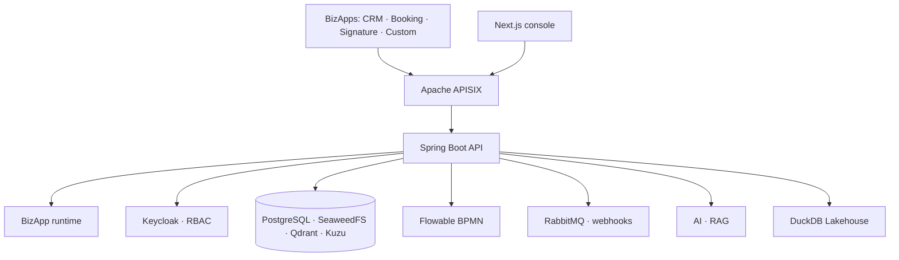

<p align="center">
  
</p>

<p align="center">
  Xây dựng ứng dụng nội bộ có AI hỗ trợ trên lõi headless mã nguồn mở.<br>
  <sub>Build AI-assisted internal business apps on an open-source headless core.</sub>
</p>

<p align="center">
  <a href="https://github.com/OpenVie/OpenVie/actions/workflows/ci.yml"></a>
  <a href="LICENSE"></a>
  <a href="https://discord.gg/zbQbA8GqW"></a>
</p>

<p align="center">
  <a href="#tiếng-việt">Tiếng Việt</a> ·
  <a href="#english">English</a> ·
  <a href="docs/BIZAPPS.md">BizApps</a> ·
  <a href="docs/README.md">Tài liệu</a> ·
  <a href="CONTRIBUTING.md">Đóng góp</a> ·
  <a href="https://discord.gg/zbQbA8GqW">Discord</a>
</p>

<!-- TODO(demo): docs/assets/hero.gif — Marketplace → cài BizApp → tạo bản ghi → gửi duyệt → duyệt → xem báo cáo. -->

## Tiếng Việt

OpenVie là nền tảng mã nguồn mở để xây dựng và vận hành ứng dụng nội bộ. Nền tảng gồm một lõi headless — định danh, API gateway, dữ liệu, quy trình, sự kiện, kiểm toán, phân tích — cùng **BizApps**, lớp khai báo biến manifest JSON thành ứng dụng chạy được, và một lớp tri thức/AI tích hợp sẵn.

RAG (retrieval-augmented generation) nằm trong lõi và phục vụ hai việc: hỏi đáp kho tài liệu doanh nghiệp, và cung cấp ngữ cảnh cho trợ lý trong BizApp. Nó đánh chỉ mục tài liệu và bản ghi ứng dụng, trả lời kèm trích dẫn, và giúp AI soạn manifest. Nó có thể tích hợp vào nền tảng, ứng dụng khác thông qua API với bảo mật qua secret key được khởi tạo.

Thay vì dựng thêm backend cho từng quy trình, lập trình viên có thể khai báo form, bản ghi, báo cáo, luồng duyệt và tích hợp trong một BizApp rồi cài lên cùng nền tảng. Lõi giữ nguyên; ứng dụng thay đổi theo nghiệp vụ.

[Bắt đầu nhanh](#bắt-đầu-nhanh) · [Tính năng](#tính-năng) · [BizApps](#bizapps) · [Hỏi đáp tài liệu](#hỏi-đáp-tài-liệu-và-dữ-liệu-ứng-dụng) · [Ứng dụng mẫu](#ứng-dụng-mẫu) · [Kiến trúc](#kiến-trúc)

### Bắt đầu nhanh

#### Chạy bằng Docker Compose

```bash
cp .env.production.example .env.production
# điền secret và cấu hình model trong .env.production
docker compose -f docker-compose.prod.yml --env-file .env.production up -d --build
```

Mở `http://localhost:8088/setup` để tạo tài khoản chủ sở hữu và workspace đầu tiên. Sau đó vào **Marketplace** (`/admin/apps`) để cài template mẫu, hoặc mở **Compose** (`/admin/apps/compose`) để tạo BizApp đầu tiên.

Cần cài Ollama trên host và tải các model như `vylinh`, `bge-m3`. Xem [hướng dẫn triển khai](docs/DEPLOYMENT.md) để biết yêu cầu đầy đủ.

#### Phát triển cục bộ

Yêu cầu: Git, Docker kèm Compose, Make, JDK 21, Python 3.11 hoặc 3.12 và Node.js 22 LTS.

```bash
# 1. Tạo tệp cấu hình từ mẫu (không ghi đè tệp đã có)
test -f .env || cp .env.example .env
test -f api/.env || cp api/.env.example api/.env
test -f rag-chatbot-fastapi/.env || cp rag-chatbot-fastapi/.env.example rag-chatbot-fastapi/.env
test -f frontend/.env.local || cp frontend/.env.example frontend/.env.local

# 2. Cài dependency
make -C api deps
make -C rag-chatbot-fastapi setup PYTHON=python3.11
npm --prefix frontend ci

# 3. Khởi động hạ tầng và chạy migration
make -C rag-chatbot-fastapi dev-infra
make -C api migrate

# 4. Chạy ba ứng dụng trong ba terminal riêng
make -C api dev
make -C rag-chatbot-fastapi dev PYTHON=python3.11
npm --prefix frontend run dev
```

Mở `http://localhost:3000`. Hướng dẫn đầy đủ, gồm yêu cầu hệ thống và cách cài Ollama: [phát triển cục bộ](docs/DEVELOPMENT.md).

### Tính năng

- **Một lõi headless dùng chung** — định danh, API, dữ liệu, quy trình, sự kiện, kiểm toán và phân tích cho mọi ứng dụng; không phải dựng lại backend cho từng app.
- **BizApps** — cài ứng dụng nghiệp vụ dưới dạng manifest `bizapp.v1`; form, registry, timeline, report và quy trình duyệt sinh từ cấu hình, không cần backend riêng.
- **Hỏi đáp tài liệu doanh nghiệp** — knowledge base theo workspace; nạp PDF, DOCX, bảng tính, Markdown, HTML; trả lời kèm trích dẫn; quyền xem tài liệu được kiểm tra trước khi trả lời.
- **RAG cho dữ liệu ứng dụng** — bản ghi và digest của BizApp được đánh chỉ mục; trợ lý trong app trả lời trên dữ liệu đó.
- **Composer và AI drafting** — dựng app trên canvas, sửa JSON hoặc để AI soạn manifest từ lịch sử chat.
- **Quy trình và phê duyệt** — Flowable BPMN một hoặc hai cấp, SLA nhắc nhở/chuyển tiếp, inbox tác vụ chung.
- **Tích hợp** — email, webhook ký HMAC, connector HTTP/MQTT có credential vault, allowlist và chống SSRF.
- **Dữ liệu và phân tích** — PostgreSQL, SeaweedFS, Qdrant/Kuzu, Parquet và DuckDB; dữ liệu giao dịch tách khỏi phân tích.
- **Tự triển khai** — Docker Compose, Apache APISIX, Keycloak và Ollama cục bộ.

### BizApps

Một **BizApp** là một manifest JSON theo hợp đồng `bizapp.v1`. Manifest khai báo entity/field, view, RBAC, hook và các khối thực thi. Khi cài đặt, OpenVie kiểm tra manifest, chốt phiên bản, sinh giao diện và triển khai BPMN nếu app có bước duyệt. Bản ghi nằm trong bảng JSONB dùng chung, được kiểm tra schema và phân quyền lại mỗi request.

1. **Khai báo** — dùng composer trực quan hoặc nhờ AI soạn manifest từ chat.
2. **Kiểm tra** — validator trả lỗi theo đường dẫn cụ thể trong manifest.
3. **Cài đặt** — chốt manifest, deploy quy trình và mở app tại `/apps/{kind}`.
4. **Vận hành** — người dùng tạo bản ghi, gửi duyệt, xem báo cáo; hook gửi email, webhook hoặc gọi connector.

App dùng RBAC riêng, báo cáo khai báo (groupBy, metrics, filters, orderBy; export CSV/XLSX) và trợ lý AI trong app; app có bước duyệt sẽ có thêm lịch sử phê duyệt. Template có thể export/import/remix.

Thêm một quy trình, biểu mẫu hay báo cáo mới không cần thêm service, migration hay API mới. Lõi giữ nguyên; BizApp chỉ là dữ liệu khai báo và cấu hình.

<!-- TODO(demo): docs/assets/composer.gif — tạo entity/field → thêm approval → kiểm tra → cài đặt. -->

### Hỏi đáp tài liệu và dữ liệu ứng dụng

RAG trong OpenVie có hai bề mặt:

- **Hỏi đáp tài liệu doanh nghiệp** — người dùng tải PDF, DOCX, văn bản, Markdown, HTML, CSV/XLSX vào knowledge base của workspace, đặt câu hỏi và nhận câu trả lời kèm trích dẫn. OCR cho PDF scan/ảnh và ASR cho audio/video là tùy chọn. Truy hồi kết hợp dense/sparse/graph, có thể rerank; quyền xem tài liệu được kiểm tra trước khi trả lời.
- **Dữ liệu ứng dụng** — bản ghi và digest của BizApp được đồng bộ vào knowledge base khi entity bật `knowledge.project`; trợ lý trong app trả lời trên dữ liệu đó. AI cũng soạn và sửa manifest khi tạo app mới.

Phần lõi của BizApp (form, record, report, approval, connector) chạy độc lập với AI. Trong bản cài tiêu chuẩn, lớp AI/RAG được bật sẵn; có thể tắt từng phần bằng cấu hình nếu chỉ cần CRUD.

Xem [nạp tài liệu và truy hồi](docs/RETRIEVAL.md) để biết chi tiết pipeline, định dạng hỗ trợ và giới hạn.

<!-- TODO(demo): docs/assets/document-qa.gif — tải PDF/DOCX → hỏi → trả lời kèm trích dẫn. -->
<!-- TODO(demo): docs/assets/assistant.gif — hỏi trợ lý về dữ liệu app và chỉ ra trích dẫn. -->

### Ứng dụng mẫu

| BizApp | Nghiệp vụ | Thành phần chính |
| --- | --- | --- |
| CRM-lite | Quản lý lead và pipeline bán hàng | registry, form, báo cáo, email thông báo |
| Đặt lịch hẹn | Tiếp nhận, duyệt và nhắc lịch hẹn | form, phê duyệt, email, webhook, báo cáo |
| Yêu cầu ký số | Trình ký nội bộ và chuyển sang nhà cung cấp ký | phê duyệt, connector HTTP |

### Kiến trúc


Spring Boot giữ API nghiệp vụ, phân quyền và dữ liệu PostgreSQL. Python FastAPI xử lý suy luận, nạp tài liệu và chỉ mục tìm kiếm. Next.js là giao diện web; APISIX làm cổng biên.

| Thư mục | Nội dung |
| --- | --- |
| [`api/`](api/) | Lõi nghiệp vụ Spring Boot: identity, RBAC, dữ liệu, workflow, BizApp runtime |
| [`rag-chatbot-fastapi/`](rag-chatbot-fastapi/) | AI service, nạp tài liệu, truy hồi, graph service |
| [`frontend/`](frontend/) | Next.js console và BizApp runtime UI |
| [`contracts/`](contracts/), [`proto/`](proto/) | Schema, fixture và gRPC contract dùng chung |

### Tài liệu

- [BizApps](docs/BIZAPPS.md)
- [Kiến trúc](docs/ARCHITECTURE.md)
- [Tích hợp](docs/INTEGRATION.md)
- [Phê duyệt tài liệu](docs/WORKFLOW.md)
- [Keycloak OIDC](docs/KEYCLOAK.md)
- [Triển khai](docs/DEPLOYMENT.md)
- [Bắt đầu phát triển](docs/DEVELOPMENT.md)
- [Nạp tài liệu và truy hồi](docs/RETRIEVAL.md)
- [Hướng dẫn module Java](api/GUIDE.md) và [Python](rag-chatbot-fastapi/GUIDE.md)
- [Mục lục tài liệu](docs/README.md)

### Tự triển khai

OpenVie chạy được trên hạ tầng của bạn bằng Docker Compose. Hướng dẫn production gồm TLS, sao lưu/phục hồi, giám sát, nâng cấp và các lưu ý vận hành khác: [triển khai](docs/DEPLOYMENT.md).

### Cộng đồng và đóng góp

- **Discord:** [discord.gg/zbQbA8GqW](https://discord.gg/zbQbA8GqW)
- **Báo lỗi và đề xuất:** [GitHub Issues](https://github.com/OpenVie/OpenVie/issues)
- **Đóng góp mã nguồn:** [CONTRIBUTING.md](CONTRIBUTING.md)
- **Báo cáo lỗ hổng:** [SECURITY.md](SECURITY.md)

### Giấy phép

Mã nguồn OpenVie theo [Apache License 2.0](LICENSE), bản quyền 2026 LinkedNodeDigital. Xem [NOTICE](NOTICE) và [THIRD_PARTY_LICENSES.md](THIRD_PARTY_LICENSES.md).

Package, container image, model weights và dataset của bên thứ ba vẫn theo điều khoản riêng.

## English

OpenVie is an open-source platform for building and running internal business applications. It combines a headless core — identity, API gateway, data, workflow, events, audit, analytics — with **BizApps**, a declarative layer that turns a JSON manifest into a working app, and a built-in knowledge/AI layer.

RAG is part of the core and serves two jobs: document Q&A over enterprise knowledge bases, and context for in-app assistants in BizApp. It indexes documents and app records, answers with citations, and helps AI draft manifests.

Instead of adding a new backend for every business process, teams define forms, records, reports, approval flows, and integrations in a BizApp and install it on the same platform. The core stays stable; apps change with the business.

[Quick start](#quick-start) · [Features](#features) · [BizApps](#bizapps-1) · [Document Q&A](#document-qa-and-app-data) · [Example apps](#example-apps) · [Architecture](#architecture)

### Quick start

#### Run with Docker Compose

```bash
cp .env.production.example .env.production
# fill in secrets and model settings in .env.production
docker compose -f docker-compose.prod.yml --env-file .env.production up -d --build
```

Open `http://localhost:8088/setup` to create the owner account and the first workspace. Then open **Marketplace** (`/admin/apps`) to install a template, or **Compose** (`/admin/apps/compose`) to build your first BizApp.

Install Ollama on the host and pull the `vylinh` and `bge-m3` models. See the [deployment guide](docs/DEPLOYMENT.md) for the full requirements.

#### Local development

Prerequisites: Git, Docker with Compose, Make, JDK 21, Python 3.11 or 3.12, and Node.js 22 LTS.

```bash
# 1. Create local configuration without overwriting existing files
test -f .env || cp .env.example .env
test -f api/.env || cp api/.env.example api/.env
test -f rag-chatbot-fastapi/.env || cp rag-chatbot-fastapi/.env.example rag-chatbot-fastapi/.env
test -f frontend/.env.local || cp frontend/.env.example frontend/.env.local

# 2. Install dependencies
make -C api deps
make -C rag-chatbot-fastapi setup PYTHON=python3.11
npm --prefix frontend ci

# 3. Start infrastructure and run migrations
make -C rag-chatbot-fastapi dev-infra
make -C api migrate

# 4. Run the three applications in separate terminals
make -C api dev
make -C rag-chatbot-fastapi dev PYTHON=python3.11
npm --prefix frontend run dev
```

Open `http://localhost:3000`. For prerequisites and Ollama setup, see [local development](docs/DEVELOPMENT.md).

### Features

- **One shared headless core** — identity, API, data, workflow, events, audit, and analytics for every app; no backend rebuild per app.
- **BizApps** — install business apps as `bizapp.v1` manifests; forms, registries, timelines, reports, and approval flows are generated from configuration, with no separate backend.
- **Document Q&A for teams** — workspace-scoped knowledge bases; ingest PDF, DOCX, spreadsheets, Markdown, and HTML; answers include citations; document permissions are checked before answering.
- **RAG for app data** — BizApp records and digests are indexed; the in-app assistant answers over that data.
- **Composer and AI drafting** — build on a canvas, edit JSON, or let AI draft a manifest from chat history.
- **Workflow and approvals** — one- or two-level Flowable BPMN, SLA reminders/escalation, shared task inbox.
- **Integration** — email, HMAC-signed webhooks, HTTP/MQTT connectors with credential vault, allowlists, and SSRF protection.
- **Data and analytics** — PostgreSQL, SeaweedFS, Qdrant/Kuzu, Parquet, and DuckDB; transactional data stays separate from analytics.
- **Self-hosted** — Docker Compose, Apache APISIX, Keycloak, and local Ollama.

### BizApps

A **BizApp** is a JSON manifest using the `bizapp.v1` contract. The manifest declares entities and fields, views, RBAC, hooks, and executable blocks. On install, OpenVie validates the manifest, freezes the version, generates the UI, and deploys BPMN when the app has an approval step. Records live in a shared JSONB table, validated against the schema with authorization re-resolved on every request.

1. **Author** — use the visual composer or ask AI to draft a manifest from chat.
2. **Validate** — the validator reports errors by path in the manifest.
3. **Install** — freeze the manifest, deploy workflows, and open the app at `/apps/{kind}`.
4. **Run** — users create records, submit for approval, and view reports; hooks send email, webhooks, or call connectors.

Apps use their own RBAC, declarative reports (groupBy, metrics, filters, orderBy; CSV/XLSX export), and an in-app AI assistant; apps with an approval step also keep approval history. Templates can be exported, imported, and remixed.

Adding a new process, form, or report requires no new service, migration, or API. The core stays the same; the BizApp is just declarative data and configuration.

<!-- TODO(demo): docs/assets/composer.gif — create entity/field → add approval → validate → install. -->

### Document Q&A and app data

RAG in OpenVie has two surfaces:

- **Enterprise document Q&A** — users upload PDF, DOCX, text, Markdown, HTML, CSV/XLSX files into a workspace knowledge base, ask questions, and get answers with citations. OCR for scanned PDFs/images and ASR for audio/video are optional. Retrieval combines dense, sparse, and graph signals with optional reranking; document permissions are checked before answering.
- **App data** — BizApp records and digests are projected into the knowledge base when an entity enables `knowledge.project`; the in-app assistant answers over that data. AI also drafts and repairs manifests when creating a new app.

The BizApp core (forms, records, reports, approvals, connectors) runs independently of AI. In the standard installation, the AI/RAG layer is enabled by default; individual features can be disabled when only CRUD is needed.

See [ingestion and retrieval](docs/RETRIEVAL.md) for the pipeline, supported formats, and limits.

<!-- TODO(demo): docs/assets/document-qa.gif — upload PDF/DOCX → ask → answer with citations. -->
<!-- TODO(demo): docs/assets/assistant.gif — ask about app data and show citations. -->

### Example apps

| BizApp | Business use | Main components |
| --- | --- | --- |
| CRM Lite | Lead and sales pipeline management | registry, form, report, email notification |
| Booking | Appointment intake, approval, and reminders | form, approval, email, webhook, report |
| Signature request | Internal review and hand-off to a signing provider | approval, HTTP connector |

### Architecture



Spring Boot owns the business API, authorization, and PostgreSQL state. Python FastAPI handles inference, document ingestion, and retrieval indexes. Next.js provides the web client, and APISIX is the edge gateway.

| Directory | Contents |
| --- | --- |
| [`api/`](api/) | Spring Boot core: identity, RBAC, data, workflow, BizApp runtime |
| [`rag-chatbot-fastapi/`](rag-chatbot-fastapi/) | AI service, document ingestion, retrieval, graph service |
| [`frontend/`](frontend/) | Next.js console and BizApp runtime UI |
| [`contracts/`](contracts/), [`proto/`](proto/) | Shared schemas, fixtures, and gRPC contracts |

### Documentation

- [BizApps](docs/BIZAPPS.md)
- [Architecture](docs/ARCHITECTURE.md)
- [Integration](docs/INTEGRATION.md)
- [Document approval](docs/WORKFLOW.md)
- [Keycloak OIDC](docs/KEYCLOAK.md)
- [Deployment](docs/DEPLOYMENT.md)
- [Local development](docs/DEVELOPMENT.md)
- [Ingestion and retrieval](docs/RETRIEVAL.md)
- [Java module guide](api/GUIDE.md) and [Python module guide](rag-chatbot-fastapi/GUIDE.md)
- [Documentation index](docs/README.md)

### Self-hosting

OpenVie runs on your own infrastructure with Docker Compose. The production guide covers TLS, backups and restore, monitoring, upgrades, and operational notes: [deployment](docs/DEPLOYMENT.md).

### Community and contributing

- **Discord:** [discord.gg/zbQbA8GqW](https://discord.gg/zbQbA8GqW)
- **Issues and feature requests:** [GitHub Issues](https://github.com/OpenVie/OpenVie/issues)
- **Code contributions:** [CONTRIBUTING.md](CONTRIBUTING.md)
- **Vulnerability reports:** [SECURITY.md](SECURITY.md)

### License

OpenVie source is licensed under the [Apache License 2.0](LICENSE), copyright 2026 LinkedNodeDigital. See [NOTICE](NOTICE) and [THIRD_PARTY_LICENSES.md](THIRD_PARTY_LICENSES.md).

Third-party packages, container images, model weights, and datasets retain their own terms.
