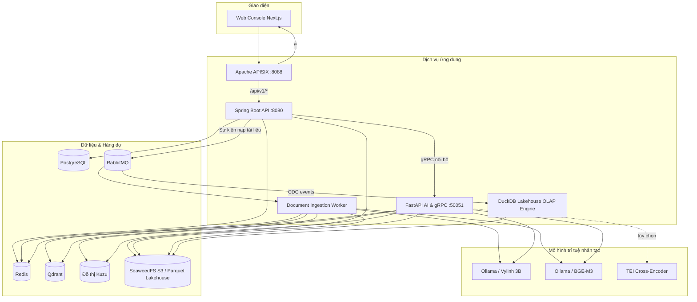

# OpenVie architecture

[Documentation index](README.md) · [Development](DEVELOPMENT.md) · [Deployment](DEPLOYMENT.md)

> **Ngôn ngữ / Language:** [Tiếng Việt](#kiến-trúc-openvie--tiếng-việt) · [English](#openvie-architecture-1)

---

## Kiến trúc OpenVie — Tiếng Việt

Tài liệu này mô tả kiến trúc runtime cho chat và nạp tài liệu, các ranh giới tin cậy và cách phân chia trách nhiệm.

### 1. Sơ đồ hệ thống

### 2. Mô hình 4 mặt phẳng (Four-Plane Boundary)

| Mặt phẳng                | Hiện có                                                                                                                                                                         |
| ------------------------ | ------------------------------------------------------------------------------------------------------------------------------------------------------------------------------- |
| **Điều khiển (Control)** | Spring Boot quản lý tổ chức, workspace, tài khoản, phân quyền ba cấp (`ORG_OWNER`, `WORKSPACE_ADMIN`, `MEMBER`), kênh thông báo, phiên chat; dữ liệu lưu trong PostgreSQL.      |
| **Dữ liệu bất đồng bộ**  | RabbitMQ điều phối hàng đợi; worker xử lý song song; SeaweedFS lưu tệp gốc; Qdrant lưu vector; Kuzu lưu đồ thị. OCR cho PDF scan/ảnh là tùy chọn, mặc định tắt.                |
| **Suy luận (Inference)** | FastAPI trả lời qua gRPC server-streaming; lọc chào hỏi/nhiễu bằng quy tắc bảo thủ; RAG tách theo tenant; định tuyến câu hỏi nhạy cảm theo từ khóa; LLM sinh câu trả lời có trích dẫn nguồn. |
| **Đánh giá ngoại tuyến** | Công cụ phát lại trace JSONL để đo nhãn nhạy cảm và độ chính xác của trích dẫn mà không gọi API model.                                                                          |

### 3. Phân định trách nhiệm dữ liệu

- **PostgreSQL (Spring sở hữu):** Nguồn dữ liệu chuẩn cho tổ chức, người dùng, workspace, phiên hội thoại, tin nhắn, nhật ký kiểm toán, kênh thông báo và outbox/inbox sự kiện bền vững. Các bảng engine Flowable (`ACT_*`, `FLW_*`) phục vụ phê duyệt tài liệu số nằm trong cùng PostgreSQL, schema do engine quản lý (ngay cạnh schema nghiệp vụ, không cần thêm container).
- **Qdrant & Kuzu (Python sở hữu):** Chứa chỉ mục vector (dense/sparse) và đồ thị quan hệ dẫn xuất từ tài liệu. Không chứa dữ liệu nghiệp vụ gốc.
- **SeaweedFS (S3):** Chứa tệp tài liệu gốc, bảng Parquet sinh ra từ bảng tính và các phân vùng Lakehouse Parquet nén Snappy (audit, chat, document, workflow) phục vụ phân tích OLAP.
- **DuckDB (Python sở hữu):** Engine OLAP nhúng, chạy truy vấn SQL tổng hợp và báo cáo trực tiếp trên các tệp Parquet Lakehouse, tách hẳn khỏi PostgreSQL giao dịch (OLTP) nên không tạo tải lên đó.
- **Redis:** Bộ đệm tạm (mặc định tắt), checkpoint và lease trạng thái cho worker nạp tài liệu.

### 4. Chuỗi tương tác chính

#### A. Xử lý yêu cầu trò chuyện (Chat Sequence)

1. Client gửi câu hỏi kèm JWT tới Spring Boot qua Gateway APISIX.
2. Spring kiểm tra quyền trong workspace, kiểm tra khóa idempotency và lưu lượt hỏi ở trạng thái `PENDING`.
3. Spring gọi gRPC server-streaming `GenerateAnswer` tới Python FastAPI, kèm ngữ cảnh và lịch sử gần nhất.
4. Python trả lời ngay các câu chào hỏi/nhiễu rõ ràng dựa trên lịch sử, không embedding, không truy hồi, không gọi LLM và không trích dẫn. Các câu còn lại đi qua query planning, truy hồi đa kênh rồi stream token thật từ Ollama hoặc endpoint tương thích OpenAI; bản nháp được làm sạch trước khi gửi.
5. Spring chuyển từng snapshot bản nháp thành sự kiện SSE `content`; client thay nội dung đang hiển thị nhưng chưa dựng link hay thẻ nguồn. Câu hỏi nhạy cảm không phát bản nháp.
6. Spring kiểm tra revision và quyền xem tài liệu của từng trích dẫn, commit phản hồi ở trạng thái `COMPLETED`, rồi mới gửi SSE `complete` kèm JSON phản hồi cuối. Chỉ phản hồi này mới có nguồn và được lưu vào hội thoại.
7. Nếu revision thay đổi, Spring gửi `reset` trước một lần sinh lại duy nhất; nếu thất bại thì gửi `error` và không lưu bản nháp. Nếu phát hiện hủy trước lúc commit, lượt hỏi được đánh dấu `FAILED`/`REQUEST_CANCELLED` và công việc gRPC/provider bị hủy; ngắt kết nối đến sau khi phản hồi đã commit thì không thể hoàn tác phản hồi đó.

POST `/api/v1/chat/sessions/{sessionId}/messages` giữ nguyên body và cách xác thực JWT, trả `text/event-stream` với các sự kiện `content`, `reset`, `complete`, `error`. Header `Cache-Control: no-cache, no-transform` và `X-Accel-Buffering: no` giúp proxy/nén không gom luồng. Giao diện hiển thị trạng thái đang viết với dấu chấm và con trỏ nhẹ; tắt animation khi người dùng bật reduced motion.

#### B. Nạp tài liệu (Ingestion Sequence)

1. Người dùng tải tệp lên Spring API (tối đa 20 MB).
2. Spring lưu tệp vào SeaweedFS, ghi sự kiện vào `internal_event_outbox` và trả HTTP 202 Accepted.
3. Relay đẩy sự kiện sang RabbitMQ. Worker nhận job, giữ lease trong Redis và chuyển trạng thái sang `PROCESSING`.
4. Worker tải tệp, chia thành đơn vị tri thức, tạo vector BGE-M3, nạp vào Qdrant, trích xuất thực thể đồ thị và nạp vào Kuzu.
5. Worker gửi sự kiện `COMPLETED` về RabbitMQ; Spring chuyển trạng thái tài liệu sang `COMPLETED`.

#### C. Phê duyệt tài liệu hai cấp (Approval Sequence)

1. Thành viên nộp tài liệu kèm đích công bố (`workspace`/`shared`/`public`). Spring ghi sổ và các biến quy trình rồi khởi chạy BPMN `eofficeDocumentApproval` nhúng bằng Flowable trong cùng PostgreSQL.
2. Service task xác định độ nhạy cảm theo hợp đồng dùng chung `contracts/approval/v1/sensitive-policy.json` (`sensitive-keyword-v1`); Java không giữ danh sách từ khóa thứ hai. Hệ thống, chứ không phải người nộp, quyết định cấp phê duyệt: nhạy cảm hoặc đích `shared`/`public` thì cấp 2 (`ORG_OWNER`); tài liệu thường thì cấp 1 (`WORKSPACE_ADMIN`).
3. Bỏ qua bước duyệt khi người đăng đã có thẩm quyền: tài liệu thường (đích `workspace`, không nhạy cảm) do người đã có quyền duyệt của workspace đó đăng — admin workspace hoặc chủ tổ chức (trường hợp General) — được quyết ngay bằng thẩm quyền sẵn có trong cùng giao dịch; quy trình vẫn chạy nhánh APPROVE để lịch sử thống nhất, và ghi `selfApproved=true`. Không thêm bước hình thức khi người nộp đã có quyền duyệt; tài liệu nhạy cảm luôn phải qua duyệt.
4. Chống tự duyệt: khi vào quy trình duyệt thật, người nộp có thể rút tài liệu (từ chối kèm lý do) hoặc chuyển lên cấp trên, nhưng không được tự quyết tài liệu của mình; chỉ chủ tổ chức — người đứng đầu chuỗi — được quyết tài liệu do mình nộp (`selfDecision` được ghi audit). Task đã có người nhận thì chỉ người đó được hoàn tất; task còn trống trong nhóm thì được nhận và hoàn tất trong cùng một bước.
5. Mọi bước được ghi vào nhật ký kiểm toán (`workflow_process`): bắt đầu, nhận xử lý, phê duyệt, từ chối (bắt buộc có lý do), bàn giao L1→L2; không cho phép bỏ cấp. `GET /api/v1/workflow/processes/{id}/log` trả nhật ký của từng quy trình, server tự tra tên người thực hiện; trang phê duyệt hiển thị log trong dialog của từng tài liệu.
6. SLA đặt được theo từng tổ chức (mặc định PT24H nhắc nhở, PT48H chuyển tiếp trong `openvie.workflow.*`; giá trị riêng nằm trong `workflow_sla_configs`). Nhắc nhở không làm gián đoạn task; khi quá hạn, task cấp 1 được chuyển sang cấp 2 và ghi log chuyển tiếp (overdue, không phải quyết định thủ công).
7. Trạng thái chạy nằm trong các bảng `ACT_*` của engine trong PostgreSQL, nên API khởi động lại (deploy hoặc crash) vẫn tìm lại được quy trình và task đang chờ mà không cần replay.
8. Ghi kết quả chính thức: khi quy trình kết thúc (duyệt hoặc từ chối), `DocumentApi.recordApprovalDecision` ghi thẳng `approval_status` và người duyệt vào bảng `documents`, đồng thời phát `WorkflowDecisionEvent` để gửi email báo kết quả cho người nộp qua kênh SMTP (`WORKFLOW_DECIDED`).

#### D. BizApp runtime (Tier 3 — ứng dụng cài được)

1. `ORG_OWNER` cài template từ marketplace (`platform:crm` hoặc bản sao của tổ chức): validator kiểm tra manifest trước, manifest được chốt vào `bizapp_installations`, và engine triển khai BPMN `bizapp-<kind>` nếu app có khối phê duyệt.
2. Người dùng làm việc trên các màn hình form/registry/timeline/report sinh từ manifest; mọi bản ghi nằm trong bảng JSONB chung `bizapp_records`, được kiểm tra chặt theo schema, còn RBAC được xác định lại mỗi request (không tin client).
3. Nộp duyệt sẽ khởi động process Flowable, hoàn tất qua inbox task chung; delegate cuối ghi quyết định vào `runtime` và phát webhook `bizapp.<kind>.record.decided` sau khi commit.
4. HTTP ra ngoài lấy secret từ vault mã hóa AES-256-GCM (`BIZAPP_ENC_KEY`); mọi bước đều được audit và đẩy qua outbox webhook ký HMAC. Chi tiết: [BIZAPPS.md](BIZAPPS.md).

#### E. Trợ lý hội thoại & Ứng dụng (Conversational BizApps v1.0.0)

Hệ thống tách ba tầng độc lập để tài liệu hệ thống không lẫn vào câu trả lời:
1. **Tầng A (Deterministic):** Liệt kê danh mục, xem chi tiết app, quyết định cài/gỡ do server quyết. Không gọi model, không đụng tới KB.
2. **Tầng B (Structured LLM):** Phân loại ý định qua RPC `CompleteJson` riêng (`bizapp_intent.schema.json`); soạn manifest nháp từ lịch sử chat.
3. **Tầng C (Document RAG):** Truy hồi đa kênh (dense + sparse + graph) theo công tắc `GRAPH_RETRIEVAL_ENABLED` (mặc định `true`). Khi tắt, kênh graph bị bỏ qua hoàn toàn, không phát sinh HTTP tới graph-service. Mọi câu hỏi tài liệu thông thường được cách ly khỏi tài liệu hệ thống (`excluded_document_kinds`).

Ranh giới module được thể hiện qua các interface công khai: `BizAppRuntimeApi` (cung cấp năng lực quản lý ứng dụng cho chat) và `ChatRuntimeApi` (cung cấp lịch sử phiên cho việc soạn thảo), nhờ đó đồ thị phụ thuộc giữa các module không có chu trình (`ModularMonolithArchitectureTest`).

### 5. Bảo mật và cách ly

- **Phân quyền ba vai trò:** `ORG_OWNER` (quản trị toàn tổ chức, tạo workspace), `WORKSPACE_ADMIN` (quản lý thành viên và tài liệu trong workspace), `MEMBER` (chat, tải lên/xóa tài liệu của mình).
- **Cách ly workspace:** Qdrant và Kuzu luôn lọc chặt theo `tenant_id` (đại diện cho workspace).
- **gRPC nội bộ:** dùng plaintext ở profile `dev`; profile `prod` bắt buộc xác thực chứng chỉ TLS qua `AI_GRPC_*`.
- **API key máy (M2M):** khóa `ovk_...` xác thực như một tài khoản service member thật trong database, tuân theo đúng ranh giới workspace và RBAC.
- **Giới hạn tần suất phân tán:** `ConsumerRateLimitFilter` đếm lưu lượng đã xác thực theo `tenant:user` trong Redis; fail-open khi Redis mất kết nối.
- **Webhook ký số:** sự kiện nghiệp vụ gửi ra ngoài được ký HMAC-SHA256 (`X-OpenVie-Signature: t=...,v1=...`), có retry giới hạn và Transactional Outbox.

---

# OpenVie architecture

This reference describes OpenVie's runtime architecture, trust boundaries, and component responsibilities.

## 1. Runtime topology

See the shared topology diagram above. Key boundaries:

- **Client to Edge:** Apache APISIX (:8088) reverse-proxies `/api/v1/*` to Spring Boot (:8080) and `/*` to Next.js (:3000) with edge rate limiting (`limit-req`).
- **Internal gRPC:** Spring communicates with Python AI (:50051) using server-streaming `GenerateAnswer`; document-unit reads and index deletion remain unary.
- **Data Isolation:** PostgreSQL is Spring-exclusive. Qdrant, Kuzu, and RabbitMQ ingestion workers are managed by Python. SeaweedFS holds raw uploads and Parquet artifacts.

## 2. Four-plane delivered boundary

| Plane                 | Delivered                                                                                                                                                                 |
| --------------------- | ------------------------------------------------------------------------------------------------------------------------------------------------------------------------- |
| **Control**           | Spring Boot workspace/auth/chat API, PostgreSQL persistence (orgs, workspaces, memberships, notification channels), Redis runtime state.                                  |
| **Async data**        | RabbitMQ ingestion, document workers, SeaweedFS storage, Qdrant vectors, Kuzu graph. Optional OCR for scanned PDFs/images (off by default).                               |
| **Inference**         | FastAPI server-streaming answer gRPC, conservative greeting/nonsense gate, tenant-scoped hybrid RAG, lexical sensitive query routing, grounded generation with citations. |
| **Offline alignment** | Local trace replay evaluating sensitive routes and citation markers without remote API calls.                                                                             |

## 3. Data ownership

- **PostgreSQL (Spring):** Authoritative state for organizations, workspaces, accounts, permissions, chat sessions, turns, audit logs, and transactional outbox/inbox. The Flowable engine tables (`ACT_*`, `FLW_*`) for the e-Office document approval live in the same PostgreSQL, with schemas managed by the engine — right next to the business tables, no extra container.
- **Qdrant & Kuzu (Python):** Materialized dense/sparse vectors and entity knowledge graphs. No business SQL access.
- **SeaweedFS (S3):** Raw source document storage, derived spreadsheet Parquet tables, and partitioned Snappy-compressed Lakehouse Parquet archives (audit, chat, document, workflow) for analytical workloads.
- **DuckDB (Python):** Embedded OLAP analytical query engine executing SQL aggregations and reporting directly over Lakehouse Parquet partitions without touching or loading the transactional PostgreSQL database.
- **Redis:** Checkpoint leases for workers, rate limiting, and optional caches (off by default).

## 4. Key execution flows

### Chat execution

1. Client submits message with JWT via APISIX gateway.
2. Spring authenticates workspace scope, checks idempotency key, persists user turn as `PENDING`.
3. Spring invokes server-streaming gRPC `GenerateAnswer` with recent history.
4. Python answers high-confidence greetings/nonsense directly, using history without embedding, retrieval, model calls, or citations. Other questions use contextual planning, hybrid retrieval, and native Ollama/OpenAI-compatible token streams; previews are polished before emission.
5. Spring forwards provisional replacement snapshots as SSE `content`; the client does not render draft links or source cards. Sensitive questions emit no previews.
6. Spring validates the knowledge revision and citation permissions, commits the assistant turn as `COMPLETED`, then emits SSE `complete` with the authoritative response JSON and sources.
7. Revision changes emit `reset` before the single bounded regeneration attempt; failures emit `error`, never persist drafts. Cancellation observed before commit marks the turn `FAILED`/`REQUEST_CANCELLED` and cancels gRPC/provider work; disconnects cannot undo an answer already committed before they are observed.

POST `/api/v1/chat/sessions/{sessionId}/messages` retains its request body and JWT authentication but returns `text/event-stream` events: `content`, `reset`, `complete`, `error`. `Cache-Control: no-cache, no-transform` and `X-Accel-Buffering: no` prevent proxy/compression buffering. The UI shows a writing status, subtle dots and cursor, and disables animations for reduced motion.

### Document ingestion

1. Client uploads document (up to 20MB) to Spring API.
2. Spring stores raw object in SeaweedFS, records outbox event, returns HTTP 202 Accepted.
3. Outbox relay forwards message to RabbitMQ. Worker claims job lease via Redis, sets `PROCESSING`.
4. Worker parses text, chunks content, extracts BGE-M3 vectors, indexes Qdrant, projects Kuzu graph entities.
5. Worker publishes `COMPLETED` to RabbitMQ; Spring marks document `COMPLETED`.

### Two-level document approval

1. A workspace member submits a COMPLETED document with a publish target (`workspace`, `shared`, or `public`); Spring starts the embedded Flowable process `eofficeDocumentApproval` in the shared PostgreSQL.
2. The scoring service task applies the shared sensitivity contract (`contracts/approval/v1/sensitive-policy.json`, `sensitive-keyword-v1`) — Java has no second keyword list — and the system (not the submitter) fixes the approval level: sensitive or `shared`/`public` targets need level 2 (`ORG_OWNER`), ordinary documents stay at level 1 (`WORKSPACE_ADMIN`).
3. Authority short-circuit: a workspace publishing an ordinary (`workspace`-target, non-sensitive) document by someone who already holds that workspace's approval authority — its admin, or the org owner (the General case) — is decided by their own authority in the same transaction; the process still runs its APPROVE path (uniform history), audited with `selfApproved=true`. No ceremony is added where the submitter already holds the reviewing authority; sensitive documents always keep the review.
4. Self-approval guard: inside a real review the submitter may withdraw (reject with a reason) or hand the task upward, but a decision on an own document requires another reviewer — only the org owner, the terminal authority of the chain, decides an own submission (`selfDecision` audited). A claimed task is completed only by its claimant; an unclaimed task of the approval group is claim-on-complete.
5. Every transition is audited (`workflow_process`): start, claim (one claim per task; the group queue keeps seeing it), approve, reject (reason is mandatory), and the explicit L1→L2 hand-off — level skipping is not offered. `GET /api/v1/workflow/processes/{id}/log` returns the workspace-scoped audit trail of one process with actor display names resolved server-side; the approvals page shows it as a per-process log dialog.
6. SLA timers are per-organization configurable (`workflow_sla_configs`, defaults `openvie.workflow.*` = PT24H reminder / PT48H escalation): the reminder never interrupts the task, escalation interrupts it and moves an overdue level 1 task to the owner queue, both audited (`overdue`, not a manual decision).
7. Runtime state lives in the engine's `ACT_*` tables, so an API restart (deploy or crash) rediscovers the running process and pending task without replay; workflows are claimed and completed by live membership, so a foreign-workspace task or process is answered with an explicit 403.
8. Authoritative decision write-back: upon terminal settlement (approved or rejected), `DocumentApi.recordApprovalDecision` commits `approval_status`, timestamp, and the deciding user directly onto the `documents` record, invalidating document caches and publishing `WorkflowDecisionEvent` for transactional submitter email notification (`WORKFLOW_DECIDED`).

#### D. BizApp runtime (Tier 3 — installable apps)

1. An `ORG_OWNER` installs a marketplace template (`platform:crm` or a company-crafted copy): the manifest validator gates first, the manifest freezes onto `bizapp_installations`, and the engine deploys the `bizapp-<kind>` BPMN when the app declares an approval block.
2. Users work through manifest-generated form/registry/timeline/report views; every record lands in the shared JSONB table `bizapp_records`, strictly validated against the schema with workspace RBAC re-resolved per request — the client is never trusted.
3. Submitting for approval starts a Flowable process completed through the generic engine inbox; the terminal delegate writes the decision into `runtime` and raises the `bizapp.<kind>.record.decided` webhook after commit.
4. Outbound HTTP pulls secrets from the AES-256-GCM credential vault (`BIZAPP_ENC_KEY`); every step is audited and pushed through the HMAC-signed webhook outbox. Details: [BIZAPPS.md](BIZAPPS.md).

#### E. Three-Tier Conversational Architecture & Graph Toggle (v1.0.0)

The platform strictly isolates application management from document knowledge retrieval:
1. **Tier A (Deterministic):** Catalog listings, app details, and server-authoritative action execution. Zero LLM calls, zero knowledge base writes.
2. **Tier B (Structured LLM):** Intent routing and manifest drafting via isolated `CompleteJson` RPC with strict schema contracts.
3. **Tier C (Document RAG):** Multi-channel hybrid retrieval governed by `GRAPH_RETRIEVAL_ENABLED` toggle (defaults to `true`). When disabled, graph HTTP queries are skipped entirely. All normal turns enforce `excluded_document_kinds` against system records.

Published module boundaries `BizAppRuntimeApi` and `ChatRuntimeApi` enforce strict acyclic dependency graphs across the monolith.

## 5. Security and isolation

- **Three-tier RBAC:** `ORG_OWNER` (organization administration), `WORKSPACE_ADMIN` (workspace-level moderation), `MEMBER` (workspace interaction and self-upload management).
- **Tenant Isolation:** Qdrant and Kuzu filter queries by `tenant_id` (representing the workspace).
- **Transport Security:** Plaintext gRPC in development; TLS mTLS certificate authentication required in production (`AI_GRPC_PLAINTEXT=false`).
- **Machine-to-Machine API Keys:** Token format `ovk_...` authenticates as an active service-member user row with live membership checks, enforcing identical RBAC and tenancy guarantees without separate code paths.
- **Distributed Rate Limiting:** `ConsumerRateLimitFilter` meters authenticated requests per `tenant:user` in Redis, failing open during Redis outages to maintain service availability.
- **Cryptographic Webhooks:** Outbound events are signed with HMAC-SHA256 (`X-OpenVie-Signature: t=...,v1=...`) via a transactional outbox with bounded exponential retries.
