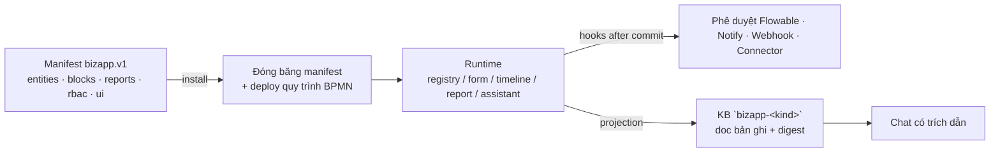
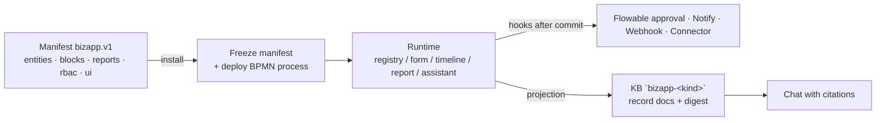

# BizApps — nền tảng ứng dụng kinh doanh cài được (Tier 3)

[Danh mục tài liệu](README.md) · [Kiến trúc](ARCHITECTURE.md) · [Tích hợp](INTEGRATION.md) · [Workflow](WORKFLOW.md)

> **Ngôn ngữ / Language:** [Tiếng Việt](#bizapps--nền-tảng-ứng-dụng-kinh-doanh-cài-được) · [English](#bizapps--the-installable-business-app-platform)
>
> Tài liệu này là tham chiếu đầy đủ cho manifest `bizapp.v1`, các khối thực thi, composer trực quan,
> báo cáo khai báo, chiếu tri thức cho trợ lý AI, API runtime và các giới hạn báo lỗi thật của bản
> cài hiện tại. Nguồn chuẩn: `contracts/bizapp/bizapp.v1.schema.json`, `api/src/main/java/com/openvie/api/bizapp/`
> (validator/executor/composer) và `frontend/src/components/bizapp/composer/`.

## BizApps — nền tảng ứng dụng kinh doanh cài được

### 0. Mô hình tư duy (TL;DR)

BizApp là **ứng dụng kinh doanh khai báo** chạy trực tiếp trên các headless service của nền tảng:
không cần backend riêng. Toàn bộ hành vi của ứng dụng được mô tả bằng **một JSON duy nhất** theo
hợp đồng `bizapp.v1` — gọi tắt là **manifest**:



Ba bề mặt người dùng:

| Bề mặt | Đường dẫn | Ai dùng |
| --- | --- | --- |
| Kho ứng dụng + console quản trị (cài/gỡ/template/credential/bản thảo AI) | `/admin/apps`, `/admin/apps/compose` | Chủ tổ chức |
| Ứng dụng runtime (registry, form, timeline, report, assistant) | `/apps`, `/apps/{kind}` | Theo `rbac` manifest |
| Trợ lý hội thoại (Liệt kê/Cài đặt/Gợi ý/Tạo app/Bản ghi) | Chat workspace | Theo vai trò |

### 1. Bắt đầu nhanh (10 phút)

1. `/admin/apps/compose`: đặt tên (Vi/En), chỉnh thực thể mặc định `records` (thêm trường, kiểu,
   required, PII), đổi tên thực thể.

   > Composer chỉ mở vài thuộc tính thân thiện: tên, nhãn, kiểu, required, PII. Các cấu hình sâu hơn
   > (`maxLen`, `format`, `options`, `optionLabels`, `knowledge`, lớn nhất là các tham số đặc thù của
   > từng khối) đặt qua **tab JSON** hoặc **Additional settings** trong inspector.

2. Thêm khối chạy được: ví dụ **Approval** (quy trình 1/2 cấp + vai trò duyệt) hoặc **Report**.
   Kết nối thực thể → khối để tạo hook `onCreate`/`onUpdate`/`onDecide` (biểu tượng chú thích trên edge).

3. Kiểm tra Panel kiểm tra hợp lệ (debounce 400ms, gọi `POST /api/v1/bizapps/validate`) lúc nhỏ màu
   xanh, lúc đỏ (hiện lỗi dễ hiểu).

4. **Lưu bản thảo** (draft) hoặc **Cài đặt** (tự nâng cấp nếu app cùng kind đã cài). Cài đặt sẽ đóng băng
   manifest, deploy BPMN, rồi chuyển tới `/apps/{kind}`.

5. Thêm bản ghi bằng form, gửi duyệt, xem report, trao đổi qua assistant.

### 2. Tham chiếu manifest `bizapp.v1`

Schema máy đọc được: `contracts/bizapp/bizapp.v1.schema.json` (`additionalProperties: false`). Mọi key
ngoài hợp đồng bị từ chối với gợi ý sửa (ví dụ `maxLength` → "key đúng là `maxLen`").

#### 2.1 Top level

| Key | Kiểu/Shell | Mặc định | Ghi chú |
| --- | --- | --- | --- |
| `schema` | `"bizapp.v1"` (const) | — | bắt buộc |
| `kind` | `[a-z][a-z0-9-]{1,31}` | — | duy nhất mỗi cài đặt; trùng kind khi cài → `409` |
| `name` | `{vi, en}` nhãn in được ≤200 ký tự | — | bắt buộc, dùng làm tiêu đề |
| `version` | int ≥1 | 1 | khi nâng cấp: `max(cài đặt hiện tại+1, yêu cầu)` |
| `icon` | chuỗi ≤64 | — | nhãn icon (fallback emoji ở `/apps`) |
| `storage` | `jsonb` / `typed` | `jsonb` | `typed` chỉ dành cho template platform cốt lõi |
| `rbac` | map `read/write/delete/approve/submit` → danh sách vai trò | xem §2.3 | |
| `entities` | 1..20 đối tượng | — | bắt buộc |
| `blocks` | ≤40 đối tượng | — | |
| `conversational` | `{triggers[≤50], description≤2000}` | — | từ khoá dùng cho router ngữ nghĩa |
| `ui` | `{views[≤20], layout}` | — | thứ tự view + toạ độ canvas |

#### 2.2 `entities` & `fields`

**Entity**: `name` (`[a-z][a-z0-9_]{0,63}`, duy nhất), `label {vi,en}` (khuyến nghị; schema yêu cầu),
`fields` (1..40), `knowledge`, `hooks`.

**Field**:

| Key | Giá trị | Mặc định | Ghi chú |
| --- | --- | --- | --- |
| `name` | `[a-z][a-z0-9_]{0,63}` (chuẩn hoá chữ thường) | — | duy nhất trong entity |
| `type` | `string` `number` `boolean` `enum` `date` `ref` | — | |
| `entity` | tên entity | — | bắt buộc/không được trỏ tới entity chưa khai báo khi `type=ref` |
| `required` | bool | false | chặn tạo mới khi thiếu; cập nhật chỉ chặn khi trường có mặt nhưng rỗng |
| `maxLen` | int 1..2000 | 1024 cho `string` | KHÔNG phải `maxLength` |
| `format` | `email` `uri` `phone` | — | hiện tại chỉ `email` mới được kiểm chứng server-side |
| `options` | danh sách chuỗi | — | bắt buộc cho `enum`; khớp không phân biệt hoa/thường khi ghi |
| `optionLabels` | map option → `{label, aliases}` | — | nhãn/mẹo dùng cho slot-extraction của chat |
| `pii` | bool | false | trường không bao giờ được chiếu lên KB |
| `label` | `{vi,en}` | fallback tên trường | dùng ở form/registry/export/assistant |

`date` nhận ISO (`2026-01-31`, `2026-01-31T10:30`), `d/m/y`, và ngôn ngữ tự nhiên ("hôm nay", "mai",
"thứ 4", "next Friday"); thời gian bị chuẩn hoá về `HH:mm`.

#### 2.3 `rbac` thực thi thế nào

| Khả năng | Mặc định khi không khai báo | Ghi chú |
| --- | --- | --- |
| `read` | mọi vai trò workspace | `ORG_OWNER` luôn đọc được |
| `write` | chỉ admin workspace | list `MEMBER` để cho member ghi |
| `delete` | chỉ admin workspace | |
| `approve` | chỉ admin workspace | `candidateRole` của khối duyệt phải nằm trong list này khi khai báo |
| `submit` | fallback = `write` | hoặc list riêng |

Runtime **không tin vai trò do client gửi**; vai trò manifest được suy lại từ phiên + org mỗi request.
Runtime cũng tôn trọng `entities[].rbac.write/submit` (cấp theo thực thể, thường do AI draft sinh ra),
nhưng **`rbac` top-level là chuẩn** — schema đóng băng không khai báo key theo thực thể.

#### 2.4 `knowledge` (chiếu tri thức)

```json
"knowledge": { "project": true, "titleField": "name", "fields": ["name", "amount", "stage"] }
```

Chỉ bật khi `rbac.read` chứa **cả ba** vai trò (nguyên tắc fail-closed); `titleField`/`fields` phải tồn tại
trong entity; trường `pii: true` bị chặn chiếu. Chi tiết §7.

#### 2.5 `hooks` (lifecycle → khối)

| Hook | Khi nào chạy | Ghi chú |
| --- | --- | --- |
| `onCreate` | sau khi bản ghi tạo thành công | approval → **tự gửi duyệt** |
| `onUpdate` | sau khi patch bản ghi | như trên; bản ghi đang `PENDING` không khởi động lại quy trình |
| `onDecide` | sau phán quyết duyệt | luôn best-effort, không target `approval_workitem` |

Target là **block id** của khối hook được (`approval_workitem`, `notify`, `webhook_out`, `external_call`)
hoặc `webhook_out:<event>` (event phải được một khối `webhook_out` khai báo). Thứ tự chạy mỗi event:
**approval → external_call → notify/webhook/custom** — phần có rollback được chạy trước, để một thông báo
không bao giờ "kêu trước" về bản ghi mà transaction sẽ roll back. Nói rõ: `external_call` chỉ **enqueue**
job trong transaction — lỗi provider thuộc worker retry, không rollback bản ghi; `notify`/`webhook_out`
lỗi cũng chỉ bị audit, không phá write.

Decision về hook → audit `BIZAPP_HOOK_EXECUTED`/`BIZAPP_HOOK_FAILED` + metric.

#### 2.6 `ui`

`views` là mảng `"<prefix>:<target>"` (≤20, mỗi mục ≤100 ký tự):

| Prefix | Target | Render |
| --- | --- | --- |
| `registry:` | entity | bảng bản ghi có phân trang/sửa/lưu trữ/gửi duyệt/export |
| `form:` | entity | registry + hộp thoại tạo bản ghi mở sẵn |
| `timeline:` | entity | feed thẻ bản ghi theo thời gian |
| `report:` | view | bảng dữ liệu view (admin workspace) |
| `assistant:` | block id `assistant` | khung chat trong app |

Validator từ chối view tham chiếu entity/view/block không tồn tại (`unknown ui view`). Composer tự thêm
`report:<name>` rồi xoá khi bị xoá view. `layout` lưu toạ độ `{x,y}` (±10000) cho canvas.

#### 2.7 `conversational`

`triggers` (≤50, mỗi mục ≤200) và `description` (≤2000) được router ngữ nghĩa dùng để **chọn đúng app**
khi message không nhắc tên kind (ví dụ "tạo phiếu xin mua"). Tránh từ khoá chung chung ("quản lý").

#### 2.8 Ví dụ tối thiểu

```json
{
  "schema": "bizapp.v1",
  "kind": "asset-request",
  "name": { "vi": "Yêu cầu tài sản", "en": "Asset request" },
  "version": 1,
  "storage": "jsonb",
  "rbac": {
    "read": ["ORG_OWNER", "WORKSPACE_ADMIN", "MEMBER"],
    "write": ["WORKSPACE_ADMIN", "MEMBER"],
    "approve": ["WORKSPACE_ADMIN"]
  },
  "entities": [{
    "name": "requests",
    "label": { "vi": "Yêu cầu", "en": "Requests" },
    "fields": [
      { "name": "title", "type": "string", "required": true, "maxLen": 200 },
      { "name": "amount", "type": "number" },
      { "name": "stage", "type": "enum", "options": ["NEW", "APPROVED", "REJECTED"] }
    ],
    "hooks": { "onCreate": ["approval1"] }
  }],
  "blocks": [
    { "id": "approval1", "type": "approval_workitem",
      "params": { "bpmnTemplate": "processes/bizapp-single-approval.bpmn20.xml",
                  "candidateRole": "WORKSPACE_ADMIN",
                  "sla": { "reminder": "PT24H", "escalation": "PT48H" } } },
    { "id": "notify1", "type": "notify",
      "params": { "to": ["creator"], "title": "Yêu cầu mới", "subject": "Yêu cầu {{record.title}}" } }
  ],
  "utils": {},
  "conversational": { "triggers": ["yêu cầu tài sản", "asset request"] },
  "ui": { "views": ["registry:requests", "form:requests", "timeline:requests"] }
}
```

### 3. Danh mục khối (blocks)

Quy tắc chung: `id` duy nhất `[A-Za-z][A-Za-z0-9_]{0,63}`; hook chỉ chạy được
`approval_workitem` / `notify` / `webhook_out` / `external_call`; `registry` / `form` / `timeline` là
khối trình bày (không thực thi). `report`/`knowledge_base`/`assistant` là khối chức năng nhưng **không
được target bởi lifecycle hook**.

#### 3.1 `approval_workitem` (tối đa 1 khối/app)

- `params.bpmnTemplate` phải theo `processes/<name>.bpmn20.xml` (chống traversal). Bundled:
  `bizapp-single-approval.bpmn20.xml`,
  `bizapp-two-level-approval.bpmn20.xml`, `eoffice-document-approval.bpmn20.xml`. Template không tồn tại
  → **fallback** về generic single-approval (KHÔNG abort cài đặt).
- `candidateRole` (mặc định `WORKSPACE_ADMIN`) phải ∈ vai trò trong `rbac.approve` nếu `rbac.approve` khai báo.
- `sla.reminder` (mặc định `PT24H`) / `sla.escalation` (mặc định `PT48H`): chuỗi ISO-8601.
- Cài đặt deploy Flowable process key `bizapp-<kind>` per workspace; biến task gồm `recordId`, `entity`,
  `appKind`, `workspaceId`, `initiatorId`, `candidateRole`, `reminderDuration`, `escalationDuration`.
- Claim/complete dùng **task inbox chung của engine** (không phải API riêng); phán quyết ghi về bản ghi qua
  delegate: `runtime.approvalStatus = APPROVED | REJECTED`, `runtime.processId`.

#### 3.2 `notify`

- `params.to` (bắt buộc, list): `creator` (tác giả **bản ghi**, không phải người thực hiện hook) |
  `record.<emailField>` (string field có sẵn trên bất kỳ entity) | `config.<key>` | địa chỉ email cụ thể.
- `subject`/`title` dùng biến `{{record.<field>}}`/``.
- Gửi HTML qua kênh thư của tổ chức; **lỗi gửi được audit nhưng không huỷ giao dịch**; nếu không phân giải
  được recipient, block log cảnh báo và bỏ qua.

#### 3.3 `webhook_out`

- `params.events` (bắt buộc): các sự kiện đã biết `record.created|updated|archived|submitted|decided`
  (hoặc tuỳ ý pattern `[a-z0-9][a-z0-9._-]{1,62}`).
- Record service chỉ đẩy event mà **một khối nào đó khai báo**. `hook: ["webhook_out:custom.event"]`
  đẩy sự kiện tuỳ ý `bizapp.<kind>.custom.event` ngay tại thời điểm hook chạy (best-effort).
- Định danh ký HMAC + fan-out qua module tích hợp (webhook dispatcher), không chạy trong transaction.

#### 3.4 `external_call` (connector khai báo)

| Param | Domain | Mặc định | Ghi chú |
| --- | --- | --- | --- |
| `protocol` | `http` \| `mqtt` | `http` | |
| `url` | URL tuyệt đối | — | bắt buộc khi `http`; HTTPS (trừ `allow-http`) |
| `method` | `GET` `HEAD` `POST` `PUT` `PATCH` `DELETE` | `POST` | `GET/HEAD` **không gửi body** (API GET-only sẽ không nhận POST ngầm) |
| `bodyTemplate` | JSON string | — | chỉ hợp lệ cho POST/PUT/PATCH; `{{record.<field>}}` |
| `responseMap` | map → JSON pointer `/path` | — | ≤8 mục; kết quả ghi vào `runtime.external.<blockId>` |
| `credentialRef` | tên/id vault entry | — | bắt buộc với `header`/`oauth2` auth (HTTP) / dùng cho MQTT credential |
| `auth` | `{type: header|hmac|oauth2, ...}` | `header` | `hmac` cần `secretRef` + `header`/`timestampHeader` tuỳ chọn; `oauth2` cần `tokenUrl` https + `credentialRef` (`client_id:client_secret`), token cache ~80% TTL |
| `sink` | `{type: field\|record, entity, mapping, dedupeKey}` | `field` | `field` nói lên chính bản ghi gốc; `record` yêu cầu `sink.entity` khai báo và `dedupeKey` 1..5 ⊆ `mapping` keys (idempotent upsert) |
| `mapping` | `"<entity field>": "/path"` | — | mọi field đích phải khai báo trên entity |
| `schedule` | `{every, entity, select, limit}` | — | `every` PT30S..P7D; `select` ≤5 field khai báo; `limit` 1..500 (50) |
| `timeout` | `{connectMs, readMs}` | 10000/15000 | 100..60000 ms |
| `retry` | `{maxAttempts, backoff}` | 3 / PT10S | 1..10, PT1S..PT10M; exponential ×2 cap 10 phút |
| `egress.allowedHosts` | list host | — | phải chứa host của target; chỉ **thu hẹp** list của installation |

Ranh giới bảo mật: cài đặt phải có `config.allowedHosts` (PATCH app config) — thiếu nó connector từ chối
kêu. Inline secret (key tựa `password/secret/token/api_key`) bị validator từ chối; PEM private key bị từ
chối ở vault; phản hồi cap 256 KiB; không redirect; DNS/SSRF block (loopback/private/link-local/metadata).
Mỗi lần chạy là job bền vững (`PENDING/RUNNING/SUCCEEDED/DEAD`), run được audit + đo metric; lỗi lib
`4xx/5xx` / timeout được retry exponential (cap 10 phút) tới `maxAttempts` rồi DEAD.

MQTT: subscribe một lần per job (`qos`, `maxMessages`, `readMs`), luôn disconnect; credential dạng
`mqtt` → `username:password`.

#### 3.5 `knowledge_base` & `assistant`

- `knowledge_base`: `params.graphExtraction` tuỳ chọn; thực thi tạo/lấy KB `bizapp-<kind>`. **Không cần
  cấu hình thủ công.**
- `assistant`: `params.instructions` hiển thị như lời chào/khung chỉ dẫn trên tab assistant. Thực thi là
  no-op (tab dùng chat session workspace thường). `params.knowledgeBaseBlock` chỉ dùng để **vẽ edge**
  knowledge base trên canvas — không ảnh hưởng runtime.

### 4. Report views khai báo (thay SQL tự do)

Báo cáo là view khai báo bên trong block `report` (`params.views`). **Không có chuỗi SQL**:
`{sql trong view → validator từ chối}`. Định nghĩa view:

| Key | Ý nghĩa |
| --- | --- |
| `name`, `entity` | bắt buộc; entity phải khai báo |
| `title` | metadata hiển thị (tiêu đề tab report; do composer tạo) |
| `fields[]` | danh sách trường cho **list view** (chỉ dùng khi không có `groupBy`/`metrics`) |
| `groupBy[]` | cột group-by (chỉ field khai báo) |
| `metrics[]` | `{fn: count\|sum\|avg\|min\|max, field?, as}` — `sum/avg` chỉ nhận field `number`; `count` có thể bỏ `field` |
| `filters[]` | `{field, op, value? / values? / param?}` — `op`: `eq ne in gt gte lt lte contains isnull`; `param` gắn giá trị runtime |
| `orderBy[]` | `{by, dir: asc\|desc}`, `by` phải là field khai báo hoặc alias metric/groupBy |
| `limit` | 1..500 (mặc định 100); SQL luôn `LIMIT` theo cap này |
| `engine` | `postgres` (JSONB các trường qua `payload->>'field'`; `number` cast `::numeric`) hoặc `lakehouse` (DuckDB, cần cấu hình lakehouse) |

Compiler luôn ép `org_id`,`tenant_id` + (JSONB: `app_kind`,`entity`) + `status='ACTIVE'` và **chỉ bind
named params** — bảng nguồn do storage layer quyết định, manifest không thể nhắm tới bảng khác. Params runtime
bị chặn `orgId`/`tenantId`/`appKind`/`entityName`.

Quyền: **chỉ workspace admin** chạy report (`POST /bizapps/{kind}/reports/{viewName}`), và tab report chỉ
hiện với admin. Runtime hiển thị **tối đa 6 cột**; export trả **toàn bộ cột/dòng**. Report view không có
row/limit view → không export được (file rỗng); Report đó vẫn an toàn.

### 5. Runtime views, bản ghi & phê duyệt

| View | Hành vi |
| --- | --- |
| `registry:` | trang 20 bản ghi (`updated_at desc`), nút refresh, export CSV/XLSX, tạo, sửa, lưu trữ (soft, status `ARCHIVED`), gửi duyệt (chỉ khiم app có khối approval) |
| `form:` | tương tự registry nhưng mở hộp thoại tạo bản ghi mặc định; form sinh từ manifest, field không khai báo không thể nhập (server cũng từ chối 400) |
| `timeline:` | feed thẻ bản ghi mới nhất, 3 field đầu + badge trạng thái |
| `report:` | bảng kết quả view (chỉ admin), refresh, export |
| `assistant:` | khung chat trong app (chat session workspace thường, §7) |

Trạng thái bản ghi:

| Trường | Giá trị |
| --- | --- |
| `status` | `ACTIVE` \| `ARCHIVED` (xóa mềm; không có endpoint xoá cứng) |
| `runtime.approvalStatus` | `PENDING` \| `APPROVED` \| `REJECTED`; `runtime.processId` khi đang chạy |

API bản ghi bị fence bởi `rbac` manifest + vai trò manifest suy lại từ request (client không gửi được);
thực thể không khai báo → 404. Chấp nhận `payload` dạng patch; trường lạ bị từ chối 400. Update khi
`PENDING` **giữ nguyên runtime** (không phá process); update khi đã có phán quyết thì xoá decision cũ.

### 6. Composer trực quan

**Route:** `/admin/apps/compose` (app mới; `?template=<platform:<kind>|<uuid>` để bắt đầu từ một template)
và `/admin/apps/compose/{draftId}`.

**Cổng Dashboard:** 3 tab trên header:

| Tab | Nút/mục |
| --- | --- |
| Canvas | **Auto Layout** (Dagre trái→phải); Palette bên trái; canvas trung tâm; Inspector phải |
| List | thẻ entity/block: chọn (nhảy về inspector), xoá, thêm entity |
| JSON | chỉnh trực tiếp manifest; Format/Copy; lỗi cú pháp hiện ngay; JSON → canvas tự sync |

**Canvas:**

| Edge | Ý nghĩa |
| --- | --- |
| entity → entity (ref field) | derived, chỉ đọc (di chuyển không xoá) |
| entity → block (`hook`) | kéo từ entity sang block; label mặc định `onCreate`; bấm edge đổi hook hoặc xoá |
| block `report` → entity | derived từ views; xoá edge/Xoá view cũng xoá view thật (Không chỉ edge) |
| block `external_call` → entity (`schedule`) | dashed, chỉ đọc; chỉnh schedule trong Inspector |
| assistant → knowledge_base | derived khi `params.knowledgeBaseBlock` trỏ khối |

**Palette**: New Entity + 6 khối với mặc định an toàn (report tạo 1 view đánh dấu entity đầu; webhook
`record.created`/`record.updated`; notify `["creator"]`; approval single + `WORKSPACE_ADMIN`).

**Inspector:**

- Entity: name, label EN, field list (name/type/required/PII, thêm/xoá). Các cấu hình field sâu
  (label vi/en, maxLen, format, options, optionLabels, knowledge) sửa trong **tab JSON**.
- Approval: quy trình 1/2 cấp (preset BPMN) + vai trò duyệt; giải thích 2 cấp.
- External Call: URL, credentialRef; các tham số còn lại qua "Additional settings" (editor kiểu
  scalar/list/object cho key chưa được UI xử lý).
- Notify: recipients (creator/record.*/config.*/email), Title, Subject.
- Report: **Report Builder** (title, entity, list vs summary, fields, metrics + alias, filters, sort,
  limit 1..500; chuẩn hoá tên view slug từ title; đổi entity reset groupBy/metrics).
- Webhook: checkboxes các event chuẩn.
- Knowledge base: ghi chú "tự động".

**Panel kiểm tra hợp lệ:** debounce 400ms gọi `POST /bizapps/validate`; nút Install disable khi không hợp lệ.
Chuyển đổi palette language/theme ngay trên header.

**Hành động:** Save draft (`PUT /drafts/{id}` hoặc `PUT /drafts/new` khi tạo mới), Install — nếu kind đã
cài thì **nâng cấp tại chỗ** (version auto-bump, giữ bản ghi) thay vì báo "already installed". Publisher
template (`Save template`) hiện chỉ có **API** (`POST /marketplace/bizapps`), chưa có nút UI.

### 7. Chiếu tri thức & trợ lý AI

- **Doc bản ghi:** với entity bật `knowledge.project`, mỗi bản ghi chiếu thành một tài liệu Markdown
  `bizapp__<kind>__<entity>__<recordId>.md` (chỉ những field khai báo trong `knowledge.fields`, không
  `pii`), source_ref `bizapp:<kind>:<entity>`, `document_kind=BIZAPP_RECORD`.
- **Digest:** `bizapp__<kind>__digest.md` tổng hợp toàn bộ view khai báo (mỗi view 1 bảng; `No active data
  recorded.` nếu không có row), rebuild dạng **debounce 30s** (`BIZAPPS_PROJECTION_DEBOUNCE_MS`) sau mỗi
  record lifecycle event (tạo/sửa/gửi/phán quyết), không chạy khi **cài đặt/gỡ cài đặt** (giữ `search_revision`
  ổn định, tránh 409 cho chat đang stream).
- **KB đích:** mặc định KB riêng `bizapp-<kind>` (tự tạo). Chat chỉ truy hồi KB gắn với chatbot phiên —
  tức **KB mặc định workspace**. Cài đặt cho app chiếu vào KB chat bằng `config.knowledgeBaseId` (PATCH
  `/bizapps/{kind}/config`, chỉ ORG_OWNER) rồi **touch một bản ghi** để chiếu lại.
- **Trợ lý trong app (`assistant:` tab):** khởi tạo chat session workspace thường; khối `instructions`
  hiển thị như title phụ; router suy app từ nội dung muốn (không tự scope app).
- **Chế độ: chạy thật, không Text-to-SQL.** Số liệu aggregate "chính tuyệt đối" phải đến từ report view
  (tab report hoặc export) — chat hiện trả lời theo top-k truy hồi, **không đảm bảo phủ mọi bản ghi**.

**Giới hạn hiện tại của bản build này** (ghi rõ để tránh ao ước):

1. Truy hồi là top-K chunk — không phủ hết bản ghi; digest chỉ là bản sao văn bản của view đã khai báo.
2. Writes qua **connector** (sink record/field) không phát lifecycle event → projection/digest có thể
   lag sau khi connector ghi; `PATCH` bản ghi qua API luôn refresh.
3. `document_kind` chưa được đẩy vào vector index (ingest command bỏ qua) → filter theo loại tài liệu
   hiện không phân biệt được doc BizApp; chat workspace có thể trích hoặc trả lời dựa trên projected doc.
4. Chat app chưa tự scope theo app; câu hỏi không nhắc app có thể bị trộn doc của app khác.

### 8. API surface

| Method & đường dẫn | Quyền | Mô tả |
| --- | --- | --- |
| `GET /bizapps`, `GET /bizapps/{kind}` | mọi thành viên | app đã cài + manifest đóng băng |
| `GET /bizapps/installed-summary`, `/installed-anywhere` | mọi thành viên | danh sách app cho chat/catalog |
| `GET /bizapp-data/{kind}/{entity}` | `rbac.read` | trang bản ghi (`page/size≤100/includeArchived`) |
| `POST|PATCH|DELETE /bizapp-data/{kind}/{entity}[/{id}]` | `write`/`delete` | tạo/sửa/lưu trữ |
| `POST …/{recordId}/submit` | `submit` | bắt đầu quy trình phê duyệt |
| `POST /bizapps/{kind}/reports/{view}` | workspace admin | chạy view (body `{"params": {...}}`) |
| `POST /bizapps/{kind}/reports/{view}/export` | workspace admin | CSV/XLSX đầy đủ cột/dòng |
| `GET /bizapps/{kind}/entities/{entity}/export` | `rbac.read` | CSV/XLSX mọi bản ghi ACTIVE (cap 10 000) |
| `PATCH /bizapps/{kind}/config` | ORG_OWNER | thay `config` (vd `allowedHosts`, `knowledgeBaseId`) |
| `POST /bizapps/validate` | ORG_OWNER | validate không lưu |
| `POST /bizapps/drafts/generate`, `/drafts/from-chat` | ORG_OWNER | soạn thảo AI / từ chat (≤20 turn gần nhất) |
| `GET/PUT/DELETE /bizapps/drafts[/new|/{id}]` | ORG_OWNER | CRUD bản thảo |
| `GET /marketplace/bizapps[/{templateRef}]` | mọi thành viên | catalog (platform + org) |
| `POST /apps/install`, `POST /apps/{kind}/upgrade`, `DELETE /apps/{kind}` | ORG_OWNER | cài / nâng cấp / gỡ (mềm) |
| `POST /marketplace/bizapps`, `DELETE /marketplace/bizapps/{id}` | ORG_OWNER | lưu-tuỳ ý xoá org template |
| `GET /marketplace/bizapps/{ref}/export`, `POST /marketplace/bizapps/import`, `POST …/{ref}/remix`, `GET /marketplace/catalog` | ORG_OWNER (browse bất kỳ) | trao đổi template |
| `GET/POST/DELETE /bizapp-credentials` | ORG_OWNER | kho xác thực |

`templateRef` định danh: `platform:<kind>` cho template tích hợp sẵn (crm/booking/signature-request) hoặc
UUID cho org template.

### 9. Cấu hình

| Key (env) | Mặc định | Ý nghĩa |
| --- | --- | --- |
| `BIZAPPS_ENABLED` | true | kill-switch: false → mọi route `/bizapp*` 404 |
| `BIZAPP_ENC_KEY` | — | bắt buộc để lưu credential; `openssl rand -base64 32` |
| `BIZAPPS_OUTBOUND_ALLOW_HTTP` | false | cho phép `http://` (dev) |
| `BIZAPPS_OUTBOUND_ALLOW_PRIVATE_HOSTS` | false | dev: cho loopback/private host (mock server) |
| `BIZAPPS_AI_DRAFTING_ENABLED` | true | tắt → AI drafting 404 |
| `BIZAPPS_AI_DRAFT_MODEL` / `_FALLBACK_MODEL` | trống | model `CompleteJson` cho drafting; trống = mặc định AI service |
| `BIZAPPS_PROJECTION_DEBOUNCE_MS` | 30000 |debounce digest |
| `BIZAPPS_REMOTE_CATALOG_ENABLED` / `_HOSTS` | false / trống | host allowlist cho `GET /marketplace/catalog` và import theo URL |
| `app.bizapps.connectors.*` (`enabled`, `scan-delay-ms`=15000, `worker-delay-ms`=5000, `batch-size`=20) | | connector scheduler/worker |
| `CHAT_BIZAPP_ACTIONS_ENABLED` / `CHAT_BIZAPP_RECORDS_ENABLED` | true | kill-switch cho chat actions/records |
| `CHAT_INTENT_CONFIDENCE_THRESHOLD` / `CHAT_INTENT_CLASSIFY_ALL_TURNS` | 0.75 / false | bộ phân loại app |

Chọn model, chạy đánh giá và rollout cho chat/intent/slot/drafting: xem
[định tuyến model AI](AI_MODEL_ROUTING.md).

### 10. Sự cố & giới hạn báo lỗi thật

| Triệu chứng / lỗi | Nguyên nhân & cách sửa |
| --- | --- |
| `unknown manifest key … "maxLength"` | dùng `maxLen` |
| `free-form sql in report view is forbidden` | chuyển sang `groupBy/metrics/filters` |
| `metric sum requires numeric field` | metric chỉ nhận field `number` |
| `orderBy target x is neither a declared field nor metric alias` | orderBy phải là field hoặc alias khai báo |
| `entity knowledge projection requires rbac.read …` | thêm đủ 3 vai trò vào `rbac.read` |
| `unsupported notify recipient` | chỉ `creator` / `record.<string field>` / `config.<key>` / email |
| `hook target … cannot run as a lifecycle hook` | chỉ 4 loại khối hook được; `report`/`registry`… không |
| `approval_workitem cannot run onDecide` | chuyển approval sang `onCreate`/`onUpdate` |
| `external_call egress.allowedHosts does not include …` | thêm host (hoặc bỏ egress) + đảm bảo installation `config.allowedHosts` chứa host |
| `inline field … looks like a secret` | di chuyển secret vào vault, dùng `credentialRef` |
| `App <kind> is already installed` | dùng `POST /apps/{kind}/upgrade` (editor tự làm khi bấm Install) |
| `Upgrade removes entity/field` / `changes the type` | nâng cấp không được xoá/đổi kiểu phần có bản ghi |
| `Report views are workspace-admin material` | chuyển vai trò workspace sang admin (tab/API report) |
| `Export is limited to 10000 records` | registry cap; thu hẹp scope trước khi export |
| Báo cáo trống | view không có `metrics`/`groupBy` và không row → file trắng (dự kiến) |
| Chat không thấy dữ liệu app | set `config.knowledgeBaseId` = KB chat, touch 1 bản ghi, verify doc `PROJECTED`; nhớ top-K không phủ hết — dùng report cho số liệu chính |
| Digest bị cũ | connector ghi không phát event; PATCH một bản ghi để trigger rebuild |
| Đã set knowledge nhưng chat trộn doc app khác | xem giới hạn §7.4 |

### 11. Ranh giới & pháp lý (Non-Goals)

- Không stringify/exec runtime SQL tự do, không Text-to-SQL, không DDL từ manifest.
- Không VHMS private key / không ký số trong process; e-signature là recipe qua `external_call` tới nhà
  cung cấp bên ngoài; giá trị pháp lý do provider + luật sở tại (operator tự tham vấn).
- Không auto-install từ bản thảo/template/import; luôn có nút xác nhận.
- Không detached cryptographic verification cho remote template; v1 neo = SHA-256 trong envelope/catalog.

---

## BizApps — the installable business app platform

### 0. Mental model (TL;DR)

A BizApp is a **declarative business application** running directly on the platform's headless services —
no dedicated backend. All behavior is described by **one JSON manifest** under the frozen `bizapp.v1`
contract:



| Surface | Route | Who |
| --- | --- | --- |
| Marketplace + owner console (install/templates/drafts/credentials) | `/admin/apps`, `/admin/apps/compose` | Organization owner |
| Runtime views (registry/form/timeline/report/assistant) | `/apps`, `/apps/{kind}` | Per manifest `rbac` |
| Conversational BizApps (list/install/suggest/create/records) | Workspace chat | Per role |

### 1. Quickstart (10 minutes)

1. Open `/admin/apps/compose`; set Vi/En name, edit the default `records` entity (fields, types,
   required, PII). The composer exposes friendly settings only; deep field options (`maxLen`, `format`,
   `options`, `optionLabels`, entity `knowledge`) go through the **JSON tab** or the inspector's
   **Additional settings**.
2. Add executable blocks (Approval with 1/2-level preset, Report, Notify, Webhook, External Call).
   Drag entity → block to create a hook (`onCreate`/`onUpdate`/`onDecide` — pick in the edge dialog).
3. Watch the validation panel (debounced 400ms, `POST /api/v1/bizapps/validate`); green = installable,
   red = readable error list.
4. **Save draft** or **Install** (auto-upgrades when the same `kind` is already active). Install freezes
   the manifest, deploys BPMN, then routes to `/apps/{kind}`.
5. Create records, submit for approval, run reports, chat with the assistant.

### 2. Manifest reference (`bizapp.v1`)

Machine-readable schema: `contracts/bizapp/bizapp.v1.schema.json` (`additionalProperties: false`).
Unknown keys are rejected with corrective hints (`maxLength` → "the contract key is `maxLen`").

#### 2.1 Top level

| Key | Shape | Default | Notes |
| --- | --- | --- | --- |
| `schema` | const `"bizapp.v1"` | — | required |
| `kind` | `[a-z][a-z0-9-]{1,31}` | — | unique per workspace; reinstall of same kind → `409` |
| `name` | `{vi, en}` printable ≤200 chars | — | required |
| `version` | int ≥1 | 1 | upgrade takes `max(current+1, requested)` |
| `icon` | string ≤64 | — | label; `/apps` falls back to emoji |
| `storage` | `jsonb` \| `typed` | `jsonb` | `typed` is platform-bundled templates only |
| `rbac` | `read/write/delete/approve/submit` → role arrays | see §2.3 | |
| `entities` | 1..20 | — | required |
| `blocks` | ≤40 | — | |
| `conversational` | `{triggers[≤50 ×≤200], description≤2000}` | — | semantic routing hints |
| `ui` | `{views[≤20], layout}` | — | runtime order + canvas coordinates |

#### 2.2 `entities` & `fields`

**Entity**: `name` (`[a-z][a-z0-9_]{0,63}`, unique), `label {vi,en}` (recommended; schema requires),
`fields` 1..40, `knowledge`, `hooks`.

**Field**:

| Key | Values | Default | Notes |
| --- | --- | --- | --- |
| `name` | lowercase `[a-z][a-z0-9_]{0,63}` | — | unique per entity; runtime tolerates uppercase but the frozen schema is the contract |
| `type` | `string` `number` `boolean` `enum` `date` `ref` | — | |
| `entity` | declared entity name | — | required for `ref` and must exist |
| `required` | bool | false | blocks create when missing; blocks update only when the key is present but blank |
| `maxLen` | 1..2000 | 1024 for `string` | **not** `maxLength` |
| `format` | `email` `uri` `phone` | — | only `email` is validated server-side today |
| `options` | string list | — | required for `enum`; write matches case-insensitively |
| `optionLabels` | option → `{label, aliases}` | — | display label + slot-extraction aliases |
| `pii` | bool | false | never projected to the knowledge base |
| `label` | `{vi,en}` | field name | used by registry/form/export/assistant |

`date` accepts ISO `yyyy-MM-dd`, `yyyy-MM-ddTHH:mm`, `d/m/y`, and natural language ("today", "tomorrow",
"next Friday", Vietnamese weekday names); times normalize to `HH:mm`.

#### 2.3 How `rbac` is enforced

| Capability | Default when omitted | Notes |
| --- | --- | --- |
| `read` | every workspace role | `ORG_OWNER` always reads |
| `write` | workspace admins only | list `MEMBER` to grant write |
| `delete` | workspace admins only | |
| `approve` | workspace admins only | `candidateRole` must be inside this list when declared |
| `submit` | falls back to `write` | or its own list |

The runtime re-derives the manifest role per request; client-provided roles are never trusted. Runtime also
honors `entities[].rbac.write/submit` (emitted by some AI drafts), but the top-level `rbac` is canonical —
the frozen schema does not declare per-entity `rbac`.

#### 2.4 `knowledge`

```json
"knowledge": { "project": true, "titleField": "name", "fields": ["name", "amount", "stage"] }
```

Valid only when `rbac.read` covers all three roles (fail-closed); `titleField`/`fields` must exist; `pii`
fields are rejected. Details in §7.

#### 2.5 `hooks`

| Hook | Runs after | Notes |
| --- | --- | --- |
| `onCreate` | record created | approval → auto-submit |
| `onUpdate` | record patched | same; a `PENDING` record is not restarted |
| `onDecide` | approval decided | always best-effort; must not target `approval_workitem` |

Targets are hook-capable block ids (`approval_workitem`, `notify`, `webhook_out`, `external_call`) or
`webhook_out:<event>` where the event is declared by a `webhook_out` block. Per event the order is
**approval → external_call → notify/webhook/custom**, so a failure that would roll the transaction back
is never announced afterwards. `external_call` only enqueues a durable job inside the transaction (provider
failures belong to the worker's retry loop); `notify`/`webhook_out` failures are audited and never abort the
write; `onDecide` is fully best-effort. `BIZAPP_HOOK_EXECUTED`/`BIZAPP_HOOK_FAILED` is audited per target.

#### 2.6 `ui`

`views` is an array of `"<prefix>:<target>"` (≤20 entries, each ≤100 chars):

| Prefix | Target | Renders |
| --- | --- | --- |
| `registry:` | entity | paged record table, create/edit/archive/submit/export |
| `form:` | entity | same with the create dialog pre-opened |
| `timeline:` | entity | card feed of recent records |
| `report:` | view name | report table (workspace admin) |
| `assistant:` | `assistant` block id | in-app chat panel |

`layout` stores `{x,y}` (±10000) per entity/block id. Invalid references are rejected at validation.

#### 2.7 `conversational`

`triggers` and `description` help the semantic router pick this app when the message does not name the kind.
Avoid generic phrases such as "manage".

#### 2.8 Minimal example

```json
{
  "schema": "bizapp.v1",
  "kind": "asset-request",
  "name": { "vi": "Yêu cầu tài sản", "en": "Asset request" },
  "version": 1,
  "storage": "jsonb",
  "rbac": {
    "read": ["ORG_OWNER", "WORKSPACE_ADMIN", "MEMBER"],
    "write": ["WORKSPACE_ADMIN", "MEMBER"],
    "approve": ["WORKSPACE_ADMIN"]
  },
  "entities": [{
    "name": "requests",
    "label": { "vi": "Yêu cầu", "en": "Requests" },
    "fields": [
      { "name": "title", "type": "string", "required": true, "maxLen": 200 },
      { "name": "amount", "type": "number" },
      { "name": "stage", "type": "enum", "options": ["NEW", "APPROVED", "REJECTED"] }
    ],
    "hooks": { "onCreate": ["approval1"] }
  }],
  "blocks": [
    { "id": "approval1", "type": "approval_workitem",
      "params": { "bpmnTemplate": "processes/bizapp-single-approval.bpmn20.xml",
                  "candidateRole": "WORKSPACE_ADMIN",
                  "sla": { "reminder": "PT24H", "escalation": "PT48H" } } },
    { "id": "notify1", "type": "notify",
      "params": { "to": ["creator"], "title": "New request", "subject": "Request {{record.title}}" } }
  ],
  "conversational": { "triggers": ["asset request", "yêu cầu tài sản"] },
  "ui": { "views": ["registry:requests", "form:requests", "timeline:requests"] }
}
```

### 3. Blocks catalog

Rules: block `id` unique; hooks target only `approval_workitem` / `notify` / `webhook_out` /
`external_call`. `registry`/`form`/`timeline` are inert presentation blocks; `report`/`knowledge_base`/
`assistant` are functional but **not** hook-targetable.

#### 3.1 `approval_workitem` (at most 1 per manifest)

- `bpmnTemplate` must match `processes/<name>.bpmn20.xml`. Bundled: `bizapp-single-approval.bpmn20.xml`,
  `bizapp-two-level-approval.bpmn20.xml`, `eoffice-document-approval.bpmn20.xml`. A missing custom template
  **falls back** to the generic single-approval process (install still succeeds).
- `candidateRole` (default `WORKSPACE_ADMIN`) must be granted by `rbac.approve` when that list is declared.
- `sla.reminder` (default `PT24H`) / `sla.escalation` (default `PT48H`), ISO-8601 strings.
- Install deploys one Flowable process per workspace, key `bizapp-<kind>`, with variables `recordId`,
  `entity`, `appKind`, `workspaceId`, `initiatorId`, `candidateRole`, `reminderDuration`,
  `escalationDuration`.
- Claim/complete run through the **generic engine task inbox**; the terminal delegate writes
  `runtime.approvalStatus = APPROVED | REJECTED` plus `processId`.

#### 3.2 `notify`

- `params.to` (required, list): `creator` (the **record's** author, not the acting user) |
  `record.<emailField>` (a string field declared on any entity) | `config.<key>` | literal address.
- `subject`/`title` support `{{record.<field>}}` / `` placeholders.
- Delivers HTML via the organization's email channel; delivery failures are audited and never roll the
  write back; unresolvable recipients are skipped with a warning.

#### 3.3 `webhook_out`

- `params.events` (required): `record.created|updated|archived|submitted|decided` or custom
  `[a-z0-9][a-z0-9._-]{1,62}` kinds.
- The record service publishes an event only when some block declares it; a hook target
  `webhook_out:<event>` publishes `bizapp.<kind>.<event>` immediately at hook time (best-effort).
- Signed HMAC + fan-out happens in the integration module after commit.

#### 3.4 `external_call`

| Param | Domain | Default | Notes |
| --- | --- | --- | --- |
| `protocol` | `http` \| `mqtt` | `http` | |
| `url` | absolute URL | — | required for `http`; HTTPS unless `allow-http` |
| `method` | `GET|HEAD|POST|PUT|PATCH|DELETE` | `POST` | `GET/HEAD` send **no body** (GET-only APIs must not receive a smuggled POST) |
| `bodyTemplate` | JSON string | — | POST/PUT/PATCH only; `{{record.<field>}}` |
| `responseMap` | key → `/jsonPointer` | — | ≤8 entries; written to `runtime.external.<blockId>` |
| `credentialRef` | vault entry name/id | — | required for HTTP header auth; MQTT credential when set |
| `auth` | `{type: header|hmac|oauth2, …}` | `header` | `hmac` needs `secretRef` (+ optional `header`/`timestampHeader`, default `X-OpenVie-Signature`/`X-OpenVie-Timestamp`); `oauth2` needs https `tokenUrl` + `credentialRef` (`client_id:client_secret`, token cache refreshed at ~80% TTL) |
| `sink` | `{type: field\|record, entity, mapping, dedupeKey}` | `field` | `field` updates the source record (exactly one hook source entity or `schedule.entity`); `record` requires a declared `sink.entity` and `dedupeKey` 1..5 ⊆ `mapping` keys (idempotent upsert) |
| `mapping` | `"<entityField>": "/path"` | — | every target field must be declared |
| `schedule` | `{every, entity, select, limit}` | — | `every` PT30S..P7D; `select` ≤5 declared scalar fields; `limit` 1..500 (50) |
| `timeout` | `{connectMs, readMs}` | 10000/15000 | 100..60000 ms |
| `retry` | `{maxAttempts, backoff}` | 3 / PT10S | 1..10 attempts, PT1S..PT10M backoff, exponential ×2 capped at 10 minutes |
| `egress.allowedHosts` | host list | — | must contain the target host; only **narrows** the installation list |

Security boundaries: the installation must carry `config.allowedHosts` (missing → the connector refuses to
run). Inline secrets (keys ending `password/secret/token/api_key`) are rejected; PEM private keys cannot be
stored; responses are capped at 256 KiB; redirects disabled; DNS/SSRF check blocks loopback/private/
link-local/metadata targets unless `allow-private-hosts`. Each run is a durable job
(`PENDING/RUNNING/SUCCEEDED/DEAD`) audited and metered; retryable failures back off exponentially
(cap 10 min) until `maxAttempts` then `DEAD`.

MQTT: one bounded subscribe per job (`qos` 0|1, `maxMessages` 1..100, `readMs`), always disconnects; the
credential uses the vault `mqtt` format (`username:password`); `tcp://` brokers require
`BIZAPPS_OUTBOUND_ALLOW_HTTP`.

#### 3.5 `knowledge_base` & `assistant`

- `knowledge_base`: optional `params.graphExtraction`; creates/returns the dedicated `bizapp-<kind>` KB.
- `assistant`: `params.instructions` is displayed as the assistant panel's guidance; execution is a no-op;
  the tab opens a normal workspace chat session. `params.knowledgeBaseBlock` only draws the canvas edge.

### 4. Declarative report views (replaces raw SQL)

Report views live in a `report` block (`params.views`). Free-form `sql` is forbidden at validation.
View fields:

| Key | Meaning |
| --- | --- |
| `name`, `entity` | required; entity must exist |
| `title` | display metadata (composer produces it) |
| `fields[]` | column list for **list views** (only used when there is no `groupBy`/`metrics`) |
| `groupBy[]` | declared columns to group by |
| `metrics[]` | `{fn: count\|sum\|avg\|min\|max, field?, as}` — `sum/avg` require a `number` field; `count` may omit it |
| `filters[]` | `{field, op, value? / values? / param?}` — `op`: `eq ne in gt gte lt lte contains isnull`; `param` binds a runtime value |
| `orderBy[]` | `{by, dir: asc\|desc}` — `by` must be a declared field or a groupBy/metric alias |
| `limit` | 1..500 (default 100); SQL always `LIMIT`s to this cap |
| `engine` | `postgres` (JSONB columns via `payload->>'field'`, numeric cast `::numeric`) or `lakehouse` (DuckDB) |

The compiler always injects `org_id`, `tenant_id`, JSONB `app_kind`/`entity` plus `status='ACTIVE'`, binds
every user value as a named parameter, and rejects reserved params (`orgId/tenantId/appKind/entityName`).
The source table is fixed by the storage layer; a manifest can never address another table.

Permissions: the report endpoint and the report tab are **workspace-admin only**; the runtime table shows
the **first 6 columns** while export returns **all columns and rows**.

### 5. Runtime views, records, approvals

| View | Behavior |
| --- | --- |
| `registry:` | 20 records per page (`updated_at desc`), refresh, CSV/XLSX export, create, edit, archive (soft), submit (only when the app has an approval block) |
| `form:` | same as registry with the create dialog pre-opened; the form is generated from the manifest so undeclared fields cannot be typed (the API also rejects them) |
| `timeline:` | newest records as cards, first three fields plus a status badge |
| `report:` | report table (admin only), refresh, export |
| `assistant:` | in-app chat panel (§7) |

Record state:

| Field | Values |
| --- | --- |
| `status` | `ACTIVE` \| `ARCHIVED` (soft; no hard-delete endpoint) |
| `runtime.approvalStatus` | `PENDING` \| `APPROVED` \| `REJECTED`; `runtime.processId` while running |

Record APIs are fenced by manifest `rbac` plus the manifest role re-derived per request; unknown entities are
404, unknown payload fields 400. Editing a `PENDING` record preserves its process state; editing after a
decision clears it.

### 6. Visual composer

Routes: `/admin/apps/compose` (new app; `?template=<platform:<kind>|<uuid>>` starts from a template manifest)
and `/admin/apps/compose/{draftId}`.

Header: back, rename (vi/en title), schema · kind · version · workspace badge, Auto Layout (canvas only),
Save draft, Install (disabled while validation fails), theme + language switcher.

Tabs:

| Tab | Content |
| --- | --- |
| Canvas | palette (left), React Flow canvas, inspector (right) |
| List | entity/block cards: select (opens inspector), delete, add entity |
| JSON | live manifest editor with Format/Copy and instant syntax errors; edits sync into the graph |

Canvas edges:

| Edge | Meaning |
| --- | --- |
| entity → entity (`ref` field) | derived, read-only |
| entity → block (`hook`) | drag to create; label defaults to `onCreate`; click to change/delete |
| `report` block → entity | derived from views; removing a view from the edge dialog **deletes the view** |
| `external_call` → entity (`schedule`) | dashed, read-only; edit the schedule in the inspector |
| assistant → knowledge base | derived when `params.knowledgeBaseBlock` points at a block |

Palette adds one entity or one of six blocks with safe defaults (report creates a first view for the first
entity, webhook selects `record.created`/`record.updated`, notify defaults to `["creator"]`, approval uses
the single-process preset with `WORKSPACE_ADMIN`).

Inspector highlights:

- Entity: name, EN label, fields (name/type/required/PII, add/remove). Deep field settings (vi label,
  `maxLen`, `format`, `options`, `optionLabels`, `knowledge`) live in the JSON tab.
- Approval: process preset (single/two-level) + approver role; the two-level flow is explained inline.
- External call: URL, credentialRef; remaining params surface under "Additional settings" (scalar/list/object
  editors for keys the UI does not specialize).
- Notify: recipients, Title, Subject.
- Report: **report builder** (title, entity, list vs summary, fields, metrics + unique aliases, filters,
  sort, limit 1..500; slug name from title; changing the entity resets grouping).
- Webhook: checkbox list of standard events; Knowledge base: "automatic" note.

Validation panel: debounced 400ms `POST /bizapps/validate`; Install stays disabled while red.

Actions: Save draft (`PUT /drafts/{id}`, or `PUT /drafts/new` for the first save), Install — an already
active kind **upgrades in place** (version bumped, records preserved). Publishing a template is currently
API-only (`POST /marketplace/bizapps`); there is no composer button yet.

### 7. Knowledge projection & assistant

- **Record docs:** entities with `knowledge.project` mirror each record to
  `bizapp__<kind>__<entity>__<recordId>.md` (declared non-`pii` fields only), `document_kind=BIZAPP_RECORD`,
  `source_ref = bizapp:<kind>:<entity>`.
- **Digest:** `bizapp__<kind>__digest.md` renders every declared report view as a Markdown table and is
  rebuilt with a 30-second debounce (`BIZAPPS_PROJECTION_DEBOUNCE_MS`) after record lifecycle events. Install
  and uninstall write no documents, so they never bump `search_revision` (no `409 KNOWLEDGE_BASE_CHANGED`
  while a chat is streaming).
- **Target KB:** the default is a dedicated `bizapp-<kind>` KB, but chat retrieves only the session chatbot's
  KB (normally the workspace default). Point the installation `config.knowledgeBaseId` at the workspace
  default (`PATCH /bizapps/{kind}/config`) and touch a record to re-project.
- **Assistant tab (`assistant:`):** opens a normal workspace chat session; the block's `instructions` show as
  guidance. App scoping depends on the router resolving the app from the message content.
- **Grounding reality:** aggregate answers that must be exact should come from report views (report tab or
  export). Chat answers are top-K retrieval and never scan all records.

Known limitations of the current build:

1. Retrieval is top-K; coverage is not guaranteed; the digest is a text copy of declared views.
2. Writes made through **connectors** do not emit lifecycle events, so the digest/projection can lag until a
   record is updated through the record API.
3. `document_kind` is not yet carried into the vector index, so the kind-based exclusion filters cannot
   distinguish BizApp documents; the workspace chat can surface projected docs.
4. The app assistant tab is not automatically scoped to its app; questions that do not name the app can mix
   documents from other apps.

### 8. API surface

| Method & path | Permission | Description |
| --- | --- | --- |
| `GET /bizapps`, `GET /bizapps/{kind}` | members | installed apps + frozen manifest |
| `GET /bizapps/installed-summary`, `/installed-anywhere` | members | chat/catalog summaries |
| `GET /bizapp-data/{kind}/{entity}` | `rbac.read` | paged records (`page`, `size≤100`, `includeArchived`) |
| `POST|PATCH|DELETE /bizapp-data/{kind}/{entity}[/{id}]` | `write`/`delete` | create/patch/archive |
| `POST …/{recordId}/submit` | `submit` | start approval |
| `POST /bizapps/{kind}/reports/{view}` | workspace admin | run the view (body `{"params": {…}}`) |
| `POST /bizapps/{kind}/reports/{view}/export` | workspace admin | full CSV/XLSX |
| `GET /bizapps/{kind}/entities/{entity}/export` | `rbac.read` | CSV/XLSX of every active record (10 000 cap) |
| `PATCH /bizapps/{kind}/config` | ORG_OWNER | replace install config (`allowedHosts`, `knowledgeBaseId`, …) |
| `POST /bizapps/validate` | ORG_OWNER | stateless manifest validation |
| `POST /bizapps/drafts/generate`, `/drafts/from-chat` | ORG_OWNER | AI drafting / draft from last 20 chat turns |
| `GET/PUT/DELETE /bizapps/drafts[/new|/{id}]` | ORG_OWNER | draft CRUD |
| `GET /marketplace/bizapps[/{templateRef}]` | members | platform + org catalog |
| `POST /apps/install`, `POST /apps/{kind}/upgrade`, `DELETE /apps/{kind}` | ORG_OWNER | install / upgrade / soft uninstall |
| `POST /marketplace/bizapps`, `DELETE /marketplace/bizapps/{id}` | ORG_OWNER | save / delete org template |
| `GET /marketplace/bizapps/{ref}/export`, `POST /marketplace/bizapps/import`, `POST …/{ref}/remix`, `GET /marketplace/catalog` | ORG_OWNER (browsing open) | template exchange |
| `GET/POST/DELETE /bizapp-credentials` | ORG_OWNER | credential vault |

`templateRef` is `platform:<kind>` (crm, booking, signature-request) or the org template UUID.

### 9. Configuration

| Key (env) | Default | Meaning |
| --- | --- | --- |
| `BIZAPPS_ENABLED` | true | kill-switch: false turns every `/bizapp*` route into 404 |
| `BIZAPP_ENC_KEY` | — | required to store credentials; `openssl rand -base64 32` |
| `BIZAPPS_OUTBOUND_ALLOW_HTTP` | false | allow plain `http://` (dev only) |
| `BIZAPPS_OUTBOUND_ALLOW_PRIVATE_HOSTS` | false | dev escape for loopback/private hosts (mock servers) |
| `BIZAPPS_AI_DRAFTING_ENABLED` | true | disable → AI drafting answers 404 |
| `BIZAPPS_AI_DRAFT_MODEL` / `_FALLBACK_MODEL` | empty | `CompleteJson` model override; empty = AI service default |
| `BIZAPPS_PROJECTION_DEBOUNCE_MS` | 30000 | digest debounce window |
| `BIZAPPS_REMOTE_CATALOG_ENABLED` / `_HOSTS` | false / empty | host allowlist for the remote catalog and URL imports |
| connectors (`enabled` true, `scan-delay-ms` 15000, `worker-delay-ms` 5000, `batch-size` 20) | | scheduler/worker cadence |
| `CHAT_BIZAPP_ACTIONS_ENABLED` / `CHAT_BIZAPP_RECORDS_ENABLED` | true | chat kill-switches |
| `CHAT_INTENT_CONFIDENCE_THRESHOLD` / `CHAT_INTENT_CLASSIFY_ALL_TURNS` | 0.75 / false | app intent classifier |

For model selection, evaluation, and rollout for chat, intent, slots, and drafting, see
[AI model routing](AI_MODEL_ROUTING.md).

### 10. Troubleshooting (real error messages)

| Symptom / message | Cause & fix |
| --- | --- |
| `unknown manifest key … "maxLength"` | use `maxLen` |
| `free-form sql in report view is forbidden` | express it with `groupBy/metrics/filters` |
| `metric sum requires numeric field` | metrics only accept `number` fields |
| `orderBy target x is neither a declared field nor metric alias` | orderBy must be a declared field or alias |
| `entity knowledge projection requires rbac.read …` | grant all three roles in `rbac.read` |
| `unsupported notify recipient` | only `creator` / `record.<string field>` / `config.<key>` / an email |
| `hook target … cannot run as a lifecycle hook` | only the four hookable block types |
| `approval_workitem cannot run onDecide` | move approval to `onCreate`/`onUpdate` |
| `external_call egress.allowedHosts does not include …` | add the host (or drop `egress`) and ensure the installation `config.allowedHosts` contains it |
| `inline field … looks like a secret` | move the secret to the vault and use `credentialRef` |
| `App <kind> is already installed` | use `POST /apps/{kind}/upgrade` (the composer's Install button does this) |
| `Upgrade removes entity/field` / `changes the type` | upgrades cannot drop or retype data that records already carry |
| `Report views are workspace-admin material` | the report tab/API needs the workbook admin role |
| `Export is limited to 10000 records` | registry cap; narrow the scope before exporting |
| empty report export | the view returned no rows and no derivable headers → the file is intentionally empty |
| chat cannot see app data | set `config.knowledgeBaseId` to the chat KB, touch a record, verify `PROJECTED`; remember top-K is not exhaustive — use reports for exact numbers |
| digest is stale | connector writes emit no events; patch a record to trigger a rebuild |
| chat mixes documents from another app | see limitation §7 |

### 11. Boundaries & legal (non-goals)

- No string SQL execution, no Text-to-SQL, no DDL derived from manifests.
- No in-process signature/keys custody; e-signature is a recipe delegating to an external provider through
  `external_call`; legal validity belongs to the provider and local law (operators seek their own counsel).
- No auto-install from drafts/templates/imports; every install is an explicit confirmation.
- No detached cryptographic verification for remote templates; v1 anchors trust in the SHA-256 hash inside
  the template envelope/catalog index.
