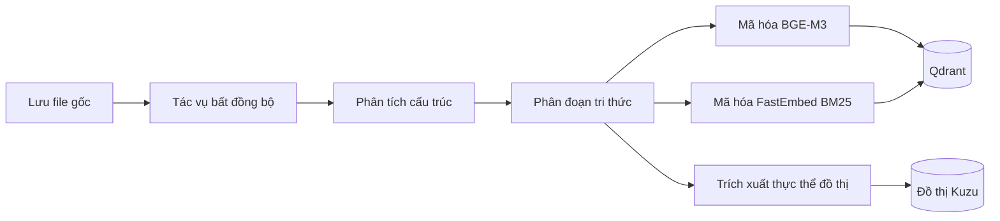
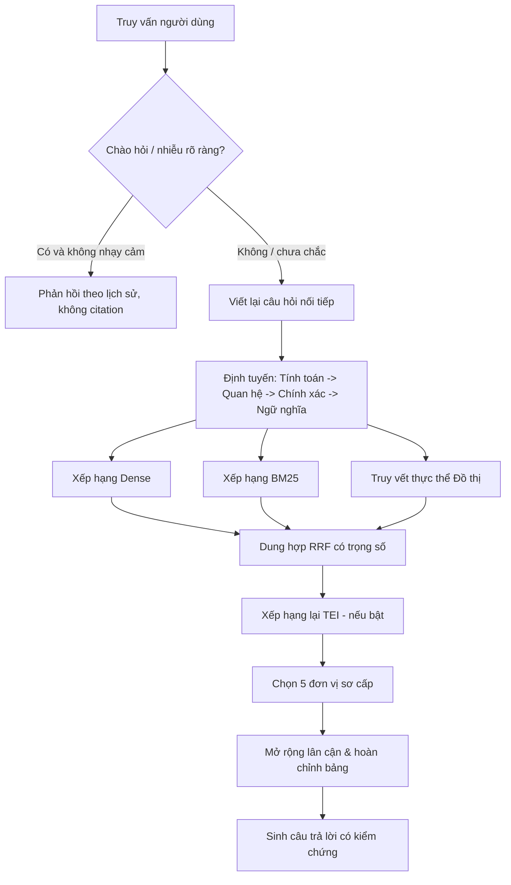
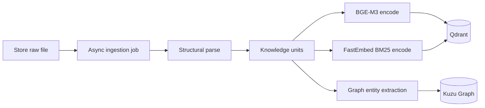
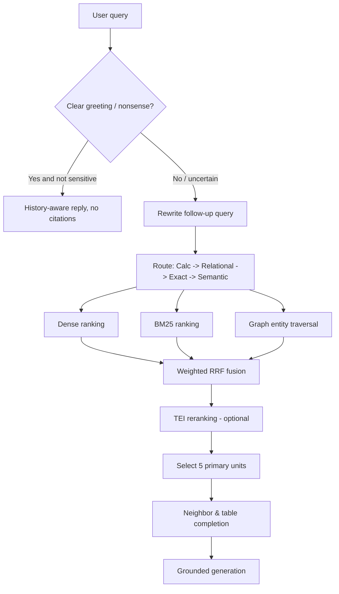

# Ingestion and retrieval

[Documentation index](README.md) · [Development](DEVELOPMENT.md) · [Architecture](ARCHITECTURE.md)

> **Ngôn ngữ / Language:** [Tiếng Việt](#hấp-thụ-và-truy-hồi--tiếng-việt) · [English](#ingestion-and-retrieval-1)

---

## Hấp thụ và truy hồi — Tiếng Việt

Tài liệu này mô tả pipeline RAG xử lý tài liệu kỹ thuật số của OpenVie. OCR (PDF scan và ảnh đơn lẻ) và ASR (âm thanh và video) là các **stage tùy chọn, tắt theo mặc định**.

### 1. Ngăn xếp mô hình và lưu trữ

| Năng lực | Triển khai | Ghi chú |
|---|---|---|
| Sinh văn bản, trích xuất đồ thị, lập kế hoạch tính toán | Chat model adapter: `ollama` | Mặc định là Ollama với `vylinh` (3.09B). |
| Vector dày (Dense embeddings) | Adapter Ollama `/api/embed` | Mặc định là `bge-m3` (1024 chiều). |
| Truy hồi từ vựng (Lexical/Sparse) | FastEmbed `Qdrant/bm25` | Bổ sung cho ngữ nghĩa đối với từ ngữ chính xác, mã hiệu, ngày tháng. |
| Xếp hạng lại (Reranking - tùy chọn) | TEI cross-encoder endpoint | Mặc định `Alibaba-NLP/gte-multilingual-reranker-base`. Hỗ trợ tiếng Việt, cơ chế fail-open khi lỗi. |
| Phân tích tài liệu số | Parser chuyên biệt: `pypdf`, `python-docx`... | Trích xuất văn bản có cấu trúc kèm nguồn gốc (provenance). |
| OCR tùy chọn (PDF scan, ảnh, ảnh lồng trong PDF/DOCX/XLSX) | `ocr.py`: Tesseract (TSV + confidence) hoặc VLM qua Ollama; `pypdfium2` + Pillow | Chỉ hoạt động khi `INGESTION_OCR_ENABLED=true` (ảnh lồng cần thêm `INGESTION_OCR_EMBEDDED_IMAGES=true`); phụ thuộc Apache-2.0. |
| Phiên âm ASR tùy chọn (âm thanh, video, OCR khung hình video) | `transcription.py`: faster-whisper (PyAV nội bộ) hoặc endpoint HTTP `/v1/audio/transcriptions`; `ffmpeg` | Chỉ hoạt động khi `INGESTION_ASR_ENABLED=true` (video cần thêm `INGESTION_VIDEO_ENABLED=true`, OCR khung hình cần `INGESTION_VIDEO_KEYFRAME_OCR=true`); phụ thuộc Apache-2.0 / MIT. |
| Chỉ mục vector | Qdrant named vectors (dense + sparse) | Giới hạn theo tenant, knowledge base và document. |
| Đồ thị tri thức (Graph) | Kuzu chạy ngầm sau graph-service | Thực thể và quan hệ được neo bằng bằng chứng trong tài liệu. |

### 2. Nguồn tài liệu được chấp nhận

- **Định dạng hỗ trợ:** PDF có text (`.pdf`), Word (`.docx`), Văn bản thuần (`.txt`), Markdown (`.md`), HTML (`.html`), Bảng tính (`.xlsx`, `.csv`) — ảnh (`.png`, `.jpg`, `.jpeg`, `.webp`) khi OCR bật; âm thanh (`.mp3`, `.wav`, `.m4a`, `.oga`, `.ogg`, `.opus`, `.flac`) và video (`.mp4`, `.mkv`, `.mov`, `.webm`) khi ASR bật. Giới hạn kích thước tệp có thể cấu hình qua `app.documents.max-file-size-mb` (mặc định **20 MB/tệp**).
- **Không hỗ trợ:** PDF mã hóa, định dạng nhị phân cũ (`.doc`, `.xls`), file nén độc hại/hư hỏng. PDF scan và ảnh thuần được hấp thụ qua stage OCR tùy chọn (§7), tắt theo mặc định.

### 3. Quy trình hấp thụ bất đồng bộ

- **Trạng thái:** `PENDING` → `PROCESSING` → `COMPLETED` (hoặc `FAILED`).
- **Idempotency:**
  - File trùng SHA-256 trong cùng KB: trả về tài liệu hiện có, bỏ qua xử lý lại.
  - File cùng tên nhưng nội dung thay đổi: cập nhật tại chỗ, chuyển lại `PENDING`, ghi đè nguồn và thay thế vector/graph tương ứng.
- **Giới hạn tài nguyên:** `INGESTION_WORKER_CONCURRENCY` (mặc định 4) điều tiết số tài liệu xử lý đồng thời. `GRAPH_EXTRACTION_MAX_OUTPUT_TOKENS` (512) giới hạn token sinh ra mỗi batch trích xuất đồ thị (tối đa 2 thực thể, 2 quan hệ mỗi đơn vị tri thức).
- **OCR tùy chọn:** Khi `INGESTION_OCR_ENABLED=true`, trang thiếu text được raster hóa và nhận dạng ngay trong bước parse; kết quả cache theo fingerprint (§7). Sự kiện `COMPLETED` mang thêm `text_source` và `page_count` khi OCR tham gia.

### 4. Xử lý cấu trúc và bảng tính

- **Phân đoạn (Chunking):** Đoạn văn thông thường cắt ở **800 ký tự với 120 ký tự gối đầu (overlap)**. Bảng biểu, tiêu đề, danh sách dùng overlap bằng 0 và tôn trọng ranh giới dòng. Bảng bị cắt sẽ lặp lại dòng tiêu đề (header) để giữ ngữ cảnh.
- **Bảng tính (Spreadsheet):**
  - *Ngữ nghĩa:* Mỗi dòng được chuẩn hóa thành văn bản kèm metadata (Sheet, Range, Cột, Giá trị).
  - *Tính toán tiền kiểm định:* Với câu hỏi tính toán, mô hình lập kế hoạch JSON (`count`, `sum`, `average`, `min`, `max`, `sort`, `top`, `bottom`) và Polars thực thi an toàn trên dữ liệu Parquet. Không chạy code tùy ý.

### 5. Xử lý truy vấn lai (Hybrid Retrieval)

**Bộ lọc ý định:** Quy tắc Việt/Anh bảo thủ chỉ chặn lời chào, hội thoại xã giao hoặc nhiễu rõ ràng; bỏ qua cả cache câu trả lời, embedding, query planning, truy hồi và LLM. Phản hồi nhắc chủ đề gần nhất khi phù hợp, không citation. Câu hỏi nhạy cảm, mã/định danh và câu nối tiếp có nội dung vẫn đi qua RAG; khi chưa chắc, ưu tiên truy hồi. Đây không phải bộ phân loại ngữ nghĩa đã huấn luyện.

1. **Viết lại truy vấn theo ngữ cảnh (Query Planning):** Câu hỏi nối tiếp (follow-up) được viết lại thành truy vấn độc lập trước khi tìm kiếm dựa trên lịch sử hội thoại gần nhất.
2. **Định tuyến:** `calculation` → `relational` → `exact` → `semantic` với trọng số kênh tương ứng.
3. **Khai thác ứng viên:** Thu thập tối đa 40 dense, 40 sparse, 20 graph song song.
4. **Dung hợp (Fusion):** RRF với $k=30$, giữ lại 30 ứng viên tốt nhất.
5. **Reranking:** Tùy chọn xếp hạng lại bằng mô hình cross-encoder.
6. **Lựa chọn & Mở rộng:** Lấy 5 đơn vị sơ cấp (tối đa 2 đơn vị/tài liệu). Tự động kéo thêm các dòng lân cận cùng bảng (`table_id`) và ngữ cảnh lân cận, tối đa 8 đơn vị tri thức đưa vào prompt.

### 6. Nguyên tắc sinh phản hồi và đối soát

- **Liệt kê đầy đủ:** Prompt yêu cầu toàn bộ các mục, nhãn và thông số trong nguồn. Ngân sách câu trả lời mặc định là `LLM_MAX_OUTPUT_TOKENS=1024`; graph extraction giữ ngân sách riêng 512 token.
- **Trích dẫn có cấu trúc:** Câu trả lời dẫn nguồn `[S1]`, `[S2]`. Control plane kiểm tra tính hợp lệ và quyền truy cập tài liệu trước khi phát phản hồi cuối và thẻ nguồn.
- **Không tìm thấy:** Khi không có bằng chứng liên quan, mô hình từ chối suy đoán và thông báo thiếu thông tin.
- **Streaming thật:** Ollama NDJSON hoặc SSE từ endpoint tương thích OpenAI → gRPC server-streaming → SSE tới client. Bản nháp tích lũy thay thế snapshot cũ; giữ lại đuôi và token/placeholder chưa đủ để làm sạch trước khi hiển thị. Bản nháp không có link/thẻ nguồn và không được lưu.
- **Câu hỏi nhạy cảm:** Chờ toàn bộ kết quả, kiểm tra citation và cắt cụt trước khi hiển thị; câu trả lời bị cắt hoặc thiếu nguồn hợp lệ không lộ bản nháp.

### 7. OCR tùy chọn — PDF scan và ảnh

Stage OCR **tắt theo mặc định** (`INGESTION_OCR_ENABLED=false`): khi tắt, pipeline hành xử y như bản chỉ-text và PDF không có text trả ngay lỗi cũ "PDF document contains no extractable text; scanned PDFs are not supported".

- **Bật:** `INGESTION_OCR_ENABLED=true` ở worker; upload ảnh (`.png`, `.jpg`, `.jpeg`, `.webp`) cần thêm `OCR_UPLOADS_ENABLED=true` ở API (Spring). Phụ thuộc Apache-2.0: `pypdfium2` (raster hóa) và Pillow; Docker image cài sẵn `tesseract-ocr` kèm gói `vie`/`eng`.
- **Cổng từng trang:** Trang PDF có ít hơn `INGESTION_OCR_MIN_TEXT_CHARS_PER_PAGE` (mặc định 32) ký tự hiển thị sẽ được raster hóa ở `INGESTION_OCR_DPI` (300) rồi nhận dạng; trang có text giữ nguyên fast-path (không OCR).
- **Ảnh lồng trong tài liệu:** Bật thêm `INGESTION_OCR_EMBEDDED_IMAGES=true` để quét **ảnh nhúng**: các trang PDF *có* text (trang thiếu text đã được OCR toàn trang) được lấy từng ảnh XObject ra nhận dạng; `.docx` (`word/media/`) và `.xlsx` (`xl/media/`) quét media trong package. Best-effort, không nhân bản text layer: ảnh nhỏ hơn 32px hoặc không giải mã được bị bỏ qua, tối đa 64 ảnh/tài liệu, kết quả dưới 8 ký tự (logo, icon) bị lọc; block OCR mang nguồn `ocr-v1` kèm `ocr_source=embedded-image`, tham gia chung cache fingerprint §7. **Vị trí trích dẫn:** DOCX đánh số trang ước tính bằng dấu ngắt trang trong file (`w:lastRenderedPageBreak`, `w:br[@w:type="page"]`) — best-effort, file không có dấu ngắt thì coi là trang 1; block OCR được chèn đúng vị trí ảnh trong tài liệu kèm `section_path` từ heading trước đó. XLSX gán `sheet_name` về sheet chứa ảnh (đọc theo chuỗi relationship của package, không giải mã được thì bỏ trống). `parser_version` được lộ đến ngoài cùng: payload index KEYWORD trên Qdrant (lọc được `parser_version=ocr-v1`), DTO retrieval (`RetrievedKnowledgeUnit`), gRPC `Citation`, Spring và frontend (thẻ OCR badge trên citation). Cache retrieval (codec chunk, schema v2) và cache semantic-answer (schema v2) tự vô hiệu hóa mục cũ — các mục schema v1 bị từ chối, tính lại bình thường (fail-open). Ảnh hỏng vẫn im lặng bỏ qua, nhưng **3 lần lỗi provider liên tiếp** (thiếu tesseract, VLM sập, timeout dồn dập) sẽ fail tài liệu và giữ đúng loại lỗi gốc (transient → retry).
- **Giới hạn:** Tối đa `INGESTION_OCR_MAX_PAGES` (300) trang/tài liệu; giới hạn megapixel mỗi trang (`INGESTION_OCR_MAX_MEGAPIXELS_PER_PAGE=25`) tự thu nhỏ ảnh thay vì từ chối; timeout mỗi trang (`INGESTION_OCR_TIMEOUT_SECONDS_PER_PAGE=60`) thành lỗi vĩnh viễn (không tái thử); nhận dạng chạy song song `INGESTION_OCR_PAGE_CONCURRENCY=2` trang.
- **Provider:** `INGESTION_OCR_PROVIDER=tesseract` (mặc định; đọc TSV kèm độ tin cậy; `INGESTION_OCR_LANGUAGES=vie+eng`; PSM=3) hoặc `ollama-vlm` (bắt buộc `OCR_VLM_MODEL_ID`; gọi `/api/chat` của Ollama với ảnh base64).
- **Cache kết quả:** Parse OCR được cache JSON tại `<document>/ocr/<fingerprint>.json`; fingerprint bó SHA-256 của file gốc với cấu hình OCR (provider, DPI). Trùng fingerprint khi reindex → bỏ qua nhận dạng; artifact hỏng/lệch → parse lại toàn phần; lỗi ghi cache chỉ ghi log, không chặn hấp thụ.
- **Siêu dữ liệu:** Sự kiện `COMPLETED` và API tài liệu mang `text_source` (`text`/`ocr`/`mixed`) và `page_count`; frontend hiển thị badge OCR và xem trước ảnh trực tiếp.

### 8. Phiên âm ASR tùy chọn — Âm thanh và video

Stage ASR **tắt theo mặc định** (`INGESTION_ASR_ENABLED=false`, `INGESTION_VIDEO_ENABLED=false`): khi tắt, các định dạng media bị từ chối ngay từ cổng upload API hoặc trả lỗi không hỗ trợ.

- **Bật:** `INGESTION_ASR_ENABLED=true` ở worker; upload âm thanh (`.mp3`, `.wav`, `.m4a`, `.oga`, `.ogg`, `.opus`, `.flac`) cần `ASR_UPLOADS_ENABLED=true` ở API (Spring); video (`.mp4`, `.mkv`, `.mov`, `.webm`) cần thêm `INGESTION_VIDEO_ENABLED=true` ở worker và `VIDEO_UPLOADS_ENABLED=true` ở API.
- **Provider kép:**
  - `faster-whisper` (mặc định, MIT): giải mã container trực tiếp qua PyAV/FFmpeg nhúng trong thư viện, không cần cài ffmpeg hệ thống cho file âm thanh độc lập.
  - `openai-compat`: gửi tới endpoint `/v1/audio/transcriptions` (Speaches, whisper.cpp server...); chuẩn hóa audio thành WAV 16 kHz mono bằng ffmpeg trước khi gửi.
- **Xử lý video:** Demux track âm thanh qua ffmpeg thành 16 kHz mono để phiên âm ASR. Khi bật thêm `INGESTION_VIDEO_KEYFRAME_OCR=true` (yêu cầu bật cả stage OCR §7), ffmpeg trích xuất các khung hình mẫu (`fps=1/{interval}`) kèm timestamp từ bộ lọc `showinfo`; các khung hình được nhận dạng OCR tốt nhất có thể, chuỗi 3 lỗi liên tiếp từ provider sẽ dừng tài liệu bảo toàn loại lỗi; sinh ra các block `ocr-v1` mang `ocr_source=video-keyframe`, tài liệu mang `text_source=mixed`.
- **Timestamp bucket:** Thời gian âm thanh (giây) được chia thành các bucket (`INGESTION_ASR_TIMESTAMP_BUCKET_SECONDS`, mặc định 60 giây, 1-based) đóng vai trò số trang tương đương (`page_number`) để tái sử dụng toàn bộ cơ chế trích dẫn hiện có; mốc thời gian chi tiết bắt đầu/kết thúc được lưu trong metadata của block.
- **Giới hạn & Cache:** Giới hạn thời lượng tối đa (`INGESTION_ASR_MAX_DURATION_SECONDS`, mặc định 3600s, kiểm tra qua ffprobe nếu có) và timeout phiên âm (`INGESTION_ASR_TIMEOUT_SECONDS=3600`). Parse được cache tại `<document>/asr/<fingerprint>.json` (schema `asr-artifact-v1`), fingerprint gắn kết SHA-256 file gốc, provider tag và độ dài bucket.
- **Siêu dữ liệu & Giao diện:** Sự kiện mang `text_source="asr"` (hoặc `"mixed"` nếu có OCR khung hình); giao diện hiển thị badge ASR và trình phát `<audio>` / `<video>` nguyên bản.

---

# Ingestion and retrieval

This guide describes OpenVie's digital-document RAG implementation. OCR (scanned PDFs and standalone images) and ASR (audio and video) are **optional stages, off by default**.

## 1. Current model and storage stack

| Capability | Implementation | Notes |
|---|---|---|
| Text generation, graph extraction, calculation planning | Chat model adapter: `ollama` | Default: native Ollama with `vylinh` (3.09B). |
| Dense embeddings | Ollama `/api/embed` | Default: `bge-m3` (1024 dimensions). |
| Lexical retrieval | FastEmbed `Qdrant/bm25` | Complements semantic search for exact codes, identifiers, dates. |
| Reranking (optional) | TEI cross-encoder endpoint | Default: `Alibaba-NLP/gte-multilingual-reranker-base`. Fails open on errors. |
| Document parsing | Dedicated parsers: `pypdf`, `python-docx` | Extracts structured text with source provenance. |
| Optional OCR (scanned PDFs, images, images embedded in PDF/DOCX/XLSX) | `ocr.py`: Tesseract (TSV + confidence) or a VLM via Ollama; `pypdfium2` + Pillow | Active only when `INGESTION_OCR_ENABLED=true` (embedded images additionally require `INGESTION_OCR_EMBEDDED_IMAGES=true`); Apache-2.0 dependencies. |
| Optional ASR transcription (audio, video, video-keyframe OCR) | `transcription.py`: faster-whisper (bundled PyAV) or OpenAI-compatible endpoint `/v1/audio/transcriptions`; `ffmpeg` | Active only when `INGESTION_ASR_ENABLED=true` (video additionally requires `INGESTION_VIDEO_ENABLED=true`, keyframe OCR requires `INGESTION_VIDEO_KEYFRAME_OCR=true`); Apache-2.0 / MIT dependencies. |
| Vector index | Qdrant dense and sparse vectors | Filtered by tenant, knowledge base, and document ID. |
| Knowledge graph | Kuzu behind graph-service | Grounded entities and evidence-backed relations. |

## 2. Accepted knowledge sources

- **Supported:** PDF with extractable text (`.pdf`), Word (`.docx`), Plain text (`.txt`), Markdown (`.md`), HTML (`.html`), Spreadsheets (`.xlsx`, `.csv`) — images (`.png`, `.jpg`, `.jpeg`, `.webp`) when OCR is enabled; audio (`.mp3`, `.wav`, `.m4a`, `.oga`, `.ogg`, `.opus`, `.flac`) and video (`.mp4`, `.mkv`, `.mov`, `.webm`) when ASR is enabled. File size limit is configurable via `app.documents.max-file-size-mb` (default **20 MB per file**).
- **Unsupported:** Encrypted PDFs, legacy binary files (`.doc`, `.xls`), corrupted archives. Scanned and image-only PDFs ingest through the optional OCR stage (§7), off by default.

## 3. Asynchronous ingestion

- **Statuses:** `PENDING` → `PROCESSING` → `COMPLETED` (or `FAILED`).
- **Idempotency:**
  - Identical SHA-256 within the same knowledge base: returns existing document without reprocessing.
  - Same filename with changed content: updates document in place, resets status to `PENDING`, and replaces vector/graph entities.
- **Resource limits:** `INGESTION_WORKER_CONCURRENCY` (default 4) governs document concurrency. `GRAPH_EXTRACTION_MAX_OUTPUT_TOKENS` (512) caps tokens per graph batch (max 2 entities, 2 relations per unit).
- **Optional OCR:** When `INGESTION_OCR_ENABLED=true`, text-free pages are rasterized and recognized inside the parse step; results are cached per fingerprint (§7). The `COMPLETED` event additionally carries `text_source` and `page_count` when OCR participates.

## 4. Structure and spreadsheet handling

- **Chunking:** Prose blocks target **800 characters with 120-character overlap**. Tables, headings, and code use zero character overlap. Fragmented tables repeat header lines to preserve context.
- **Spreadsheets:**
  - *Semantic representation:* Normalized rows include sheet name, cell range, headers, and values.
  - *Deterministic calculation:* Model plans restricted JSON operations (`count`, `sum`, `average`, `min`, `max`, `sort`, `top`, `bottom`) executed safely via Polars on derived Parquet files.

## 5. Hybrid query processing

**Intent gate:** Conservative Vietnamese/English rules short-circuit clear greetings, social-only messages, and nonsense before answer caches, embeddings, planning, retrieval, or LLM calls. Replies reference the recent topic when appropriate and carry no citations. Sensitive questions, codes/identifiers, and substantive follow-ups retain RAG; uncertainty defaults to retrieval. This is not a trained semantic classifier.

1. **Contextual Query Planning:** Follow-up questions are reformulated into standalone search queries based on recent conversation turns.
2. **Routing:** Order: `calculation` → `relational` → `exact` → `semantic` with profile-specific weights.
3. **Retrieval:** Fetches up to 40 dense, 40 sparse, and 20 graph candidates concurrently.
4. **Fusion:** Profile-weighted RRF with $k=30$, retaining top 30 candidates.
5. **Reranking:** Optional cross-encoder scoring.
6. **Selection & Expansion:** Selects 5 primary units (soft limit 2 per document), completed with structural table siblings (`table_id`) and eligible neighbors up to 8 total units.

## 6. Grounding and response behavior

- **Full Enumeration:** Prompt instructions require all listed items, identifiers, and values. Answer generation defaults to `LLM_MAX_OUTPUT_TOKENS=1024`; graph extraction keeps its independent 512-token budget.
- **Structured Citations:** Facts are marked with `[S1]`, `[S2]`. The control plane validates document visibility and ownership before emitting the authoritative final response and source cards.
- **Abstention:** If evidence is insufficient, the system abstains rather than hallucinating.
- **Native Streaming:** Ollama NDJSON or OpenAI-compatible SSE → server-streaming gRPC → client SSE. Cumulative polished snapshots replace previous drafts; an incomplete tail, token, or placeholder is withheld until it can be cleaned safely. Drafts have no links/source cards and are never persisted.
- **Sensitive Questions:** Full generation, citation, and truncation checks precede display; truncated or unauthorized sensitive answers expose no draft.

## 7. Optional OCR — scanned PDFs and images

The OCR stage is **off by default** (`INGESTION_OCR_ENABLED=false`): while disabled, the pipeline behaves exactly like the text-only build and text-free PDFs fail with the legacy "PDF document contains no extractable text; scanned PDFs are not supported" error.

- **Activation:** `INGESTION_OCR_ENABLED=true` on the worker; image uploads (`.png`, `.jpg`, `.jpeg`, `.webp`) additionally require `OCR_UPLOADS_ENABLED=true` on the API (Spring). Apache-2.0 dependencies: `pypdfium2` (rasterization) and Pillow; the Docker image ships `tesseract-ocr` with the `vie`/`eng` packs.
- **Per-page gate:** A PDF page with fewer than `INGESTION_OCR_MIN_TEXT_CHARS_PER_PAGE` (default 32) visible characters is rasterized at `INGESTION_OCR_DPI` (300) and recognized; text-bearing pages keep the untouched fast path.
- **Embedded document images:** Additionally enable `INGESTION_OCR_EMBEDDED_IMAGES=true` to read **embedded images**: PDF pages that *do* have text (gate-failing pages are already fully rasterized) get their image XObjects recognized individually; `.docx` (`word/media/`) and `.xlsx` (`xl/media/`) media parts are scanned inside the package. Best-effort, no text-layer duplication: images below 32px or undecodable are skipped, at most 64 images per document, results under 8 characters (logos, icons) are dropped; OCR blocks carry the `ocr-v1` source with `ocr_source=embedded-image`, and share the §7 fingerprint cache. **Citation location:** DOCX estimates page numbers from page-break markers in the file (`w:lastRenderedPageBreak`, `w:br[@w:type="page"]`) — best-effort; files without markers count as page 1; OCR blocks are interleaved at the image position with `section_path` from the preceding headings. XLSX assigns `sheet_name` of the anchoring sheet (read from the package relationship chain; left empty when it cannot be resolved). `parser_version` is surfaced end-to-end: a KEYWORD payload index on Qdrant (filterable as `parser_version=ocr-v1`), the retrieval DTO (`RetrievedKnowledgeUnit`), gRPC `Citation`, Spring, and the frontend (OCR badge on the citations panel). The retrieval cache (chunk codec, schema v2) and semantic-answer cache (schema v2) invalidate older entries — schema-v1 payloads are rejected and recomputed normally (fail-open). Bad images are skipped silently, but **3 consecutive provider failures** (missing tesseract, VLM outage, all timeouts) fail the document preserving the original error kind (transient → retry).
- **Bounds:** At most `INGESTION_OCR_MAX_PAGES` (300) pages per document; the per-page megapixel cap (`INGESTION_OCR_MAX_MEGAPIXELS_PER_PAGE=25`) downsizes oversized pages instead of rejecting them; a page timeout (`INGESTION_OCR_TIMEOUT_SECONDS_PER_PAGE=60`) becomes a permanent failure (no retry); recognition runs `INGESTION_OCR_PAGE_CONCURRENCY=2` pages in parallel.
- **Providers:** `INGESTION_OCR_PROVIDER=tesseract` (default; TSV parsing with confidence; `INGESTION_OCR_LANGUAGES=vie+eng`; PSM=3) or `ollama-vlm` (requires `OCR_VLM_MODEL_ID`; calls Ollama's `/api/chat` with base64 images).
- **Result cache:** OCR parses are cached as JSON under `<document>/ocr/<fingerprint>.json`; the fingerprint binds the raw file SHA-256 to the OCR configuration (provider, DPI). A matching fingerprint skips recognition entirely on reindex; a corrupted or mismatched artifact falls back to a full parse; cache write failures are logged and never block ingestion.
- **Metadata:** The `COMPLETED` status event and document API carry `text_source` (`text`/`ocr`/`mixed`) and `page_count`; the frontend shows an OCR badge and previews images inline.

## 8. Optional ASR — audio and video transcription

The ASR stage is **off by default** (`INGESTION_ASR_ENABLED=false`, `INGESTION_VIDEO_ENABLED=false`): while disabled, media uploads are rejected up front at the API or fail with unsupported format errors.

- **Activation:** `INGESTION_ASR_ENABLED=true` on the worker; audio uploads (`.mp3`, `.wav`, `.m4a`, `.oga`, `.ogg`, `.opus`, `.flac`) require `ASR_UPLOADS_ENABLED=true` on the API (Spring); video uploads (`.mp4`, `.mkv`, `.mov`, `.webm`) additionally require `INGESTION_VIDEO_ENABLED=true` on the worker and `VIDEO_UPLOADS_ENABLED=true` on the API.
- **Dual providers:**
  - `faster-whisper` (default, MIT): decodes containers directly through bundled PyAV/FFmpeg, requiring no system ffmpeg binary for standalone audio files.
  - `openai-compat`: posts payloads to a configured `/v1/audio/transcriptions` endpoint (Speaches, whisper.cpp server, etc.); normalizes audio into 16 kHz mono WAV via ffmpeg first.
- **Video ingestion:** Demuxes the audio track via system ffmpeg into 16 kHz mono for ASR. When `INGESTION_VIDEO_KEYFRAME_OCR=true` is enabled (requires the OCR stage §7), ffmpeg samples keyframes (`fps=1/{interval}`) with timestamps from the `showinfo` filter; sampled frames are recognized best-effort, a streak of 3 consecutive provider failures fails the document preserving the error kind; generates `ocr-v1` blocks carrying `ocr_source=video-keyframe` and `text_source=mixed`.
- **Timestamp buckets:** Media positions (seconds) map into page-equivalent buckets (`INGESTION_ASR_TIMESTAMP_BUCKET_SECONDS`, default 60s, 1-based) to seamlessly reuse existing citation machinery without schema changes; segment start/end seconds are preserved in block metadata.
- **Bounds & Caching:** Maximum media duration guard (`INGESTION_ASR_MAX_DURATION_SECONDS`, default 3600s, probed via ffprobe when available) and document transcription timeout (`INGESTION_ASR_TIMEOUT_SECONDS=3600`). Parse results are cached under `<document>/asr/<fingerprint>.json` (schema `asr-artifact-v1`), binding the raw SHA-256, provider tag, and bucket seconds.
- **Metadata & UI:** Status events carry `text_source="asr"` (or `"mixed"` when keyframe OCR is active); the frontend displays an ASR badge and native `<audio>` / `<video>` controls.

## 9. Implementation map

| Concern | Primary source files |
|---|---|
| Upload & lifecycle | `DocumentService.java`, `DocumentFileValidator.java` |
| Parsing & chunking | `extraction.py`, `chunking.py`, `pipeline.py` |
| Optional OCR ingest | `ocr.py`, `ocr_artifacts.py` |
| Optional ASR ingest | `transcription.py`, `extraction.py` |
| Model adapters | `chat.py`, `embedding.py`, `sparse.py` |
| Intent, retrieval & planning | `intent.py`, `query_plan.py`, `retrieval.py`, `reranking.py` |
| Graph projection | `entity_extraction.py`, `search.py` |
| Calculation engine | `calculation.py`, `spreadsheets.py` |
